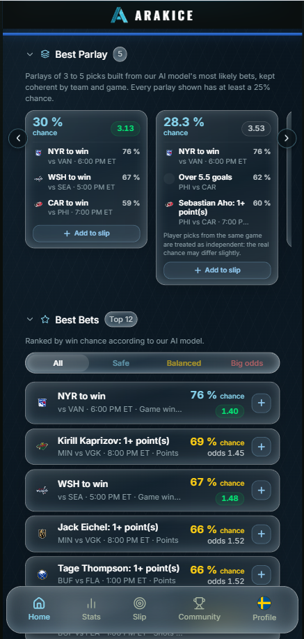
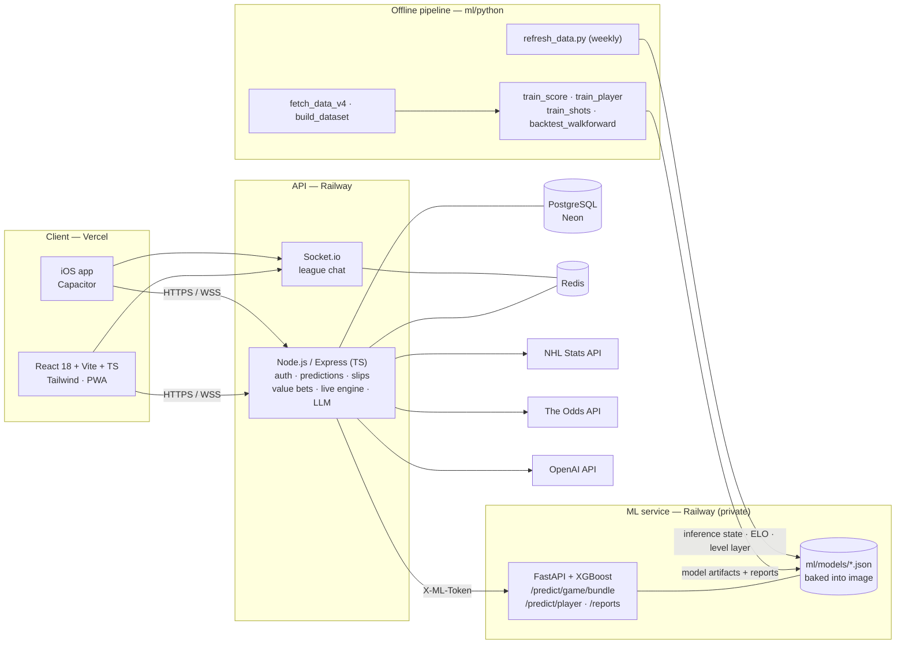

<div align="center">


# ArakIce

**NHL game and player predictions from a walk-forward-validated XGBoost model, running in production.**

[Live app → arakice.com](https://arakice.com) · [ML documentation](docs/ML.md) · [Architecture](#architecture) · [Run it locally](#getting-started)


</div>

---

## What it is

ArakIce is a mobile-first web app (with an iOS build) that gives NHL fans a calibrated probability for the bets they're thinking about: moneyline, puck line, totals, period markets, exact score and player props (goals, assists, points, shots, hits, blocked shots, penalty minutes, power-play points, goalie saves).

The ML side is called **arakiceML**. It's a stack of XGBoost models served by a FastAPI microservice. A Node/Express API sits in front of it and feeds the React client.

<p align="center">
  
</p>

### The problem

Sportsbook odds are hard for a casual bettor to read. The margin is baked into every price, markets on the same game are priced separately, and nothing tells you whether a 3-leg parlay has a 30% chance or a 5% chance. ArakIce gives every market a probability that is:

- **Consistent across markets.** Every game market (win, totals, puck line, exact score, periods) is read from one joint score distribution, so the numbers can't contradict each other.
- **Honestly evaluated.** Every model change is checked out-of-sample against a decision rule written down before the run, and compared with the bookmaker's closing line.
- **Live.** During a game, probabilities are recomputed every 30 seconds from the actual score and clock.

> ArakIce shows probabilities and analysis only. No real-money betting happens inside the app.

---

## Highlights for reviewers

| | |
|---|---|
| 🧠 **Modeling** | A Poisson XGBoost model predicts each team's expected goals (λ). A continuous-time Markov "game engine" turns the two λ into an exact score distribution, with empty-net dynamics measured from timestamped goals. |
| 📏 **Evaluation discipline** | Chronological splits, walk-forward backtests by season, paired z-tests, adoption rules fixed *before* each run, placebo checks, and comparison with the closing line. Rejected ideas are documented along with the evidence. |
| 🔁 **Production ML** | FastAPI service in Docker on Railway, token-protected, with health/readiness probes, a circuit breaker and cache on the Node side, a weekly data refresh, and artifact freshness exposed through `/reports`. |
| 🧩 **Full stack** | React + TypeScript client, Express API, PostgreSQL, Redis, Socket.io chat, OAuth/JWT with refresh-token rotation, Stripe and Apple IAP subscriptions, web and native push, Sentry. |
| 🤖 **LLM feature** | Per-bet "AI analysis" written by an LLM that may only use a structured block of facts computed by the model, with quotas, cost tracking and an offline eval harness (`server/scripts/eval-llm-analysis.ts`). |
| ✅ **Quality gates** | GitHub Actions: secret scan (gitleaks, full history), server typecheck + build + Vitest suite (~80 test files), client typecheck + build, production-bundle URL check. |

---

## How the ML works (short version)

> Full write-up: **[docs/ML.md](docs/ML.md)**. Exhaustive French reference with every formula: [`ml/EXPLICATION_ML.md`](ml/EXPLICATION_ML.md).

The key idea: **don't predict "who wins" directly.** Predict how many regulation goals each team should score (λ_home, λ_away), build the full score matrix from those two numbers, and read every betting market from it.

```
NHL API + MoneyPuck (2008 → today)
        │  build_dataset.py — features use only games played BEFORE the match (no leakage)
        ▼
26 pre-game features per team-game: xG for/against (short & long EWMA), 5-on-5 share,
special teams, finishing, starting goalie GSAx & backup flag, projected lineup strength,
injuries to key players, rest / back-to-back, ELO difference, home ice
        │  train_score.py — XGBoost count:poisson, chronological split
        ▼
λ_home, λ_away  ──► correction layer (walk-forward logistic, moneyline only)
                ──► in-season level recalibration (goal environment drift)
                ──► game engine: exact score distribution, empty-net effects
        ▼
Every market: moneyline · puck line · totals · team totals · BTTS · OT · exact score · periods
```

Separate XGBoost Poisson models cover **player props** (one model per stat, negative-binomial dispersion) and **team shots on goal** (which drive goalie-saves props).

### Results (from the committed report files)

Test set = the most recent 20% of games by date (4,305 games, 2023 → 2026), never seen during training or tuning.

| What | Result | Source |
|---|---|---|
| Moneyline log-loss, score model | **0.6632** (constant baseline 0.6901, ELO-only 0.6704) | `ml/models/score_report.json`, `training_report.json` |
| Moneyline classifier (reference model) | log-loss 0.6644 · accuracy **58.95%** (always-home 54.0%, ELO-only 57.7%) | `training_report.json` |
| Ties after 60 min (calibration check) | predicted 21.4% vs observed 22.1% (plain Poisson: 15.8%) | `score_report.json` |
| Correction layer, walk-forward 2015–2026 (13,585 games) | log-loss −0.0026, z = −3.85, better in **12 of 12 seasons** | `correction_report.json` |
| Goal-level recalibration (11 seasons) | total-goals deviance z = −3.19; P(over 5.5) 58.4% → 55.8% vs 56.0% observed | `level_report.json` |
| Player props (8 stats, test 2023+) | beats the previous rule-based baseline on log-likelihood for **all 8** | `player_report.json` |
| Goalie saves over 24.5 | rule 43.3% · model 54.3% · observed 53.3% | `shots_report.json` |
| Live in-game model, replay of 3,903 games | cumulative log-loss −2.19% vs constant-rate baseline | `ml/models/live/live_report.md` |

**Honest limitation:** against the bookmaker's closing line the model is roughly even, not better. On 11,297 games with closing odds, the corrected model is −0.0008 log-loss vs the market (z = −1.0, not significant). Value-bet backtests show positive closing-line value but no statistically proven ROI. More in [docs/ML.md → Limitations](docs/ML.md#limitations).

---

## Architecture



### Key engineering decisions

| Decision | Why |
|---|---|
| **Separate Python ML service** | Lets the model be deployed, scaled and rolled back on its own. The Node API treats it as an unreliable dependency (circuit breaker, cache, rule-based fallback) so the app keeps working if ML is down. |
| **Predict goals, not outcomes** | One λ pair produces every market consistently. A direct classifier was built first; it's kept as a reference and is no longer served. |
| **Chronological splits + walk-forward** | Random splits leak future information in sports data. Every adoption decision is based on seasons the model never saw. |
| **Pre-registered adoption rules** | Each experiment states its pass criterion (e.g. z ≤ −2 and better in ≥ 70% of seasons) before running, which guards against p-hacking across dozens of experiments. |
| **Correction layer instead of retraining** | Poisson deviance is dominated by goal *level*, while winning depends on the *difference* between λ. A small logistic layer on top optimizes moneyline log-loss directly. |
| **Odds are not a model input** | The model is built to be compared with the market, not to copy it. Odds are only used as a benchmark. |
| **Native XGBoost JSON artifacts** | Small, versioned in git, loaded without pickle, and baked into the Docker image, so every deploy is reproducible. |
| **Grounded LLM output** | The LLM narrates a FACTS block computed by the model and is told not to add outside claims, which limits hallucinated stats. |

---

## Tech stack

| Layer | Technologies |
|---|---|
| **Frontend** | React 18, TypeScript, Vite, Tailwind CSS, React Router, Recharts, Socket.io client, Tesseract.js (bet-slip OCR), Capacitor (iOS) |
| **Backend** | Node.js, Express, TypeScript, Zod, PostgreSQL (`pg`), Redis (`ioredis`), Socket.io + Redis adapter, JWT + Google OAuth, Stripe, Apple IAP, Web Push / APNs, Pino, Sentry, Vitest |
| **ML** | Python, XGBoost, NumPy, pandas, FastAPI, Uvicorn, Pydantic |
| **Data** | NHL Stats API, MoneyPuck (xG, team / goalie / skater game logs), historical odds (SBRO archive, The Odds API) |
| **Infra** | Vercel (client), Railway (API + ML, Docker), Neon (Postgres), Cloudflare (DNS, R2), GitHub Actions |

---

## Project structure

```
.
├── client/                 # React + Vite + TypeScript app (web + Capacitor iOS shell)
│   ├── src/app/            #   components, contexts, hooks, API services
│   ├── public/             #   static assets + generated SEO pages (match previews)
│   ├── scripts/            #   SEO page generators, env checks, OCR benchmark
│   └── ios/                #   Capacitor iOS project
├── server/                 # Express API (TypeScript)
│   ├── src/routes/         #   auth, nhl, ml (predictions), slips, chat, odds, llm, push…
│   ├── src/services/       #   feature engineering, ML client, value bets, live engine, LLM…
│   ├── src/db/             #   schema.sql + numbered migrations
│   └── scripts/            #   ops & evaluation scripts (LLM eval, odds export, settlement)
├── ml/
│   ├── python/             # data pipeline, training, backtests, FastAPI service (ml_service.py)
│   │   └── explore_*/      #   documented experiments (adopted and rejected)
│   ├── models/             # trained XGBoost models (.json) + evaluation reports (*_report.json)
│   ├── figures/            # evaluation figures
│   ├── data/               # small reference data (large CSVs are git-ignored, regenerable)
│   ├── EXPLICATION_ML.md   # full technical reference (French)
│   └── Dockerfile
├── content/                # social-content engine (templates, insight mining)
├── loadtest/               # load tests and benchmark results
├── docs/                   # ML.md, iOS / App Store docs, images
└── .github/workflows/      # CI, iOS build/release, daily SEO page generation
```

Internal runbooks and planning notes (deployment, monitoring, backups) are kept outside the public repository.

---

## Getting started

### Prerequisites

- Node.js 20+ (CI uses Node 24)
- Python 3.12+
- PostgreSQL (16 in production)
- *(optional)* Redis, an OpenAI API key (AI analysis), a The Odds API key (live odds)

### 1. Database & API

```bash
cd server
cp .env.example .env          # fill DATABASE_URL, JWT_SECRET, JWT_REFRESH_SECRET, ENCRYPTION_KEY
npm install
npm run db:migrate:all        # applies schema.sql + all migrations
npm run dev                   # → http://localhost:3001
```

### 2. ML service

```bash
cd ml/python
pip install -r requirements.txt
python ml_service.py          # → http://localhost:8000  (OpenAPI docs at /docs locally)
```

The trained models are already in `ml/models/`, so you don't need to retrain to run the service. Without `ML_API_TOKEN`, auth is off locally. In a deployed environment the service won't start without a token.

### 3. Client

```bash
cd client
cp .env.example .env          # defaults point to localhost
npm install
npm run dev                   # → http://localhost:5173
```

### Tests

```bash
cd server && npm test         # Vitest
cd client && npm run typecheck
```

### Retraining (optional)

```bash
cd ml/python
python fetch_data_v4.py                      # historical data (NHL API + MoneyPuck), long-running
python build_dataset.py                      # leak-free feature table
python train_score.py && python train.py && python train_player.py && python train_shots.py
python backtest_walkforward.py --correction --write-layer   # rewrites the layer only if the rule passes
python refresh_data.py                       # weekly: inference state, ELO, level layer, game engine
```

---

## Development workflow

- `master` is protected by CI: secret scan, typecheck, build and tests on every push and pull request.
- Model changes go through a script in `ml/python/` (or an `explore_*/` folder) that writes a JSON report. Artifacts are only overwritten when the report's verdict is `ADOPTER` (adopt).
- Large raw datasets are git-ignored and regenerable. Secrets live only in `.env` files (git-ignored) and the hosting dashboards.

---

## Author

Built end to end by **Ireina Hedad**: data pipeline, modeling, evaluation, backend, frontend and deployment.
Software Engineering (AI specialization), Polytechnique Montréal.

## License

Copyright © 2026 Ireina Hedad. **All rights reserved.** The source is public for portfolio and evaluation purposes only; see [LICENSE](LICENSE).

<sub>NHL team names, logos and data belong to the NHL and its teams. ArakIce is an independent project, not affiliated with or endorsed by the NHL.</sub>
