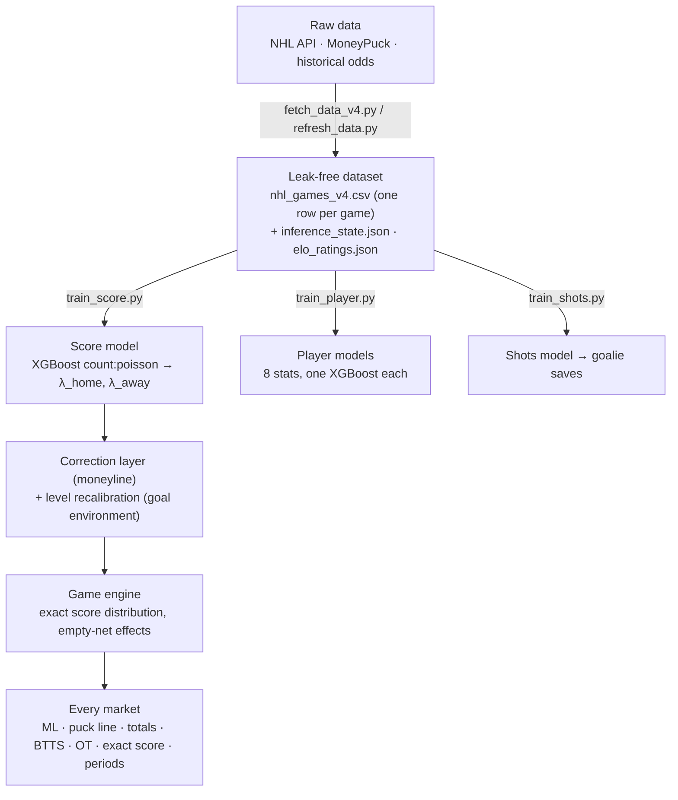
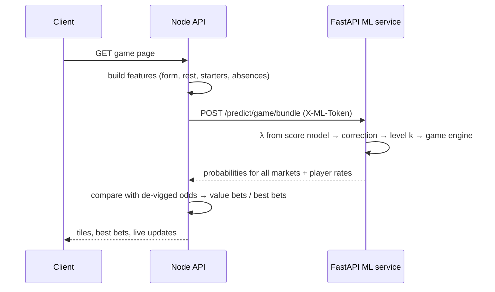

# arakiceML: model documentation

This document covers the machine-learning system behind ArakIce: data, features, models, the serving pipeline, how everything is evaluated, and what the models **can't** do.

Every number here comes from a report file committed in [`ml/models/`](../ml/models). If a number here disagrees with a report file, the report file is right. The exhaustive reference, with every formula and file, is in French: [`ml/EXPLICATION_ML.md`](../ml/EXPLICATION_ML.md). Experiments on the score model, including the rejected ones, are in [`ml/EXPLORATION_SCORE.md`](../ml/EXPLORATION_SCORE.md).

---

## Contents

1. [Overview](#1-overview)
2. [Data](#2-data)
3. [Feature engineering](#3-feature-engineering)
4. [Models](#4-models)
5. [From two numbers to every market](#5-from-two-numbers-to-every-market)
6. [Serving pipeline](#6-serving-pipeline)
7. [Evaluation methodology](#7-evaluation-methodology)
8. [Results](#8-results)
9. [Limitations](#limitations)
10. [Reproducing](#10-reproducing)
11. [File map](#11-file-map)

---

## 1. Overview



**Core idea:** the main model doesn't predict "who wins". It predicts the **expected regulation goals of each team** (λ_home, λ_away). Those two numbers define a full joint distribution of final scores, and every betting market on the game is read from that one distribution. The probabilities are therefore consistent with each other by construction: P(home win), P(over 5.5) and P(home −1.5) can never contradict each other.

---

## 2. Data

| Source | Content | Coverage |
|---|---|---|
| NHL Stats API | schedule, official final scores (the "spine") | regular season, 2008-09 → today |
| MoneyPuck | per game: team stats by situation (all / 5v5 / 5v4 / 4v5), goalie and skater game logs, expected goals (xG) | same |
| Historical odds | opening and closing moneyline, totals, puck line (SBRO archive to Nov 2022; The Odds API / DraftKings for recent seasons) | used **only** for benchmarking |
| Timestamped goals | used to measure in-game scoring rates and empty-net dynamics | recent seasons |

Franchise moves are normalized (e.g. ATL→WPG, ARI→UTA), so rolling stats and ELO follow the franchise.

Large CSVs are git-ignored and can be regenerated with `fetch_data_v4.py`. Model artifacts and reports are versioned.

---

## 3. Feature engineering

All features are **pre-game**: they only use games played strictly before the one being predicted. This is enforced by shifted rolling windows in `build_dataset.py`. The same features are rebuilt at inference time from `inference_state.json`, so training and serving use one definition.

| Family | Examples | Notes |
|---|---|---|
| Team process stats | xG for/against per 60, 5v5 xG share, Corsi share, power-play / penalty-kill xG | Two exponentially weighted averages per stat: short (half-life ≈ 6 games) and long (≈ 20 games) |
| Results / finishing | goals for/against, finishing = goals − xG | Captures shooting luck that tends to regress |
| Goalie | starting goalie GSAx/60 (goals saved above expected), save %, backup-goalie flag | From the projected starter |
| Lineup ("bottom-up") | projected lineup xG and points | Built from tonight's expected skaters |
| Star power & absences | star power index, weighted absences of key players | Reacts to injuries |
| Schedule | rest days, back-to-back | Both for the attacking and the defending side |
| Strength | ELO difference (franchise-continuous ELO, margin-aware) | Ranks among the most important features |

The score model uses **26 features**, organized as *attacking team* vs *defending team* columns (see §4.1). Top features by XGBoost gain (`score_report.json`): `elo_atk_minus_def` 8.9%, `is_home` 8.5%, `def_goalie_backup` 5.5%, `def_xga60_l` 5.3%, `atk_lineup_pts` 5.0%, `atk_lineup_xg` 4.8%.

Some features were built and then dropped because they didn't help in validation, for example a travel-distance feature that is still computed but not used by any model. Dropping features that don't pass is part of the process.

---

## 4. Models

### 4.1 Score model (the core): `train_score.py`

- **Framing:** each game becomes two rows, *home attacking vs away defending* and *away attacking vs home defending*. Each row has `atk_*` features, `def_*` features, `is_home` and the ELO difference. A single model learns "how many goals does this attack score against this defense".
- **Objective:** XGBoost `count:poisson`. The output is λ directly.
- **Split:** games sorted by date. The most recent 20% = **test** (4,305 games). Of the rest, the most recent 15% = **validation**. The remainder (14,637 games, 2008 → 2021) = **training**.
- **Tuning:** random search over hyperparameters, model selection by Poisson deviance on validation, early stopping on validation. Selected parameters are written to `score_report.json`.
- **Overtime:** if tied after 60 minutes, the OT/shootout winner is modeled as `σ(w·(λ_home − λ_away) + b)`, fitted on ~3,400 tied regulation games from the training period.

### 4.2 Game engine: `game_dynamics.py`

Two independent Poisson distributions get score **margins** wrong: too few regulation ties, too many one-goal games, too few three-goal games. The reason is mechanical. A team trailing by one pulls its goalie, so it either ties the game or gives up an empty-net goal.

Instead of patching the matrix after the fact, the engine **plays the game** through time slices. Each team scores at rate

```
r(t) = λ_team / 3600 × c(score margin, time slice)
```

where `c` is measured from timestamped goals over the last three complete seasons and normalized so it doesn't change the total expected goals. The score distribution is computed **exactly**, as a continuous-time Markov chain solved by uniformization (~1 ms per game), not by Monte Carlo simulation.

It was adopted after a walk-forward test over 13 seasons against Poisson × a re-fitted margin correction: exact-score log-loss −0.0032 (z = −4.0, better in 11/13 seasons), with no degradation on moneyline, puck line or totals (`ml/EXPLORATION_SCORE.md`). It also prices period markets on the actual game state, which a fixed "30.5 / 36.5 / 33% of goals per period" rule couldn't do.

Rejected alternatives that were tested and documented: Frank copula, Conway-Maxwell-Poisson, a hierarchical Bayesian model, and a shot-by-shot xG simulation.

<p align="center">
  <br/>
  <sub>Measured goal-rate multiplier by score margin (x) and elapsed time (y), used by the in-game engine. Late in the 3rd period, a team leading by one scores ~7× its normal rate (empty net). * = significant. Labels in French.</sub>
</p>

### 4.3 Moneyline correction layer: `backtest_walkforward.py --correction`

The score model is trained on Poisson deviance, which is dominated by the **level** of goals. Winning depends on the **difference** between the two λ. A small logistic regression on top of the model's win probability corrects this:

```
z = b + a·logit(p_score) + Σ coef_k · standardized(x_k)
x = { back-to-back diff, 5v5 xG-share diff, lineup xG diff, star-power diff, ELO diff }
```

It is fitted **walk-forward**: for each season S, it's fitted only on out-of-sample predictions from seasons before S. Retraining the score model to absorb these signals was tried first and wasn't enough. That attempt is documented in `EXPLICATION_ML.md` §4.3.3.

### 4.4 Goal-level recalibration: `level_layer.json`

The league's goal environment drifts: observed goals / predicted λ was ~0.96 on 2022-26 seasons. A single in-season factor `k = 1 + w·(Σobs/Σλ − 1)` with shrinkage `w = n/(n+200)` rescales the **total** while keeping the corrected win probability unchanged. The shrinkage strength (200 games) was chosen by leave-one-season-out. `k` is refrozen every Monday, the same way as in production.

### 4.5 Player models: `train_player.py`

- One XGBoost `count:poisson` model **per stat**: goals, assists, points, shots, hits, blocked shots, penalty minutes, power-play points.
- Features: ice time (5/10/30-game averages, last game, power-play TOI), per-60 production over several windows and career, on-ice teammate xG, team and opponent context, rest, position.
- Split: train ≤ 2021-22, early stopping on 2022-23, test 2023-24 → 2025-26. Six stats are retrained on recent seasons after a rolling validation showed it helped (`policy: "recent"` in `player_report.json`).
- Dispersion: a negative binomial `k` is fitted per stat (Poisson for goals/assists/points; overdispersed for shots, hits, blocks). Penalties are modeled as a **count** of penalties times a duration distribution, because modeling minutes directly put probability on impossible values like 1 or 3 minutes.
- Additional measured features: player-vs-opponent history (kept only for hits and penalties) and referee tendencies (kept only for penalties).

### 4.6 Shots model: `train_shots.py`

Predicts each team's shots on goal (λ_shots). Its main use is **goalie saves** = opponent λ_shots × goalie save % × 0.970 (scale fitted on validation), with a negative binomial (k = 50).

### 4.7 Reference classifier: `train.py`

The first model: XGBoost `binary:logistic` on home win, 15 difference features, Platt-calibrated. It's still computed and returned for comparison, but it **is not the served probability**.

### 4.8 In-game (live) model

During a game, the pre-game λ stay frozen and the **remaining time** is played with goal-rate multipliers measured on 12,586 games (the figure above). Probabilities are refreshed every 30 seconds from the real score and clock. The model was validated by replaying 3,903 test-season games at fixed checkpoints (`ml/models/live/live_report.md`).

---

## 5. From two numbers to every market

From λ_home and λ_away, the engine produces a 14 × 14 matrix `M[i][j]` = P(home scores i, away scores j in regulation), plus the overtime rule. Every market is a sum over that matrix:

| Market | Read as |
|---|---|
| Moneyline (incl. OT) | Σ i>j + P(tie) × P(home wins OT) |
| Puck line −1.5 | Σ i−j ≥ 2 |
| Total over 5.5 | Σ i+j ≥ 6 |
| Both teams score | Σ i≥1, j≥1 |
| Exact score, margin, team totals, periods | direct reads / engine state |

Same-game parlays use the joint distribution rather than multiplying probabilities. For example, "player scores + his team wins" is priced from the shared score grid, which was measured to beat the naive product (z = 26 on test).

---

## 6. Serving pipeline



- **Artifacts:** native XGBoost `.json` models and JSON layers are baked into the Docker image (`ml/Dockerfile`), so every deploy is reproducible and can be rolled back.
- **Robustness:** the Node side uses a circuit breaker and a response cache for the ML client. If the ML service is unavailable, rule-based estimates are served instead.
- **Safety rails in the service:** a layer file from another season, or one whose verdict isn't "adopt", is refused and falls back to the neutral value. The service refuses to start when deployed without an auth token. `/reports` exposes training reports and artifact freshness.
- **Rollback without redeploying a model:** the env var `SCORE_SHAPE` switches the score-distribution method back to earlier versions.
- **Weekly refresh:** `refresh_data.py` updates inference state, ELO, level factors and engine tables. The models stay the same.

---

## 7. Evaluation methodology

The point of this section: **every number on the site has to survive data it has never seen.**

1. **Chronological splits only.** No random splitting of games.
2. **Walk-forward by season** for anything layered on top of the model: to judge season S, fit only on seasons < S.
3. **Pre-registered decision rules.** Before each run, the script states its adoption rule, typically *paired z ≤ −2 on log-loss/deviance, AND better in ≥ 70% of seasons*. The report records the verdict (`ADOPTER` / `REJETER` / `NON TRANCHABLE`), and artifacts are only overwritten on `ADOPTER`.
4. **Paired tests per game.** Differences between two models are computed game by game, so the z-score reflects the actual comparison rather than two noisy averages.
5. **Proper scoring rules.** Log-loss, Brier score, Poisson/negative-binomial log-likelihood and deviance. Accuracy is reported for context only.
6. **Calibration checks** on specific markets: predicted vs observed rates for ties, puck line, over 5.5, goalie saves lines.
7. **Market benchmark.** Comparison with the de-vigged **closing line**, plus closing-line value (CLV) with a **placebo** (shuffled selections) to make sure the CLV signal isn't an artifact.
8. **Selection-bias audit.** When features were chosen by looking at all seasons, the choice was redone inside each fold to check the gain survives.

---

## 8. Results

All values are from committed reports.

### Score model: test set (4,305 games, most recent 20%)

| Metric | Model | Baselines |
|---|---|---|
| Moneyline log-loss | **0.6632** | constant 0.6901 · ELO-only 0.6704 |
| Total goals MAE | 1.876 | constant 1.901 |
| Ties after 60' (pred / obs) | 21.4% / 22.1% (with margin correction) | plain Poisson 15.8% |
| Home −1.5 (pred / obs) | 33.5% / 33.2% | plain Poisson 31.3% |

Source: `score_report.json`, `training_report.json`.

### Reference classifier: same test set

Log-loss 0.6644 · Brier 0.2362 · accuracy 58.95% (always-home 53.96%, ELO-only 57.68%). Source: `training_report.json`.

### Layers (walk-forward)

| Layer | Data | Result | Verdict |
|---|---|---|---|
| Moneyline correction | 13,585 games, 12 seasons (2015 → 2026) | Δ log-loss −0.00256, z = −3.85, better in 12/12 seasons | adopted |
| Recalibration-only control | same | Δ −0.0002, z = −0.57 | inconclusive (not used) |
| Goal-level recalibration | 13,351 games, 11 seasons | deviance 0.9657 → 0.9625, z = −3.19, better in 8/11; P(>5.5) 58.4% → 55.8% vs 56.0% observed | adopted |

Source: `correction_report.json`, `level_report.json`.

### Player props: test 2023+ (log-likelihood per player-game, higher is better)

| Stat | Model | Previous rule |
|---|---|---|
| Goals | −0.4462 | −0.4566 |
| Assists | −0.6358 | −0.6486 |
| Points | −0.8292 | −0.8443 |
| Shots | −1.5530 | −1.5673 |
| Hits | −1.3428 | −1.3557 |
| Blocked shots | −1.1409 | −1.1513 |
| Penalty minutes | −0.7663 | −0.7764 |
| PP points | −0.2530 | −0.2679 |

Source: `player_report.json`.

### Shots & goalie saves: test Mar 2023 → Oct 2026

Team shots: Δ log-likelihood +0.036 vs rule, z = 9.3. Goalie saves: +0.061, z = 11.8.

| Saves line | Rule | Model | Observed |
|---|---|---|---|
| Over 24.5 | 43.3% | 54.3% | 53.3% |
| Over 27.5 | 29.2% | 36.6% | 36.8% |
| Over 29.5 | 21.5% | 26.4% | 27.2% |

Source: `shots_report.json`.

### Live model: replay of 3,903 games (2023-24 → 2025-26)

Cumulative log-loss −2.19% vs constant-rate baseline. 23 of 50 (question × checkpoint) cells significantly better, 2 significantly worse. Source: `ml/models/live/live_report.md`.

### Against the market

| Comparison | Result |
|---|---|
| Score model vs closing line (2,628 test games with odds) | 0.6714 vs **0.6705**: market slightly better |
| Corrected model vs closing line (11,297 games, walk-forward) | Δ −0.0008, z = −1.0: even, not significantly better |
| Value-bet rule replayed on DraftKings morning prices (1,121 bets) | CLV positive (t = 6.2, beats placebo), ROI −3.9% ± 3.2%: **no proven profit** |

Source: `score_report.json`, `correction_report.json`, `served_value_bets_report.json`.

---

## Limitations

- **It does not beat the closing line.** The model is about even with bookmakers' closing prices on the moneyline. Positive CLV is encouraging, but there's no statistically significant ROI. ArakIce presents probabilities, not guaranteed profit.
- **Regular season only.** Playoff dynamics (rotations, overtime format) aren't modeled.
- **Depends on lineup information.** Starting goalie and lineup features rely on projections. A late goalie change moves the true probability more than the served one until the data updates.
- **Regime drift.** The goal environment and goalie-pull behavior change over time (e.g. empty-net goals 3.8% → 6.0% of goals). Level layers and the rolling 3-season engine window mitigate this, but they lag at the start of a season (k starts at 1).
- **Small effects, large variance.** Many adopted improvements are worth 0.001–0.003 log-loss. They're real by the pre-registered tests but small for any single game.
- **Player props are marginal models.** Correlations between teammates' props are not modeled beyond the shared score grid (measured: no gain for two teammates both scoring).
- **Data dependencies.** Training data comes from third-party sources (MoneyPuck, NHL API) whose formats or availability can change.

---

## 10. Reproducing

```bash
cd ml/python
pip install -r requirements.txt

python fetch_data_v4.py           # raw data (long; large CSVs are git-ignored)
python build_dataset.py           # leak-free features → data/nhl_games_v4.csv
python train_score.py             # score model + score_report.json (+ game engine tables)
python train.py                   # reference classifier + training_report.json
python train_player.py            # player models + player_report.json
python train_shots.py             # shots model + shots_report.json
python backtest_walkforward.py --correction --write-layer   # correction layer (only if ADOPTER)
python live_pregame.py && python measure_level.py           # level recalibration measurement
python backtest_walkforward.py --served                     # replay the served value-bet rule

python ml_service.py              # serve on :8000
```

---

## 11. File map

| Path | Role |
|---|---|
| `ml/python/build_dataset.py` | Leak-free feature construction, inference state |
| `ml/python/train_score.py`, `score_model.py` | Score model training and shared scoring code |
| `ml/python/game_dynamics.py` | Continuous-time game engine |
| `ml/python/backtest_walkforward.py` | Walk-forward backtests, correction layer, CLV, served-rule replay |
| `ml/python/train_player.py`, `train_shots.py` | Player and shots models |
| `ml/python/refresh_data.py` | Weekly in-season refresh |
| `ml/python/ml_service.py` | FastAPI service |
| `ml/python/explore_*/` | Documented experiments (players, shots, references, correction, score) |
| `ml/models/*.json` | Models, layers and `*_report.json` evaluation reports |
| `server/src/services/featureEngineering.ts` | Builds the request features on the Node side |
| `server/src/services/mlApiClient.ts` | ML client with breaker and cache |
| `server/src/services/valueBets.service.ts` | Market comparison / value bets |
