# Comment le ML d'IceEdge calcule tout — explication complète

> **À qui s'adresse ce document ?** À n'importe qui : il n'y a besoin d'aucune
> connaissance en machine learning. Chaque terme technique est défini la
> première fois qu'il apparaît (et repris dans le lexique, §1). Les formules
> sont données telles que le code les applique, avec le fichier où les trouver.
>
> **Ce que décrit ce document :** l'état du code au 2026-10-02 (modèles
> entraînés présents dans `ml/models/`). Si un chiffre ici ne correspond plus
> au code, c'est le code qui a raison — et il faut mettre ce document à jour.
>
> Les incohérences repérées en écrivant ce document (21 points, toutes corrigées
> au 2026-10-05) étaient listées dans `INCOHERENCES_ML.md`, supprimé depuis :
> `git show ad0eba9:ml/INCOHERENCES_ML.md`.

---

## Sommaire

0. [Le ML en une page](#0-le-ml-en-une-page)
1. [Lexique](#1-lexique)
2. [Les données brutes](#2-les-données-brutes)
3. [Les variables calculées avant chaque match (features)](#3-les-variables-calculées-avant-chaque-match-features)
4. [Les modèles entraînés](#4-les-modèles-entraînés)
5. [Des deux λ à chaque marché de paris](#5-des-deux-λ-à-chaque-marché-de-paris)
6. [Ce que fait le service ML quand on lui demande une prédiction](#6-ce-que-fait-le-service-ml-quand-on-lui-demande-une-prédiction)
7. [Ce que fait le serveur Node avec ces chiffres](#7-ce-que-fait-le-serveur-node-avec-ces-chiffres)
8. [Comment on sait si le modèle est bon (évaluation)](#8-comment-on-sait-si-le-modèle-est-bon-évaluation)
9. [Mise à jour : rafraîchir et réentraîner](#9-mise-à-jour--rafraîchir-et-réentraîner)
10. [Le mode direct : prédire pendant le match](#10-le-mode-direct--prédire-pendant-le-match)
11. [Exemple complet chiffré](#11-exemple-complet-chiffré)
12. [Carte des fichiers](#12-carte-des-fichiers)

---

## 0. Le ML en une page

```
 ┌───────────────────────┐   fetch_data_v4.py / refresh_data.py
 │ DONNÉES BRUTES        │   • API NHL : calendrier + scores officiels
 │ (ml/data/*.csv)       │   • MoneyPuck : xG, tirs, gardiens, patineurs par match
 └──────────┬────────────┘   • Cotes historiques (SBRO, The Odds API)
            │
            ▼  build_dataset.py
 ┌───────────────────────┐   Une ligne par match, uniquement avec des infos
 │ DATASET + ÉTAT        │   connues AVANT le match (moyennes mobiles décalées).
 │ nhl_games_v4.csv      │   + inference_state.json : « l'état actuel » de chaque
 │ inference_state.json  │     équipe/gardien/joueur, pour prédire les prochains
 │ elo_ratings.json      │     matchs.
 └──────────┬────────────┘
            │
            ▼  train_score.py (+ train.py, train_player.py, backtest_walkforward.py)
 ┌───────────────────────┐
 │ MODÈLES               │   • MODÈLE DE SCORE (le cœur) : prédit λ_dom et λ_ext,
 │ (ml/models/*.json)    │     les buts attendus de chaque équipe en 60 minutes.
 │                       │   • Couche de correction : ajuste la victoire (moneyline).
 │                       │   • Recalage de niveau : total de buts × k (saison en cours).
 │                       │   • Classifieur moneyline : calculé, affiché, plus servi.
 │                       │   • Modèle joueur : buts/passes/tirs… attendus par joueur.
 └──────────┬────────────┘
            │
            ▼  ml_service.py (FastAPI, déployé sur Railway)
 ┌───────────────────────┐   λ_dom, λ_ext → matrice de TOUS les scores possibles
 │ SERVICE ML            │   (0-0, 1-0, 2-1, …) → probabilité de CHAQUE marché :
 │ /predict/game/bundle  │   victoire, puck line, totaux, BTTS, prolongation,
 └──────────┬────────────┘   score exact, écart, périodes…
            │
            ▼  server/src/services/*.ts
 ┌───────────────────────┐   • Construit les entrées (forme, repos, gardiens, absents)
 │ SERVEUR NODE          │   • Affiche les % sur les tuiles de la page match
 │                       │   • Compare au marché → « value bets »
 └───────────────────────┘   • En direct : combine l'avant-match + le score actuel
```

**L'idée centrale en une phrase :** le modèle ne prédit pas directement « qui
gagne ». Il prédit **combien de buts chaque équipe devrait marquer en temps
réglementaire** (deux nombres, λ_dom et λ_ext). À partir de ces deux nombres,
on peut calculer mathématiquement la probabilité de **n'importe quel** pari
(victoire, plus de 5,5 buts, gagne par 2, score exact 3-2…), et tous ces
chiffres sont automatiquement cohérents entre eux.

---

## 1. Lexique

| Terme | Signification simple |
|---|---|
| **Feature** | Une variable d'entrée du modèle (ex. « xG pour par 60 min de l'équipe à domicile, moyenne récente »). |
| **Pré-match / sans fuite** | Une feature n'utilise QUE des matchs joués AVANT celui qu'on prédit. Utiliser le résultat du match lui-même serait « tricher » (fuite / *leakage*). |
| **xG (expected goals)** | Buts attendus : chaque tir reçoit une probabilité de devenir un but (selon distance, angle, type…) ; la somme donne les xG. Calculés par MoneyPuck. |
| **xGF / xGA** | xG *pour* (créés par l'équipe) / *contre* (concédés). |
| **par 60** | Ramené à 60 minutes de jeu dans la situation (ex. xG créés à 5 contre 5 par 60 minutes à 5 contre 5). |
| **5on5, 5on4, 4on5** | Situations de jeu : forces égales, avantage numérique (AN), désavantage (PK). |
| **Corsi % (CF%)** | Part des tentatives de tir (cadrées, ratées, bloquées) qui sont celles de l'équipe. Mesure de possession. |
| **GSAx** | *Goals Saved Above Expected* : xG subis − buts encaissés. Positif = le gardien a arrêté plus que prévu. |
| **EWMA** | Moyenne mobile exponentielle : moyenne où les matchs récents pèsent plus. La **demi-vie** (hl) dit après combien de matchs un match pèse moitié moins. hl=6 → très récent ; hl=20 → plus long terme. |
| **ELO** | Note de force d'une équipe (base 1500) qui monte quand elle gagne, baisse quand elle perd, plus fortement si l'adversaire était fort / si l'écart était grand. |
| **λ (lambda)** | Nombre moyen de buts attendus. λ_dom = buts attendus du domicile en 60 min. |
| **Loi de Poisson** | Loi qui donne P(0 but), P(1 but), P(2 buts)… quand on connaît la moyenne λ. Ex. λ=3 → P(0)=5 %, P(3)=22 %. |
| **Matrice jointe M** | Tableau M[i][j] = probabilité que le domicile marque i buts et le visiteur j buts en 60 min. Tous les paris se lisent dedans. |
| **τ (tau)** | Correction de la matrice selon l'écart de score (voir §4.1.4) : corrige le fait que Poisson sous-estime les nuls et les écarts de 3 (filet désert). Depuis le 2026-10-15, repli seulement : la matrice vient du moteur de match. |
| **Moteur de match / c** | Le match joué par tranches de temps (§4.1.4 bis) : chaque équipe marque à λ/3600 par seconde × c(son avance, la minute). `c` est mesuré sur les buts horodatés ; le filet désert y est explicite. Donne la matrice M et tous les marchés de période. |
| **XGBoost** | Algorithme d'apprentissage qui empile des centaines de petits arbres de décision. `count:poisson` = il apprend à prédire un λ ; `binary:logistic` = il apprend une probabilité oui/non. |
| **Logit / sigmoïde** | logit(p) = ln(p/(1−p)) transforme une probabilité en nombre de −∞ à +∞ ; la sigmoïde σ(z) = 1/(1+e^−z) fait l'inverse. |
| **Régression logistique** | p = σ(a·x + b) : la formule la plus simple pour combiner des variables en probabilité. |
| **Calibration (Platt)** | Petite régression logistique posée sur la sortie d'un modèle pour que « 60 % » veuille vraiment dire « gagne 6 fois sur 10 ». |
| **Cote décimale** | Gain total pour 1 € misé (1,87 → on récupère 1,87 €). Probabilité implicite = 1/cote. |
| **Dévig (retirer la marge)** | Les probabilités implicites des deux côtés somment à plus de 100 % (la marge du bookmaker). On les normalise : p_dom = (1/c_dom) / (1/c_dom + 1/c_ext). |
| **Edge** | p_modèle − p_marché (dévigée). |
| **EV (espérance de gain)** | p_modèle × cote − 1. Positif = pari rentable *si* le modèle a raison. |
| **Log-loss** | Note d'erreur d'une probabilité (plus bas = mieux). Pile ou face constant = 0,693. Le marché fait ~0,664-0,682 selon les saisons. |
| **Walk-forward** | Test honnête : pour juger la saison S, on entraîne seulement sur les saisons avant S. |
| **CLV** | *Closing Line Value* : la cote prise bat-elle la cote de clôture ? Meilleur indicateur à long terme qu'un ROI bruité. |

---

## 2. Les données brutes

Produites par `ml/python/fetch_data_v4.py` (historique complet) et
`ml/python/refresh_data.py` (mise à jour hebdomadaire de la saison en cours).
Toutes dans `ml/data/` (les gros CSV ne sont pas versionnés dans git).

| Fichier | Source | Contenu |
|---|---|---|
| `games_spine.csv` | API NHL (`api.nhle.com/stats/rest/en/game`) | Tous les matchs de **saison régulière** terminés depuis 2008-09 : date, équipes, score final (fusillade incluse). C'est la « colonne vertébrale ». |
| `mp_team_games.csv` | MoneyPuck `all_teams.csv` | Par équipe et par match, pour chaque situation (`all`, `5on5`, `5on4`, `4on5`) : temps de glace, buts, xG, tentatives de tir, tirs cadrés, xG « haute dangerosité ». |
| `mp_goalie_games.csv` | MoneyPuck (zips par saison) | Par gardien et par match : temps de glace, xG subis, buts encaissés, tirs cadrés. |
| `mp_skater_games.csv` | MoneyPuck (zips par saison) | Par patineur et par match : temps de glace, xG individuel, points, buts, tirs, position. |
| `odds.csv` | SBRO (2007 → 27 nov. 2022, archive figée) + The Odds API / DraftKings (2024-25 et 2025-26 faites ; 2023-24 et fin 2022-23 de nov. 2026 à févr. 2027, `REFACTOR_PLAN.md` §A1) | Cotes d'ouverture et de clôture moneyline, ligne et prix des totaux, puck line. **Payées, irremplaçables, jamais écrasées.** |
| `odds_snapshots_hist.csv` | The Odds API (backfill payé, DraftKings, mêmes saisons que ci-dessus) | Série horodatée des cotes (plusieurs observations par match) : ouverture du matin et clôture, pour le CLV. |
| `odds_snapshots_live.csv` | Collecte du serveur (`npm run odds:export-snapshots`) | Même format, depuis la table `odds_snapshots` : le livre de collecte (DraftKings, prolonge la série) **et les livres collectés en parallèle** (BET99 depuis le 2026-10-04), chacun avec sa `source`. |
| `arenas.json` | Saisie | Latitude/longitude, fuseau, altitude de chaque aréna (+ déménagements datés). |

**Continuité des franchises.** Les abréviations historiques sont ramenées à la
franchise actuelle : ATL→WPG, PHX→ARI→UTA, etc. (`norm_team`). L'ELO et les
moyennes mobiles suivent donc la franchise, pas la ville.

---

## 3. Les variables calculées avant chaque match (features)

Tout est dans `ml/python/build_dataset.py`. **Règle d'or :** pour la ligne du
match N d'une équipe, on n'utilise que ses matchs 1 … N−1 (on « décale d'un
match » avec `shift(1)`). Le dataset final `nhl_games_v4.csv` a une ligne par
match avec, pour chaque variable, une version `home_…` et `away_…`.

### 3.1 Statistiques d'équipe (MoneyPuck) — `build_team_features`

Pour chaque équipe et chaque match, on calcule la valeur brute du match :

| Variable brute | Calcul (situation) |
|---|---|
| `gf`, `ga` | buts pour / contre (`all`) |
| `xgf60`, `xga60` | xG pour / contre ÷ heures de glace (`all`) |
| `sog_f`, `sog_a` | tirs cadrés pour / contre (`all`) |
| `finishing` | buts − xG (`all`) : « l'équipe marque-t-elle plus que ses occasions ? » |
| `win` | 1 si gf > ga, sinon 0 (une victoire en fusillade compte 0 : c'est un indicateur de forme, pas le résultat officiel) |
| `ev_xgf60`, `ev_xga60` | xG pour / contre par 60 à 5 contre 5 |
| `ev_hdxgf60`, `ev_hdxga60` | xG haute dangerosité par 60 à 5c5 |
| `ev_cf_pct` | tentatives pour ÷ (pour + contre) à 5c5 = Corsi % |
| `ev_xgf_pct` | xGF ÷ (xGF + xGA) à 5c5 |
| `pp_xgf60` | xG créés par 60 en avantage numérique (5on4) |
| `pk_xga60` | xG concédés par 60 en désavantage (4on5) |

Puis, pour chacune, **deux moyennes mobiles exponentielles décalées** :

```
valeur_s = EWMA(demi-vie 6 matchs)  des matchs précédents   (court terme, « forme »)
valeur_l = EWMA(demi-vie 20 matchs) des matchs précédents   (long terme, « niveau »)
```

Il faut au moins 3 matchs précédents (sinon la valeur est vide). Ces moyennes
**traversent les saisons** : au début d'octobre, elles reposent encore surtout
sur la saison précédente (choix assumé, identique à l'entraînement et au
service ; une variante « saison d'abord » existe pour mesure seulement).

**Pour le service** (`inference_state.json` → `teams`), on calcule la même
EWMA mais **en incluant le dernier match joué** : c'est l'état « avant le
prochain match ».

### 3.2 Gardien partant — `build_goalie_features`

- **Qui est le partant ?** Le gardien de l'équipe qui a le plus de temps de glace dans le match.
- **GSAx par 60, régressé vers 0** (le GSAx d'un gardien est très bruité, mesuré r = 0,04 d'un match à l'autre) :

  ```
  goalie_gsax60 = Σ GSAx de ses départs précédents  /  (Σ heures jouées + 50 heures)
  ```
  Les « 50 heures » sont un *a priori* : un gardien sans historique vaut 0 (la
  moyenne), un vétéran est jugé surtout sur sa carrière.
- **% d'arrêts régressé :**
  ```
  goalie_svpct = (moyenne des sv% passés × n + 0,906 × 50) / (n + 50)
  ```
  (0,906 = moyenne de ligue, 50 = départs « fictifs »).
- **`goalie_backup` (gardien de relève) :** 1 si ce partant a commencé **moins de 40 %** des 10 derniers matchs de son équipe (au moins 5 matchs d'historique), sinon 0. Très informatif (6e feature du modèle de score).
- **Pour le service :** pour chaque équipe, les 2 gardiens les plus utilisés sur les 15 derniers départs, avec leurs chiffres de carrière (même formule régressée), leur part d'utilisation récente et `share_last10`.

### 3.3 Projection de l'alignement (« bottom-up ») — `build_lineup_features`

Pour chaque patineur, en pré-match (EWMA demi-vie 20 de ses propres matchs, au moins 2) :

```
xg60_prior  = son xG individuel par 60 minutes
toi_prior   = son temps de glace habituel (secondes)
contrib     = xg60_prior × toi_prior / 3600      ← xG qu'il apporte par match
pts_prior   = ses points par match
```

Pour une équipe dans un match :

```
lineup_xg  = Σ contrib   des patineurs qui ont RÉELLEMENT joué
lineup_pts = Σ pts_prior des patineurs qui ont réellement joué
```

Contrôle d'échelle : en moyenne 2,84 xG par équipe-match (≈ 2,83 buts
réglementaires réels). Un absent fait baisser la projection exactement de sa
contribution habituelle.

**Pour le service**, deux listes :
- `lineups[équipe]` : les 26 joueurs vus sur les 25 derniers matchs de l'équipe, **triés par temps de glace** ; le service garde les 18 premiers (12 attaquants + 6 défenseurs) moins les absents ;
- `skater_pool` : tous les patineurs vus dans la ligue sur 550 jours, indexés par identifiant NHL — utilisé quand l'**alignement officiel** du soir est connu (le service additionne alors exactement les 18 habillés, y compris un joueur qui revient de blessure ou qui vient d'être échangé).

### 3.4 « Star power » et absences pondérées — `build_star_features`

Pour chaque joueur : `ppg` = points par match, EWMA demi-vie 15 (au moins 5 matchs), décalée.

Pour chaque équipe, avant chaque match, on regarde les joueurs **vus sur ses 10 derniers matchs** :

- **top-5** = les 5 meilleurs ppg.
- **`star_power`** = somme des ppg des 3 meilleurs **présents** parmi ce top-5.
- **`stars_missing`** = nombre de joueurs du top-5 qui ne jouent pas.
- **`stars_out_weight`** (absence pondérée) = somme des poids des joueurs-clés absents, sur un groupe de 6 meilleurs attaquants + 4 meilleurs défenseurs :
  ```
  poids = max(ppg, 0,15) × rang          pour un attaquant  (rang 1-2 : 1,0 ; 3-4 : 0,85 ; 5-6 : 0,70)
  poids = max(ppg, 0,15) × 1,6 × rang    pour un défenseur  (rang 1-2 : 1,0 ; 3-4 : 0,75)
  ```
  (le ×1,6 compense la valeur défensive d'un défenseur que les points ne voient pas).

**Pour le service :** le top-5 et la liste des joueurs-clés avec leur poids
précalculé ; le service retire les joueurs que le serveur déclare absents.

### 3.5 Calendrier — `add_schedule`

| Variable | Calcul |
|---|---|
| `rest_days` | jours depuis le match précédent de l'équipe, **plafonné à 7** (3 pour le tout premier match de l'historique) |
| `b2b` | 1 si `rest_days == 1` (dos-à-dos) |
| `3in4` | nombre de matchs joués dans les 3 jours précédents |

### 3.6 Voyage — `add_travel` (calculé, **non utilisé** par les modèles)

Distance depuis l'aréna précédent (formule de haversine), fuseaux traversés,
dénivelé, jours loin de la maison, longueur et rang dans le road-trip, dernier
match du road-trip. Ces colonnes existent dans le dataset mais **aucun modèle
entraîné ne les utilise** (le serveur ne les calcule même plus par défaut).

### 3.7 ELO — `add_elo`

En parcourant tous les matchs dans l'ordre chronologique :

```
attendu_dom = 1 / (1 + 10^(−((R_dom + 50) − R_ext) / 400))        (+50 = avantage de la glace)
marge       = |score_dom − score_ext|  (1 minimum)
multiplicateur = 0,6686 × ln(marge) + 0,8048                      (une victoire large compte plus)
Δ           = 6 × multiplicateur × (résultat − attendu_dom)       (résultat = 1 si le domicile gagne)
R_dom += Δ ;  R_ext −= Δ
```

Entre deux saisons (dès qu'il y a plus de 60 jours sans match), chaque note est
ramenée de 30 % vers 1500 : `R += 0,30 × (1500 − R)`. Les features sont la note
**avant** le match : `elo_diff = R_dom − R_ext` et `elo_expected = attendu_dom`.
Les notes finales partent dans `elo_ratings.json`.

### 3.8 Cotes — section « Cotes » de `main()`

Probabilité du marché dévigée : `market_home_p = (1/c_dom) / (1/c_dom + 1/c_ext)`,
à l'ouverture et à la clôture ; idem pour over/under et puck line. Les prix ne
sont **jamais** des features du modèle de score (seulement du classifieur, §4.2).

### 3.9 Les cibles (ce que le modèle apprend à prédire)

- `home_win` = 1 si score final domicile > visiteur.
- **Prolongation détectée** sans colonne dédiée : un match dont le temps de glace (`all`) dépasse 3 610 s est allé en prolongation (23 % des matchs).
- **Scores réglementaires** : un match allé en prolongation était à égalité après 60 minutes, donc `home_reg_score = away_reg_score = min(score_dom, score_ext)` ; sinon le score final. C'est exact, pas une approximation.

### 3.10 Les écarts (diff)

Pour la plupart des variables : `X_diff = home_X − away_X`. Et l'affrontement
attaque contre défense :

```
xg_matchup_home = home_xgf60_s − away_xga60_s
xg_matchup_away = away_xgf60_s − home_xga60_s
xg_matchup_diff = xg_matchup_home − xg_matchup_away
```

---

## 4. Les modèles entraînés

### 4.1 Le modèle de score — LE CŒUR (`train_score.py`, `score_model.py`)

C'est lui qui produit toutes les probabilités affichées (sauf la petite
retouche de la victoire, §4.3).

#### 4.1.1 Principe : deux lignes par match

Chaque match devient deux lignes « équipe qui attaque contre équipe qui défend » :

| ligne | cible | features `atk_*` | features `def_*` | `is_home` |
|---|---|---|---|---|
| 1 | buts réglementaires du domicile | domicile | visiteur | 1 |
| 2 | buts réglementaires du visiteur | visiteur | domicile | 0 |

plus `elo_atk_minus_def = ELO de l'attaquant − ELO du défenseur`.
Un seul modèle apprend « combien de buts une attaque marque contre une
défense », et `is_home` capte l'avantage de la glace.

#### 4.1.2 Les 26 features

| Côté attaque (`atk_`) | Côté défense (`def_`) |
|---|---|
| `xgf60_s`, `xgf60_l` (xG créés, court/long) | `xga60_s`, `xga60_l` (xG concédés) |
| `ev_xgf60_s` (xG créés à 5c5) | `ev_xga60_s` (xG concédés à 5c5) |
| `ev_xgf_pct_s`, `ev_xgf_pct_l` (part des xG à 5c5) | `ga_s` (buts concédés) |
| `gf_s` (buts marqués) | `pk_xga60_s` (xG concédés en désavantage) |
| `finishing_s` (buts − xG) | `goalie_gsax60`, `goalie_svpct` (gardien adverse) |
| `star_power`, `stars_out_weight` | `goalie_backup` (gardien adverse = relève ?) |
| `pp_xgf60_s` (avantage numérique) | `b2b`, `rest_days` (fatigue de l'équipe qui défend) |
| `rest_days`, `b2b` (fatigue de l'attaque) | |
| `lineup_xg`, `lineup_pts` (alignement du soir) | |

+ `is_home`, `elo_atk_minus_def`.

Les plus importantes (gain XGBoost) : `elo_atk_minus_def` 8,9 %, `is_home` 8,5 %,
`def_goalie_backup` 5,5 %, `def_xga60_l` 5,3 %, `atk_lineup_pts` 5,0 %,
`atk_lineup_xg` 4,8 %.

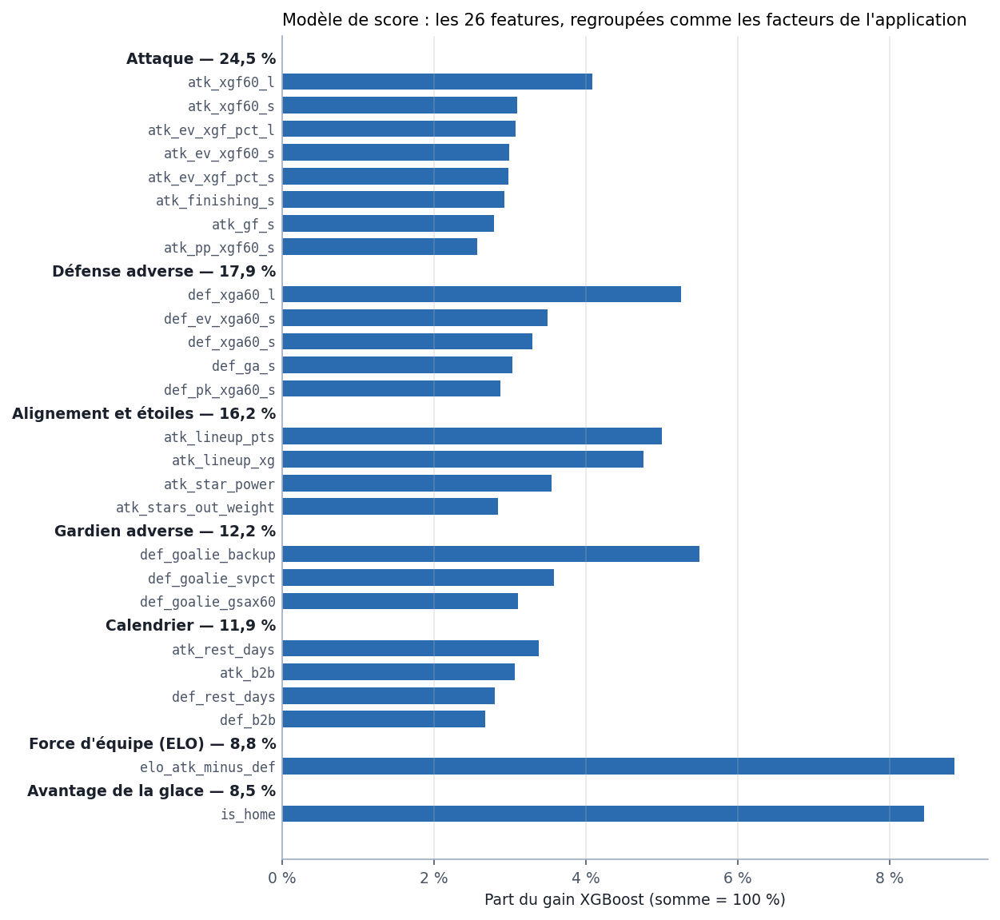

*La figure :* la part du gain XGBoost de chaque feature (`score_report.json →
feature_importances`), rangée dans les sept familles que l'application affiche
sous « pourquoi ce pronostic » (même règle `_factor_of` qu'au §6.8). Aucune
feature ne décide seule : la prédiction vient de l'addition de l'attaque, de la
défense adverse, de l'alignement et du gardien d'en face.

#### 4.1.3 Entraînement

- Matchs triés par date, découpage **chronologique** : les 20 % les plus récents = **test** (4 305 matchs, du 2023-02-27 au 2026-09-30) ; des 80 % restants, les 15 % les plus récents = **validation** (2 583 matchs) ; le reste = **entraînement** (14 637 matchs, 2008 → 2021).
- XGBoost `count:poisson` : la sortie est directement un λ (buts attendus).
- 30 essais aléatoires d'hyperparamètres, gardé celui qui minimise la *déviance de Poisson* sur la validation ; arrêt précoce sur la validation (meilleure itération : 236 arbres).
- Paramètres retenus : profondeur 5, taux d'apprentissage 0,03, sous-échantillonnage 0,7, colonnes 0,8, `min_child_weight` 20, `reg_lambda` 1.

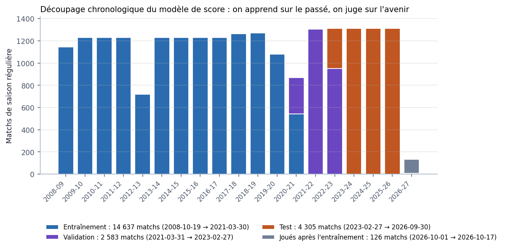

*La figure :* chaque barre est une saison, colorée selon la tranche où ses
matchs sont tombés (`train_score.split`, effectifs de `score_report.json`). Les
coupures tombent au milieu d'une saison, jamais dans le désordre : tout le test
est postérieur à tout l'entraînement. On y voit aussi les saisons courtes
(lock-out 2012-13, COVID 2019-20 et 2020-21). En gris, les matchs joués depuis
l'entraînement : le modèle servi ne les a jamais vus.

#### 4.1.4 La correction de marge τ (filets déserts)

Deux lois de Poisson indépendantes se trompent sur les **écarts** de score.
Mesuré : trop peu de matchs nuls après 60 min, trop d'écarts de 1, pas assez
d'écarts de 3. La raison est mécanique : une équipe menée d'un but retire son
gardien → soit elle égalise (écart 1 → 0), soit elle encaisse dans le filet
vide (écart 1 → 2, écart 2 → 3).

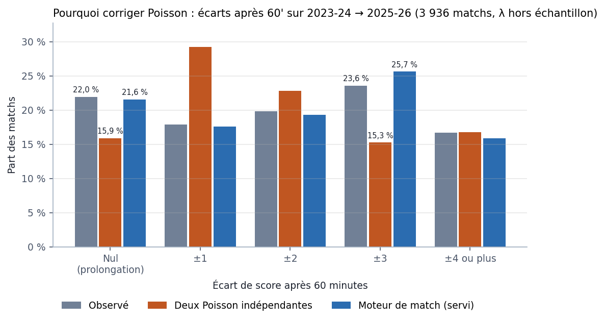

*La figure :* sur les trois dernières saisons complètes, avec les λ du modèle
de score hors échantillon (`live_pregame.csv`), deux Poisson indépendantes
prévoient beaucoup trop d'écarts de 1 et trop peu de nuls et d'écarts de 3.
C'est exactement ce que τ, puis le moteur de match (§4.1.4 bis, en bleu),
corrigent. Le moteur est ajusté sur ces mêmes saisons : la figure montre la
forme qu'il reproduit ; son test hors échantillon est le walk-forward du
§4.1.4 bis.

On corrige chaque case de la matrice par un multiplicateur qui dépend de l'écart :

```
τ(écart) = fréquence réelle de cet écart / fréquence prédite par Poisson   (mesurée sur l'entraînement)
M'(i, j) = M(i, j) × τ(i − j),  puis on renormalise pour que la somme fasse 1
```

Valeurs actuelles (`score_report.json → tau_margin`) :

| écart (dom − ext) | 0 | ±1 | ±2 | ±3 | ±4 | ±5 | ±6 |
|---|---|---|---|---|---|---|---|
| τ | **1,360** | 0,73 / 0,70 | 0,92 / 0,91 | **1,44 / 1,39** | 1,03 / 0,92 | 0,86 / 0,75 | 0,85 / 0,65 |

Effet mesuré sur le test : nuls après 60 min prédits 15,8 % sans τ → **21,4 %**
avec τ (observé 22,1 %) ; domicile −1,5 : 31,3 % → **33,5 %** (observé 33,2 %).

**Ce τ est périmé (mesuré le 2026-10-15).** Il est ajusté sur 2008-2021, or les
gardiens sortent plus tôt et plus souvent : écarts de ±1 après 60 min 23,2 %
(2010-14) → 17,9 % (2023-25), écarts de ±3 19,8 % → 23,6 %, buts en filet désert
3,8 % → 6,0 %. Il reste écrit dans `score_report.json` comme dernier repli ; le
service sert le moteur ci-dessous (ou, à défaut, un τ ré-ajusté sur les 3
dernières saisons, `game_dynamics.json → tau_margin`).

#### 4.1.4 bis Le moteur de match (`game_dynamics.py`, 2026-10-15)

Plutôt que de corriger après coup deux Poisson indépendantes, on **joue le
match**. Chaque équipe marque, à chaque seconde, avec une intensité

```
r(t) = λ_équipe / 3600 × c(avance de l'équipe, tranche de temps)
```

- **Tranches** : P1, P2, P3 0-10', P3 10-15', puis minute par minute de 55' à 60'.
- **Avance** de l'équipe bornée à ±3.
- **c** = buts observés dans la case ÷ (secondes passées dans la case × λ/3600),
  sur `live_goals.csv` (buts horodatés), 3 dernières saisons complètes, avec les
  λ du modèle servi. Rendu **relatif** (il ne change pas le nombre total de buts
  attendus — le niveau reste l'affaire de λ et du recalage §4.3 bis).

Le filet désert y est explicite (fenêtre 2023-2025) :

| avance de l'équipe | 57-58' | 58-59' | 59-60' |
|---|---|---|---|
| −1 (gardien sorti) | ×0,95 | ×1,66 | **×2,60** |
| 0 | ×0,70 | ×0,67 | ×0,67 |
| +1 (vise le filet vide) | ×1,31 | ×4,26 | **×7,69** |
| +2 | ×4,37 | ×5,73 | ×6,55 |

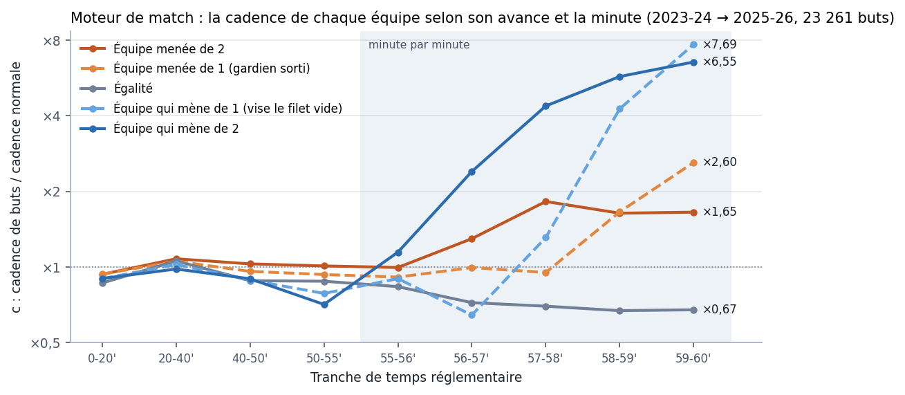

*La figure :* la table c entière (`game_dynamics.json`) pour les avances de −2
à +2, sur une échelle logarithmique. Pendant 55 minutes, toutes les courbes
restent près de ×1 : le score change peu la façon de jouer. Tout se passe dans
les dernières minutes : l'équipe qui mène vise le filet vide, celle qui est
menée d'un but joue à six et marque plus souvent, et à égalité les deux
équipes ferment le jeu en attendant la prolongation.

La loi du score est calculée **exactement** (chaîne de Markov à temps continu,
uniformisation) : ≈ 1 ms par matrice. Deux usages :

1. **La matrice M du match entier** (§5). Walk-forward 2013-2025, critère fixé
   avant le run, contre Poisson × τ ré-ajusté sur les mêmes 3 saisons : score
   exact −0,0032 de log-loss (z −4,0, 11 saisons sur 13), moneyline, puck line,
   nul après 60', plus de 5,5 / 6,5 tous |z| < 1. Adopté.
2. **Les marchés de période** (§5), sur l'état (avance, buts P1, buts P2, buts
   P3). L'ancienne règle (Poisson de part fixe 30,5 / 36,5 / 33 %) ignorait
   que la 3e période dépend du score à 40'. Test 2023-26 (4 201 matchs, niveau
   recalé) : période la plus prolifique z −5,1 ; P3 plus de 0,5 / 1,5 / 2,5
   z −4,7 / −5,5 / −4,0 ; P2 plus de 2,5 z −4,2 ; mène après P1 / P2 neutre.

**Le moneyline servi ne change pas.** La couche de correction (§4.3) a été
ajustée sur la victoire de Poisson × τ ; le service lui donne toujours cette
entrée-là (`_p_home_layer_input`), puis recale la matrice du moteur sur la
victoire corrigée. Le moteur ne fait que répartir cette victoire entre les
scores. (Sa propre victoire domicile est ~1 point plus basse, uniformément, à
log-loss égale.)

`game_dynamics.json` est réécrit par `refresh_data.py` (chaque lundi) et à la
fin de `train_score.py`. Retour arrière sans redéployer de modèle : variable
d'environnement `SCORE_SHAPE=tau_window` (Poisson × τ glissant) ou `tau_train`
(Poisson × τ 2008-2021). Exploration complète et pistes écartées (copule de
Frank, Conway-Maxwell-Poisson, bayésien hiérarchique, simulation tir par tir) :
`ml/EXPLORATION_SCORE.md`.

#### 4.1.5 Qui gagne la prolongation ?

Si c'est nul après 60 minutes, le vainqueur de la prolongation/fusillade reçoit
un but. Probabilité que le domicile la gagne, ajustée sur 3 429 prolongations :

```
p_ot_dom = σ(0,2948 × (λ_dom − λ_ext) − 0,0639)
```

Ces 3 429 prolongations sont les matchs de la tranche d'entraînement
(octobre 2008 → avril 2021) restés à égalité après 60 minutes.

Pour deux équipes égales ≈ 48 % ; si le domicile a 1 but d'avance en λ ≈ 56 %.
(Garde-fous : pente > 0 et niveau moyen entre 35 et 65 %, sinon on utilise la
constante mesurée 0,4999, `score_report.json → p_ot_home`.)

#### 4.1.6 Les autres réglages écrits dans `score_report.json`

- **`confidence.deciles`** : la distribution de |λ_dom − λ_ext| sur l'entraînement (sert à la jauge de confiance, §6.10).
- **`blend`** : un mélange « modèle de score ⊕ marché » est ajusté et mesuré, **mais le service ne l'applique pas** (sur les 2 628 matchs cotés du test : modèle seul 0,6714, marché seul 0,6705, mélange 0,6707).
- **`ensemble`** : vide. L'ensemble bootstrap (20 modèles pour mesurer l'incertitude σ) est désactivé par défaut (`--ensemble 0`) — la mesure a conclu que σ n'était pas exploitable.

### 4.2 Le classifieur moneyline (`train.py`) — encore calculé, plus servi

Historique : c'était le premier modèle. Aujourd'hui sa probabilité est
**calculée à chaque requête et renvoyée dans `probability_classifier`** pour
comparaison — sans les cotes en entrée et calibrée Platt —, mais la probabilité
servie vient du modèle de score. Le mélange avec le marché ne sert que de repli
quand le modèle de score ne répond pas.

- XGBoost `binary:logistic` sur la cible `home_win`.
- **15 features** : `elo_diff`, `elo_expected`, `ev_xgf_pct_s_diff`, `ev_cf_pct_s_diff`, `ev_xgf_pct_l_diff`, `xg_matchup_diff`, `goalie_gsax60_diff`, `star_power_diff`, `stars_out_weight_diff`, `rest_days_diff`, `b2b_diff`, `finishing_s_diff`, `win_s_diff`, **`market_home_p_open`, `market_home_p_close`** (les cotes sont des features ; absentes = vide, XGBoost sait gérer).
- Même découpage 80/20 et validation 15 %, 40 essais d'hyperparamètres.
- **Calibration Platt** sur la validation : `p = σ(1,0826 × logit(p_brut) − 0,0729)`.
- **Mélange avec le marché** (si des cotes sont fournies) : `p = σ(0,522 × logit(p_brut) + 0,655 × logit(p_marché) − 0,0537)`.
- Résultats test : log-loss 0,6644 (ELO seul 0,6704 ; constante 0,6901), précision 59,0 %.

### 4.3 La couche de correction du moneyline (`correction_layer.json`)

Une régression logistique posée **par-dessus** la victoire du modèle de score.
Elle prend la probabilité de victoire domicile du modèle (`p_score`) et la
corrige avec cinq écarts domicile − extérieur que le marché exploitait mieux que
le modèle. Ajustée en walk-forward strict par
`backtest_walkforward.py --correction --write-layer` (première version
2026-10-02 à 7 variables, version servie 2026-10-17 à 5 variables, §4.3.5) :

```
z = 0,0819 + 0,4702 × logit(p_score)
    + Σ coef_k × (x_k − moyenne_k) / écart-type_k
p_corrigée = σ(z)
```

#### 4.3.1 Les coefficients

Valeurs de `correction_layer.json`, ajustées sur 16 765 matchs (saisons 2012 →
2026-27, prédictions hors échantillon du modèle de score). Les variables sont
standardisées : chaque coefficient est l'effet **d'un écart-type**, en logit.
Près de 50 %, 0,1 de logit ≈ 2,5 points de probabilité.

| x_k (domicile − extérieur) | moyenne | écart-type | coef | z | ≈ effet d'un écart-type |
|---|---|---|---|---|---|
| `logit(p_score)` | — | — | 0,4702 | 5,09 | — |
| `b2b_diff` | −0,116 | 0,459 | −0,0991 | −5,98 | −2,5 pts |
| `ev_xgf_pct_s_diff` | −0,001 | 0,0586 | +0,1138 | 5,19 | +2,8 pts |
| `lineup_xg_diff` | −0,0005 | 0,452 | +0,0616 | 2,62 | +1,5 pt |
| `star_power_diff` | −0,007 | 0,740 | +0,0431 | 2,07 | +1,1 pt |
| `elo_diff` | −0,05 | 68,8 | +0,1409 | 4,77 | +3,5 pts |

Les cinq sont significatives (|z| ≥ 2). En unités concrètes :

- **Dos-à-dos** : le domicile joue la veille, l'extérieur est reposé
  (`b2b_diff` passe de 0 à 1) → −0,22 de logit, ≈ −5 points. C'est le signal le
  plus net (z −6,0), alors que le modèle de score lit déjà `b2b` des deux
  côtés : il le sous-pondère.
- **ELO** : 100 points d'écart → +0,20 de logit, ≈ +5 points.
- **Possession xG à 5 c. 5, court terme** : 5 points de part d'xG d'écart → ≈ +2,4 points.
- **Alignement projeté** : 0,5 xG d'écart → ≈ +1,7 point.
- **Ordonnée 0,0819** : à `p_score` = 50 % et variables à leur moyenne, la
  couche rend 52,0 %. C'est un léger avantage domicile que le modèle sous-estimait.
- **Le 0,47 sur logit(p_score)** ne veut pas dire que le modèle est « deux fois
  trop confiant ». ELO, xG et alignement sont corrélés à `p_score` et reprennent
  une partie de son poids. Seule (variante R ci-dessous), la recalibration donne
  une pente de 1,20 : le modèle est plutôt trop **prudent**.

Au service (`ml_service._apply_correction`), une variable absente vaut sa
moyenne (contribution nulle), comme à l'ajustement. La liste des variables est
lue dans le fichier : le code n'en suppose aucune. Fichier absent ou illisible →
victoire du modèle brut.

#### 4.3.2 Comment elle a été mesurée

Pour chaque saison S de 2015 à 2026-27, la couche est ajustée sur les
prédictions hors échantillon des saisons < S **seulement** (au moins 3), puis
appliquée à S. Critère fixé avant le run : log-loss moneyline z ≤ −2 (apparié,
par match) ET gain sur ≥ 70 % des saisons (`correction_report.json`, 12 saisons,
dont les 83 premiers matchs de 2026-27).

| variante | contenu | Δ log-loss | z | saisons meilleures | verdict |
|---|---|---|---|---|---|
| R | recalibration seule (logit p) | −0,0002 | −0,6 | 7 / 12 | non tranchable |
| **C** | **R + les 5 variables** | **−0,0026** | **−3,9** | **12 / 12** | **adoptée, servie** |
| B | C sans `elo_diff` | −0,0020 | −3,4 | 10 / 12 | adoptable, moins bonne que C |

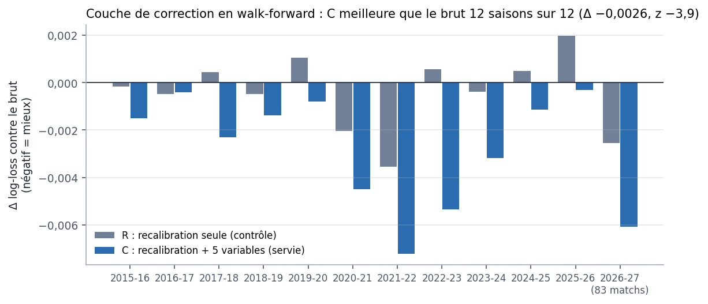

*La figure :* chaque paire de barres est une saison jugée par une couche
ajustée seulement sur les saisons d'avant (`correction_report.json →
by_season`). Sous zéro, la couche fait mieux que le modèle brut. La
recalibration seule (gris) gagne à peu près une saison sur deux, au hasard ; avec les
cinq variables (bleu), le gain est du bon côté chaque saison, ce qui compte
plus que sa taille moyenne. La dernière barre ne porte que sur le début de la
saison en cours (effectif sous l'étiquette).

Contre la cote de clôture (11 297 matchs avec cote) : le modèle brut avait
+0,0013 de log-loss de plus que le marché (z 1,4) ; avec la couche, −0,0008
(z −1,0). La couche fait jeu égal avec le marché, légèrement mieux sans que ce
soit significatif.

Le biais de sélection (les variables ont été choisies par `--market-gap` en
regardant toutes les saisons) a été mesuré le 2026-10-17 : refaire le choix à
l'intérieur de chaque fold garde l'essentiel du gain (§4.3.5, piste 1).

#### 4.3.3 Pourquoi une couche par-dessus plutôt que réentraîner le modèle

1. **Le modèle de score n'apprend pas la victoire.** C'est un XGBoost Poisson
   qui prédit les buts d'une équipe (une ligne par équipe-match, colonnes
   attaque / défense). Sa perte, la déviance de Poisson, est dominée par le
   **niveau** des λ. La victoire dépend de l'**écart** entre les deux λ. Mesuré
   à l'élagage des features (commentaire de `train_score.py`) : retirer 12 colonnes dégradait la déviance
   (+0,0009) et améliorait le moneyline (−0,0005). Ce qui aide les buts et ce
   qui aide la victoire ne coïncident pas. Une logistique qui optimise
   directement la log-loss moneyline vise la bonne cible.
2. **Le réentraînement a été essayé d'abord, et il ne suffit pas.**
   `--market-gap` avait isolé ce que le marché voyait mieux. La v2 du modèle de
   score (2026-09-27) a intégré ce qui s'y prêtait (fatigue de l'équipe qui
   défend, gardien de relève, possession long terme) et a été adoptée. Mais
   après la v2, le modèle restait trop prudent (pente 1,28 ± 0,06). L'étirement
   cohérent des λ (γ) a échoué hors échantillon, et la recalibration seule (R)
   n'est pas tranchable. Seules les variables en écart, posées sur la sortie,
   passent le critère.
3. **Le signal est dans les écarts.** Les lignes empilées voient « attaque de
   A » et « défense de B » séparément. `b2b`, `star_power`, `lineup_xg` et
   `ev_xgf_pct` y sont déjà, mais le modèle doit reconstituer l'écart à partir
   de deux lignes distinctes. La couche les reçoit directement en domicile −
   extérieur. `b2b_diff` en est l'exemple : présent dans le modèle, il ressort
   quand même à z −6,0.
4. **Coût et lisibilité.** Sept nombres, ajustés en quelques secondes, chacun
   lisible et testable. Réentraîner, c'est une recherche d'hyperparamètres par
   fold sur 14 saisons, puis τ, prolongation, déciles et recalage à refaire.
5. **Réversible et isolée.** Supprimer le fichier rend le modèle brut.
   `probability_score_model` reste servi à côté pour comparer.

Le prix à payer : la couche ne connaît que la victoire, il faut donc recaler la
distribution des buts pour que les autres marchés restent cohérents (§4.3.4).
Et elle a été ajustée sur la victoire Poisson × τ. Depuis le moteur de match
(2026-10-15), le service lui donne encore cette victoire-là, et non celle du
moteur (≈ 1 point plus basse) (`_p_home_layer_input`). Elle est à ré-ajuster si
la matrice d'entrée change.

#### 4.3.4 Comment elle s'applique à tous les marchés

Depuis le 2026-10-03. La
victoire corrigée est traduite en une distribution : on garde la somme
λ_dom + λ_ext (les totaux de buts ne bougent pas) et on choisit le partage
entre les deux équipes pour que la victoire domicile de la matrice — τ et
prolongation compris — égale la victoire corrigée (`lambdas_for_home_win`,
`score_model.py`, par bissection). Tous les marchés se lisent ensuite sur
cette matrice recalée : « gagne en 60 min » + « gagne en prolongation » =
« gagne », les scores exacts gagnants somment à la victoire. Les λ affichés
(paquet ML, direct) sont les λ recalés ; `probability_score_model` reste la
victoire du modèle brut, avant correction.

#### 4.3.5 Pistes testées pour l'améliorer (2026-10-17)

Huit pistes, toutes avec le même protocole walk-forward et une règle de
décision fixée avant le run (en-tête de chaque script). Banc d'essai et
rapports : `ml/python/explore_correction/` (README). Δ = log-loss moneyline
(négatif = mieux), apparié par match, 11 saisons 2015-2025.

| Piste | Ce qui a été testé | Résultat | Verdict |
|---|---|---|---|
| 1. Sélection imbriquée | Refaire le choix des variables sur les saisons < S seulement (critère de `--market-gap`, parmi les mêmes 23 candidates) | −0,0017 contre le brut (z −2,6, 10 / 11 saisons), contre −0,0022 pour la couche à 7 | **Gain confirmé.** Environ un quart du gain mesuré venait de la sélection. |
| 2. Queue des gros favoris | logit·\|logit\|, logit³, pentes à part au-delà de 65 % et de 70 % | Toutes moins bonnes que la couche linéaire (jusqu'à +0,0016, z +2,2) | **Rejeté.** La couche corrige déjà la queue (voir plus bas). |
| 3. Élagage | Retirer `xg_matchup_diff` et `ev_xgf_pct_l_diff` | −0,00035 contre la couche à 7 (z −2,15, 8 / 11 saisons) | **Adopté** : c'est la couche servie. |
| 3 bis. Sans ELO (B) | Retirer `elo_diff` (déjà lu par le modèle de score) | +0,0004 contre la couche à 7 (z +1,3, 3 / 11) | **Rejeté.** |
| 4. Fatigue | Distance, fuseaux horaires (calculés, §3.6), 3e match en 4 soirs, jours de repos, dos-à-dos × gardien de relève | Entre −0,00003 et +0,0001, aucun \|z\| ≥ 2,5 | **Rejeté.** Le dos-à-dos suffit. |
| 5. Période de la saison | ELO et xG pondérés par le début de saison (exp(−matchs joués / 15)) | +0,0001 (z +0,9) | **Rejeté.** |
| 6. Dérive dans le temps | Saisons récentes pondérées (demi-vie 3 ou 5 ans), fenêtre de 6 saisons | Entre +0,00003 et +0,0003 | **Rejeté.** Les coefficients sont stables d'un fold à l'autre. |
| 7. Entrée du moteur de match | Couche ajustée sur la victoire du moteur au lieu de Poisson × τ | +0,00005 (z +1,3, 3 / 11) | **Rejeté** : on garde `_p_home_layer_input`. |

Pour les pistes 4 à 6, le seuil était z ≤ −2,5 (environ 8 essais). Pour
l'élagage, une règle de parcimonie : la version plus simple remplace l'autre si
elle ne perd pas à z ≥ +1 et bat toujours le brut au critère d'origine.

Ce qu'on en retient :

- **La queue était déjà réglée.** `--market-gap` avait vu le modèle brut
  sous-estimer les gros favoris. Sur les 692 matchs où le marché donne ≥ 70 % au
  favori, celui-ci gagne 74,1 % ; le brut dit 69,2 %, le marché 73,4 %, la
  couche 73,9 %. L'ELO et la possession xG dans la couche font ce travail ; un
  terme non linéaire en plus sur-corrige.
- **Pourquoi retirer deux variables améliore.** Leurs coefficients étaient
  instables : `xg_matchup_diff` passe de −0,11 (fold 2015) à environ 0 ;
  `ev_xgf_pct_l_diff` change de signe (−0,07 → +0,07). La sélection imbriquée
  les écartait d'ailleurs le plus souvent. Les 5 restantes gardent le même signe
  et à peu près la même taille dans tous les folds.
- **Le dos-à-dos ne dérive pas.** Son effet au-delà du modèle est négatif dans
  11 saisons sur 14, sans tendance nette, d'où l'échec de la pondération des
  saisons récentes.
- **Le moteur de match.** Sa victoire brute est 0,95 point plus basse que
  Poisson × τ, avec une log-loss identique (z +0,9). Ré-ajustée dessus, la couche
  perd un tout petit peu, régulièrement (8 saisons sur 11). Le contournement
  actuel reste donc le bon choix.

Retour arrière : recopier `models/correction_layer_v1_7var.json` sur
`correction_layer.json` et relancer le service. Pour réécrire la couche à 7
variables : `CORRECTION_FEATURES = CORRECTION_FEATURES_V1` dans
`backtest_walkforward.py`.

### 4.3 bis Le recalage de niveau des buts (`level_layer.json`, 2026-10-04)

**Le défaut corrigé.** Le modèle de score se trompe de niveau selon les
saisons. Buts réglementaires observés / λ (walk-forward, `live_pregame.csv`) :
1,01-1,03 sur 2017-21, **0,965 · 0,961 · 0,955 · 0,969** sur 2022-23 → 2025-26.
Le modèle servi montre le même écart sur ces saisons hors de son entraînement.
Conséquence : « plus de 5,5 » annoncé à 58,4 % sur 2023-26 pour 56,0 % observé.

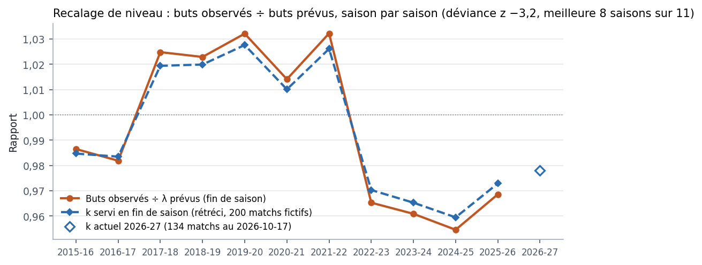

*La figure :* en orange, le rapport buts observés / λ prévus de chaque saison,
mesuré hors échantillon (`level_report.json`) ; en bleu, le k que le service
aurait appliqué en fin de saison, rétréci vers 1 ; le losange vide, le k servi
aujourd'hui (`level_layer.json`). La rupture de 2022-23 se voit d'un coup
d'œil : depuis, le modèle prévoit un peu trop de buts, et k les ramène.

**Le recalage.** Un seul nombre k par saison, le rapport buts observés / buts
prévus des matchs déjà joués de la saison en cours, rétréci vers 1 :

```
k = 1 + w × (Σ obs / Σ λ − 1),   w = n / (n + 200)
```

n = matchs joués de la saison ; 200 = force du rétrécissement, choisie par
saison laissée de côté (`measure_level.py`). En début de saison k = 1, puis k
rejoint le rapport de la saison à mesure que les matchs s'accumulent (k ≈ 0,97
à la fin de 2025-26). Borné à [0,85 ; 1,15].

**Comment il s'applique.** Le service multiplie la SOMME λ_dom + λ_ext par k
puis rechoisit le partage pour garder la victoire domicile exacte
(`lambdas_for_home_win`, la même bissection que la couche de correction, §4.3).
Donc **le moneyline ne bouge pas** ; totaux, totaux d'équipe, puck line, score
exact, BTTS, périodes et le direct (le paquet renvoie les λ recalés) se lisent
sur la matrice recalée. Les cadences joueur (modèle séparé) ne sont pas
touchées.

**La mesure** (`level_report.json`, règle fixée avant le run, 11 saisons
2015-16 → 2025-26, k gelé chaque lundi comme en production) : déviance du
total 0,96566 → 0,96247 (z −3,2), meilleure sur 8 saisons sur 11, P(> 5,5)
sur 2023-26 58,4 % → 55,8 % pour 56,0 % observé → **ADOPTÉ**.

**Qui le calcule.** `refresh_data.py`, chaque lundi : le modèle de score SERVI
chiffre les matchs déjà joués de la saison (ils sont toujours hors de son
entraînement, cf. le découpage 80/20) et écrit `level_layer.json`. Le service
refuse un fichier d'une autre saison, dont le k ne se recalcule pas à partir
de ses propres comptes, ou dont la mesure n'est pas « ADOPTER » → k = 1.

### 4.4 Le modèle joueur (`train_player.py`)

Un modèle XGBoost `count:poisson` **par statistique** : buts, passes, points,
tirs, mises en échec, tirs bloqués, minutes de pénalité, points en AN.

- **Features joueur (pré-match)** : temps de glace moyen sur 5/10/30 matchs, temps en AN sur 10 matchs, xG des coéquipiers sur la glace à 5c5 (20 matchs), xG individuel par 60 (20 matchs), nombre de matchs en carrière, production par 60 minutes sur 10, 30 matchs et carrière pour les 8 statistiques.
- **Contexte du match** : 13 statistiques de son équipe (`tm_…`) et de l'adversaire (`opp_…`) issues de `nhl_games_v4.csv` (buts, xG, tirs, AN/PK, gardien, forme), domicile, repos, dos-à-dos, défenseur ou non.
- Entraînement ≤ 2021-22, arrêt précoce sur 2022-23, test 2023-24 → 2025-26.
- **Dispersion k** (binomiale négative) ajustée par statistique : ≥ 10⁴ = Poisson (buts, passes, points, points AN), 20 (tirs), 8 (mises en échec), 12 (tirs bloqués), 0,3 (pénalités).
- Bat la règle actuelle du serveur sur les 8 statistiques (ex. buts : log-vraisemblance −0,4462 contre −0,4566).

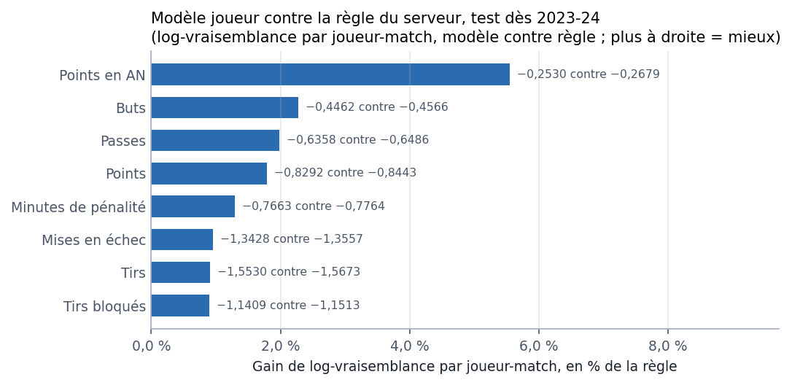

*La figure :* le gain de log-vraisemblance moyenne par joueur-match sur le test
(`player_report.json`), en pourcentage de la règle de `playerRates.ts` ; les
valeurs exactes sont à droite de chaque barre. Les pourcentages semblent
petits parce qu'un joueur dans un match est très aléatoire, mais ils sont
positifs pour les huit statistiques, sur l'ensemble des joueur-matchs du test.

- **Face-à-face joueur vs adversaire** (2026-10-06, `player_vs_report.json`) : sur ses 10 derniers matchs contre l'adversaire du soir, le joueur a-t-il produit plus ou moins que son niveau du moment ? `vs_lift_<stat>` = réel / attendu (chaque rencontre jugée avec sa cadence pré-match sur 30 matchs × son temps de glace), rétréci vers 1 par un pseudo-compte (`VS_PSEUDO`), plus `vs_gp` (nombre de rencontres). Contrainte monotone +1 sur les lifts : un lift plus haut ne peut que faire monter la prédiction. Essayé pour chaque stat, gardé seulement si la log-vraisemblance s'améliore en validation (2022-23) ET en test (2023-26) avec z ≥ 2.
  - **Gardé** : mises en échec (z 4,3, les 3 saisons ; lift ≥ 1,2 → +7,8 % observé vs modèle sans face-à-face) et pénalités (z 2,5).
  - **Rejeté (bruit)** : buts, passes, points, tirs, tirs bloqués, points en AN. Un joueur qui « marque toujours » ou « tire toujours » contre une équipe ne le refait pas plus que d'habitude (tirs : −0,3 % observé pour lift ≥ 1,2). Fenêtre de 20 rencontres testée aussi : même conclusion (seules les pénalités y passent la règle).
  - Les features sont donc **par statistique** : `player_report.json → stats[s].features`.
  - Face-à-face **équipe vs équipe** : déjà mesuré et rejeté pour le modèle de score (`live/h2h_report.json`, `keep: false`).
- **Arbitres** (2026-10-12, `referee_effects.py`, `player_ref_report.json`) : `ref_pen` / `ref_pp` = somme, pour les 2 arbitres du match, de leur écart moyen (rétréci, `/ (n + 40)`) aux pénalités / minutes à 5 c. 4 de la ligue, sur leurs matchs PRÉCÉDENTS. Essayé pour pénalités et points en AN avec la règle du face-à-face : **gardé pour les pénalités** (z 2.46), pas pour les points en AN (z 1.68). En service, Node envoie les noms des arbitres du soir (`refereeStore`, Scouting the Refs) ; la table `ref_effects.json` (rafraîchie chaque lundi) donne leurs effets ; inconnus → 0. Les arbitres n'ont AUCUN effet mesurable sur les buts : ils ne touchent ni le modèle de score ni les totaux.
- **Pour le service** : `player_state.json` = les features de chaque joueur après son dernier match, plus `vs` = { joueur: { adversaire: [vs_gp, lifts…] } } (ordre : `vs_features`) ; le service les combine au contexte du match à venir. Sans rencontre passée ou sans équipe nommée : `vs_gp` 0 et lifts 1, comme à l'entraînement.
- **Répartir la grille entre les joueurs (« top-down », 2026-10-15, `explore_players/`)** : chaque but de l'équipe revient au joueur avec sa part s = μ_buts / Σ_équipe μ_buts, sur la loi des buts comptables du moteur (but de prolongation compris, fusillade non). Mesuré sur 189 000 joueur-matchs hors échantillon (2022-23 → 2025-26), avec une règle posée avant le run :
  - **Marginales — non adopté** : aucun gain sur les buts (Δ log-vraisemblance +0,00004, z 0,5), légère perte sur les passes et les points. Les chiffres affichés restent ceux du modèle joueur.
  - **Combinés d'un même match — adopté** : la grille bat le produit des probabilités pour « X marque + son équipe gagne » (z 26 en test ; observé 1,33 × le produit, la grille dit 1,30), « 1+ point + gagne » (z 37), « marque + plus de 5,5 » (z 22), « marque + gagne par 2 » (z 24), « marque + l'adversaire gagne » (z 26). Deux coéquipiers qui marquent : rien à gagner (lift observé 1,02), ils restent au produit. Branché dans le coupon (§7.6).

---

- **Recalage de niveau dans la saison** (2026-10-15) : par statistique, k de la saison en cours = Σ observé / Σ prévu sur les matchs déjà joués, rétréci vers 1 (`level_k`). Mesuré d'abord sur le modèle figé (`explore_players/level.py` → `player_level_report_frozen.json` : tirs bloqués, mises en échec, points adoptés ; tirs z 1,7), puis **re-mesuré sur le modèle servi** après réentraînement récent et déploiement récent (`explore_players/level_wf.py` → `player_level_report.json`, hors échantillon, n0 choisi sur 2023-24, test 2024-26) : **adopté** pour tirs bloqués (z 5,4, n0 50) et mises en échec (z 3,5, n0 100) ; **plus** pour les points (perd sur 2023-24) ; toujours pas pour tirs (le modèle réentraîné ne les surestime plus : 1,574 prévu pour 1,571 observé en 2024-25), buts, passes, pénalités, points en AN. `train_player.refresh_player_level` écrit `player_level_layer.json` ; `ml_service` multiplie les cadences servies par k (fichier d'une autre saison → k = 1).
- **État rafraîchi chaque semaine** (2026-10-15) : `refresh_data.py` garde le zip COMPLET des patineurs de la saison en cours (`data/raw/skaters_<saison>_current.zip`) et relance `train_player.refresh_state()` (état + recalage). Avant, l'état restait figé à la fin de la saison précédente (16 avril 2026) : aucun match de la saison en cours n'entrait dans les features du modèle joueur.

- **Réentraîné sur les saisons récentes** (2026-10-15, `explore_players/retrain.py` → `player_retrain_report.json`) : validation « marchante » — pour chaque saison de test 2023-24 → 2025-26, entraîner jusqu'à S−2, arrêt précoce sur S−1, réentraîner jusqu'à S−1 avec ce nombre d'arbres, prédire S. Règle posée avant le run : Δ > 0 regroupé, z ≥ 2, Δ > 0 dans ≥ 2 saisons sur 3. **Adopté** pour mises en échec (z 14,2), tirs (7,6), points (5,7), passes (5,3), points en AN (3,6), tirs bloqués (3,2) — le gain tient après le recalage de niveau ; **pas** pour buts (z −0,2) ni pénalités (1,3), qui gardent le modèle ≤ 2021-22. Pondérer les saisons récentes (demi-vie 3 ans) n'ajoute rien. Servi : `train_player.py --recent` (`RECENT_STATS`) réentraîne ces 6 stats jusqu'à la dernière saison complète (arrêt sur elle, puis 2010 → elle) ; `player_report.json → stats[s].policy = "recent"`, `trained_through`. À relancer chaque été ; un entraînement complet l'applique aussi.
- **Déploiement récent** (2026-10-15, `explore_players/lineup.py` puis `recency_wf.py` → `player_lineup_report.json`, `player_recency_report.json`) : `toi_last1` et `toi_pp_last1` (temps de glace total et en AN au dernier match), `toi_pp_avg_3` (temps d'AN sur 3 matchs) — une promotion sur le 1er trio ou la 1re unité d'AN que les moyennes 5-30 matchs diluent. Les absents du soir (minutes des habitués hors de l'alignement) ont aussi été mesurés : < 0,5 % du gain, non servis. Ajoutées au modèle réentraîné, validation « marchante » 2023-26 : **adoptées** pour points en AN (z 7,3), tirs (4,5), tirs bloqués (4,2), points (3,2), passes (2,4) ; pas pour mises en échec (−2,4) ni buts (1,0). `RECENCY_STATS` dans `train_player.py` ; calculées dans `rolling_features`, donc dans `player_state.json` (un état plus ancien sans elles → avertissement au démarrage du service).
- **Tentatives de tir** (2026-10-16, `explore_players/attempts.py` → `player_attempts_report.json`) : ajoutées au modèle servi, validation « marchante » 2023-26. **Tirs** + `att_p60_10/30/career` (ses tentatives — cadrées, ratées, bloquées — par 60) : adopté (z 4,1, gain croissant chaque saison). **Tirs bloqués** + `oia_p60_20` (tentatives adverses par 60 quand il est sur la glace), `opp_att_f20` (tentatives par match de l'adversaire, 20 matchs) et `tm_att_a20` (tentatives concédées par son équipe) : adopté (z 6,1). `ATTEMPT_FEATS` dans `train_player.py` ; les variables joueur sont dans `player_state.json → players`, celles d'équipe dans `player_state.json → teams` (lues de `mp_team_games.csv`, rafraîchies avec l'état).
- **Dispersion par poste ou par profil** (2026-10-16, `explore_players/dispersion.py` → `player_dispersion_report.json`) : sur les prédictions hors échantillon du modèle servi, un k par poste (attaquant / défenseur) ou par tiers de cadence prévue, choisi sur 2023-24, jugé sur 2024-26 (z ≥ 2, positif chaque saison). **Adopté pour les mises en échec seulement**, par profil (z 5,5) : k 3 sous 0,78 mise en échec prévue, 4 jusqu'à 1,39, 10 au-delà — les petits frappeurs sont plus irréguliers. Rien pour les autres stats (tirs au plus près : z 1,9). `player_report.json → stats.hits.k_tiers` ; le service l'envoie dans `player_dispersion_tiers`, le serveur choisit le k du joueur (`prediction/playerDispersion.ts`, `PlayerRateRow.modelK`), le client le lit dans `dispersionFor`. Constat à part : les pénalités sont mal servies par une binomiale négative (minutes par blocs de 2) — 2+ PIM prévu à 9 % pour 16,5 % observé.
- **Pénalités en nombre** (2026-10-16, `explore_players/penalties.py` → `player_penalties_report.json`) : la binomiale négative en MINUTES mettait de la masse sur 1 et 3 minutes (impossibles) et sous-estimait « 2 minutes ou plus » (9,6 % prévu pour 16,8 % observé, test 2023-26). Servi : N ~ BN(μ_N, k_N 40) pénalités (XGBoost `player/pen_count.json`, features et découpage de la stat pim), chacune d'une durée {2, 4, 5, 10} — loi de la ligue (91,5 % / 1,0 % / 7,4 % / 0,05 %) avec la part de « non mineures » propre au joueur (`pen_career`, `bigpen_career` dans l'état, rétrécie, pseudo 20). Mesure (règle posée avant) : log-vraisemblance z 217 contre le servi (surtout la masse impossible), part du joueur z 25 de plus ; « plus de 0,5 » 17,3 % prévu pour 16,8 %, « plus de 2,5 » 3,1 % pour 3,0 % (servi 4,7 %) ; Brier meilleur. `ml_service._pim_ladders` envoie `player_pim_ladder` = [P(PIM ≥ 1), …, P(PIM ≥ 15)] ; le serveur (`PlayerRateRow.pimLadder`, `ladderAtLeast`) et le client (`modelAtLeast`) lisent les seuils dessus. En direct, la grille garde la binomiale négative sur la part restante. `train_player.py --penalties` réentraîne ce modèle seul.
- **Biais de comptage des arénas — rejeté** (2026-10-15, `arena_effects.py`, `explore_players/arena.py` → `player_arena_report.json`) : facteur domicile / extérieur de chaque aréna (mises en échec 0,68 → 1,38, tirs bloqués 0,76 → 1,21, stable d'une saison à l'autre). Comme variable : mises en échec +z 9,4 en validation mais −z 6,6 en test, tirs bloqués négatifs, tirs nuls. Le biais fond depuis 2024 (écart-type du facteur 0,16 → 0,07) : le modèle l'applique trop fort. Retesté dans un modèle récent : nuit encore (mises en échec z −7,0). Non servi.

### 4.5 Le modèle de tirs (`train_shots.py`, 2026-10-15)

Deuxième quantité d'équipe à côté des buts : **λ_tirs**, les tirs cadrés
attendus de chaque équipe sur le match entier (prolongation comprise).

- **Forme** : XGBoost `count:poisson` sur les lignes équipe-match, comme le modèle de score. Côté attaque : tirs pour, xG, possession (`ev_cf_pct`), AN, buts, forme, repos, xG de l'alignement. Côté défense : tirs contre, xG contre, possession, PK, forme, repos, gardien. Plus domicile et écart d'ELO. Même découpage que `train_score.split`.
- **Recalage de niveau** : les tirs baissent depuis 2022-23 (31,3 → 26,9 par équipe-match). λ_tirs est donc recalé dans la saison, exactement comme les buts (`level_k`, 200 matchs fictifs). Le fichier `shots_level_layer.json` est rafraîchi par `refresh_data.py` (étape 5ter).
- **À quoi il sert : les arrêts du gardien.** μ_arrêts = λ_tirs(adversaire) × % d'arrêts du gardien (état d'inférence) × 0,970. Ce coefficient, ajusté sur la validation, couvre le partant qui ne finit pas le match. La dispersion est une binomiale négative avec k = 50. Le paquet renvoie μ pour chaque gardien suivi des deux équipes, au cas où il partirait.
- **Mesure** (règle posée avant le run, test de mars 2023 à octobre 2026) :
  - Tirs d'équipe contre la règle « tirs pour × tirs contre / ligue » : Δ log-vraisemblance +0,036, z 9,3.
  - Arrêts contre la règle de `playerRates.ts` : Δ +0,061, z 11,8. Pour « plus de 24,5 arrêts », la règle prévoyait 43 %, le modèle 54 %, et on observe 53 % (de même 29 / 37 / 37 % à 27,5 et 22 / 26 / 27 % à 29,5).
  - Tirs d'un patineur tirés de λ_tirs (part du joueur) : **rejeté** (z −5,1, `explore_shots/`). Le modèle joueur reste leur source.
- Mises en échec et tirs bloqués ne sont pas dérivés de λ_tirs : aucune mesure ne l'a justifié.

## 5. Des deux λ à chaque marché de paris

Tout part de la matrice M (14 × 14, de 0 à 13 buts par équipe) :

```
M[i][j] = P(le moteur de match finit à i–j après 60 min | λ_dom, λ_ext, c)      (§4.1.4 bis)
repli :  Poisson(i ; λ_dom) × Poisson(j ; λ_ext) × τ(i − j), normalisée à 1      (§4.1.4)
```

Notations : « nul » = case où i = j (égalité après 60 min) ; `p_ot` = probabilité
que le domicile gagne la prolongation (§4.1.5). Code : `ScoreDistribution`
(`score_model.py`) et `_apply_score_model` (`ml_service.py`).

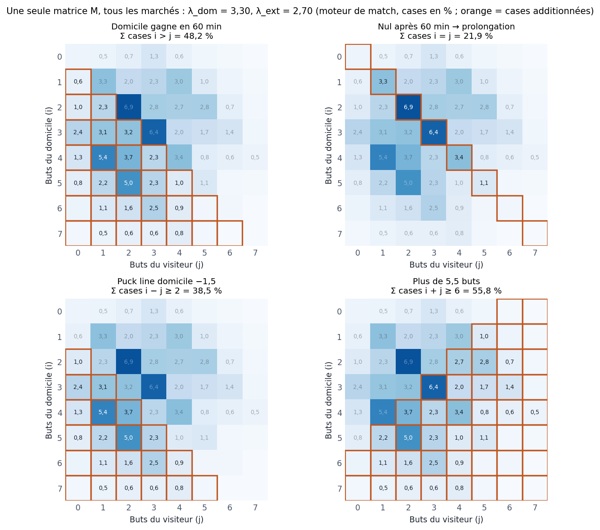

*La figure :* le match fictif du §11 (λ_dom 3,30, λ_ext 2,70), joué par le
moteur de match. Chaque case est la probabilité d'un score après 60 minutes ;
chaque marché est la somme des cases encadrées en orange. La victoire, le nul,
la puck line et le total viennent donc de la même grille et ne peuvent pas se
contredire. Le moneyline ajoute ensuite à « gagne en 60 min » la part des nuls
gagnés en prolongation (Σ M[i=j] × p_ot).

| Marché (`market_type`) | Formule |
|---|---|
| `moneyline` (victoire, prolongation incluse) | Σ M[i>j] + Σ M[i=j] × p_ot, sur la matrice **recalée** par la couche de correction (§4.3) |
| `regulation_result` (gagne en 60 min) | Σ M[i>j] |
| `game_to_ot` (va en prolongation) | Σ M[i=j] |
| `ot_so_winner` (gagne en prolongation/fusillade) | Σ M[i=j] × p_ot |
| `ot_winner` (gagne la prolongation, sachant qu'il y en a une) | p_ot |
| `puck_line` −1,5 | Σ M[i−j ≥ 2] (un match en prolongation finit toujours à 1 but d'écart) |
| `puck_line` autre ligne (−2,5, +1,5…) | sur la grille du **score final** F : Σ F[i−j + ligne > 0] |
| `alt_puck_line` | Σ M[i−j ≥ 3] |
| `total_goals_over` / `_under` (ligne L) | loi du total FINAL : un nul k–k devient 2k+1 buts ; P(total > L) / P(total < L) |
| `team_total_goals` | loi des buts FINAUX du sujet (il gagne +1 en prolongation avec p_ot) ; P(> L), et 1 − P(> L) pour la sélection « under » |
| `both_teams_score` | 1 − P(dom = 0) − P(ext = 0) + P(0–0) ; pour « 2+ / 3+ » : Σ M[i>L, j>L] |
| `clean_sheet` (l'adversaire ne marque pas) | score FINAL : Σ M[·][0] − M[0][0] × (1 − p_ot) — un 0-0 perdu en prolongation n'est pas un blanchissage |
| `winning_margin` (par 1 / par 2 / par 3+) | écart exact dans M ; « par 1 » reçoit en plus toute la masse des nuls × (p_ot ou 1−p_ot) |
| `correct_score` (ex. « 3-2 ») | case de la grille du score final F (les nuls k–k sont déplacés en k+1–k ou k–k+1) |
| `period1_winner`, `period2_winner` (mène après P1/P2, buts cumulés) | moteur de match : loi de l'avance à 20' / 40' → P(mène), P(égalité). Repli sans `game_dynamics.json` : deux Poisson de moyennes λ × 0,305 ou λ × 0,67 |
| `period{1,2,3}_total_goals` | moteur de match : loi des buts DANS la période (la 3e dépend du score à 40') ; P(> L). Repli : Poisson de moyenne (λ_dom + λ_ext) × 30,5 % / 36,5 % / 33,0 % |
| `period3_winner` | = gagne en 60 min (Σ M[i>j]) ; égalité = prolongation |
| `highest_scoring_period` | moteur de match : loi jointe (buts P1, P2, P3) → P(cette période a strictement le plus de buts), égalité en tête = issue `tie`. Repli : parts fixes 30,5 / 36,5 / 33,0 % |

**Toujours :** les probabilités sont bornées à [2 %, 98 %] (sauf le score exact,
borné à [0, 98 %]). La réponse porte l'entier d'affichage (`probability`) ET la
valeur exacte en 0–1 (`probability_exact`), qui sert à tous les calculs (edge, EV).

**Côté du sujet.** Toutes les formules sont écrites pour le domicile. Si la
question porte sur le visiteur, le service **transpose** la matrice (M → Mᵀ),
échange λ_dom/λ_ext et remplace p_ot par 1 − p_ot : les mêmes formules
répondent alors pour le visiteur.

**Côté « non » / « moins ».** Pour un marché oui/non (BTTS, blanchissage,
prolongation, puck line, but en AN, désavantage, marque à chaque période), le
côté « non » vaut 100 − P(oui). Pour un plus/moins dont le côté est dans la
sélection (total d'équipe, totaux par période), « moins » vaut 100 − P(plus).

**Marchés qui ne sortent PAS de la matrice** (heuristiques déclarées, §6.11) :
`team_pp_goals`, `team_penalty_kill`, `team_score_every_period`,
`first_team_score`, `last_team_score`, `double_chance`.

---

## 6. Ce que fait le service ML quand on lui demande une prédiction

Fichier : `ml/python/ml_service.py`. Point d'entrée principal :
`POST /predict/game/bundle` (un match, ~95 marchés d'un coup). Le travail est
fait une fois par match dans `_game_context`, puis chaque marché est lu dans
`_price_game_market`.

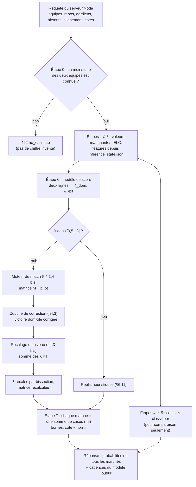

*Le schéma :* le chemin d'une requête, étape par étape ; les numéros renvoient
aux sous-sections ci-dessous. Tout le travail coûteux est fait une fois par
match, avant la boîte « Étape 7 » : ensuite, chaque marché n'est qu'une
lecture de la même matrice.

### 6.1 Au démarrage

Chargement de `game_model.json` (classifieur), `training_report.json` (liste des
features, Platt, mélange), `score_model.json` + `score_report.json` (τ, p_ot,
déciles), `game_dynamics.json` (moteur de match, §4.1.4 bis — remplace le τ du
rapport), `inference_state.json`, `elo_ratings.json`, `correction_layer.json`,
`level_layer.json` (recalage de niveau, §4.3 bis) et du modèle joueur. Chaque pièce manquante désactive seulement ce qui en dépend.

**ELO vieilli :** si `elo_ratings.json` date d'une saison précédente, chaque
note est ramenée vers 1500 en gardant 70 % de son écart par saison de retard —
la même régression qu'à l'entraînement (`season_regress`, écrit dans le fichier).

### 6.2 Étape 0 — « sait-on quelque chose sur ce match ? »

Si **aucune** des deux équipes n'est connue (ni dans l'état d'inférence, ni dans
l'ELO), réponse **422 « no_estimate »** plutôt qu'un chiffre inventé.

### 6.3 Étape 1 — valeurs manquantes

PP% / PK% absents → 20 % / 80 % (moyennes de ligue). Seulement s'ils sont absents.

### 6.4 Étape 2 — ELO

Note explicite si fournie, sinon lue dans `elo_ratings.json`, sinon 1500.
`elo_diff`, `elo_expected` comme au §3.7.

### 6.5 Étape 3 — features depuis l'état d'inférence

Pour chaque côté :
1. **Stats d'équipe** : toutes les valeurs `…_s` / `…_l` de l'équipe.
2. **Gardien** : si le serveur désigne le partant et qu'il fait partie des 2 gardiens suivis — apparié par **identifiant NHL** d'abord (le serveur traduit le nom saisi via l'effectif), par nom ensuite (sans accents, casse, points ni espaces en trop, comme pour les absents) → ses chiffres ; sinon la moyenne des 2 pondérée par leur part de départs récente. `goalie_backup` : partant nommé et connu → son drapeau ; nommé mais inconnu → 1 (relève) ; non nommé → le drapeau du gardien le plus utilisé.
3. **Star power** : top-5 de l'état moins les absents nommés (ou, sans noms, on retire les N meilleurs) ; `stars_out_weight` = somme des poids des joueurs-clés nommés absents.
4. **Alignement** : si l'alignement officiel (≥ 18 joueurs) est fourni → somme des 18 habillés (bassin de toute la ligue) ; sinon effectif récent moins absents ; on garde toujours les 18 plus gros temps de glace. Si moins de 12 joueurs sont reconnus → retour à l'effectif récent.
5. **Écarts** recalculés avec les mêmes formules qu'à l'entraînement.
6. **Repos / dos-à-dos** : ce sont les valeurs envoyées par le serveur Node (§7.1).

### 6.6 Étape 4 — cotes

Si le serveur envoie les cotes décimales : `market_home_p` dévigée, utilisée
comme `market_home_p_open` ET `market_home_p_close` du classifieur. (Le modèle
de score n'utilise jamais les cotes.)

### 6.7 Étape 5 — classifieur (pour information)

Vecteur de 15 features → XGBoost. Deux sorties : avec les cotes puis mélangé au
marché (repli si le modèle de score ne répond pas), et sans les cotes + Platt
(`probability_classifier`, pour comparaison).

### 6.8 Étape 6 — modèle de score

Deux lignes (attaque domicile / attaque visiteur) → XGBoost → λ_dom, λ_ext.
Garde-fou : si un λ sort de [0,5 ; 8], le modèle de score est ignoré pour ce
match (retour aux heuristiques). Sinon on construit la matrice M (moteur de
match, §4.1.4 bis) et p_ot, puis on la recale : victoire sur la couche de correction (§4.3), total de buts
sur le niveau de la saison (§4.3 bis).

**Facteurs affichés** (« pourquoi ce pronostic ») : XGBoost donne la
contribution exacte de chaque feature à log λ. Pour chaque feature :
`effet = contribution(ligne dom) − contribution(ligne ext)` (positif = pousse
vers le domicile), regroupé en 7 familles (avantage de la glace, force d'équipe,
gardien, alignement, calendrier, défense adverse, attaque) et exprimé en part
du total.

### 6.9 Étape 7 — prix de chaque marché

Pour chaque marché demandé : vue du sujet (§5), formule du §5, bornes, côté
« non » si demandé. Pour le moneyline : la couche de correction remplace la
valeur (vue du sujet : p ou 1 − p).

### 6.10 La « confiance » (jauge 38-90)

Purement de l'affichage (aucun tri ni filtre ne l'utilise) :

```
rang       = position de |λ_dom − λ_ext| dans les déciles de l'entraînement (0 à 1)
base       = 0,45 + 0,47 × rang
confidence = borne(base × multiplicateur_du_marché, 0,38, 0,90) × 100
```

Multiplicateurs : 1,00 moneyline, 0,92 puck line, 0,90 nul/BTTS/victoire en 60 min,
0,88 totaux/blanchissage, 0,85 totaux d'équipe/autres lignes, 0,80 ot_so_winner,
0,78 écart, 0,74 périodes, 0,72 ot_winner, 0,70 score exact, 0,60 période la plus prolifique.

### 6.11 Les replis (heuristiques) — quand il n'y a pas de modèle de score

Si le modèle de score est absent ou rejeté pour ce match, `base_prob` vient du
classifieur (ou, sans classifieur, d'une régression logistique écrite à la
main sur win%, buts, PP/PK et forme L10), et chaque marché utilise une règle
simple : puck line = base × 0,60 (favori), totaux = Poisson sur
λ = buts pour/match des deux équipes, nul = 20 % + proximité des win%, etc.
Les marchés sans règle crédible (écart de victoire, pénalités, inconnus)
renvoient « pas d'estimation ».

Quelques marchés utilisent TOUJOURS une règle, même avec le modèle de score :

| Marché | Règle |
|---|---|
| `team_pp_goals` (marque en AN) | 1 − e^(−3,1 × PP%) (3,1 avantages par match en moyenne) |
| `team_penalty_kill` (tue toutes ses pénalités) | PK% ^ 3,1 |
| `team_score_every_period` | (1 − e^(−λ/3))³ |
| `first_team_score` | λ_sujet / (λ_sujet + λ_adv), borné [35 %, 65 %] |
| `last_team_score` | 50 % + (p_victoire − 50 %) × 0,65 |
| `double_chance` | p × 0,85 + P(nul) × p_ot |

### 6.12 Les autres routes

- **`/predict/player`** : PAS le modèle joueur entraîné. Une simple Poisson sur la moyenne de saison envoyée par le serveur (`P(X > ligne)`), bornée [5 %, 95 %] ; mises en échec, tirs bloqués, arrêts, victoires… passent par le champ `shots_per_game`. **Depuis le 2026-10-15, ce n'est plus qu'un repli** : un pari joueur demandé à l'unité (`POST /api/predict/ml`, type `player`) est d'abord chiffré par le serveur Node sur la cadence du modèle joueur du paquet du match (`server/src/services/prediction/playerModelPrediction.ts` : match fourni ou prochain match du joueur, binomiale négative avec le k du modèle, plafond 97 comme les grilles). La Poisson ne sert plus que pour les gardiens, les recrues absentes de l'état, un joueur sans match dans les 14 jours, un match en cours ou un service ML en panne.
- **`/predict/team`** (Coupe, finale de conférence, séries) : probabilité a priori selon le rang de conférence (table fixe) + petits ajustements selon win%, différentiel de buts, PP/PK.
- **`/predict/game`** : un seul marché (même calcul que le paquet).
- **Cadences joueur dans le paquet** : si le serveur envoie les identifiants des joueurs, le paquet renvoie aussi, pour chacun, la cadence par match des 8 statistiques du modèle joueur (§4.4), avec son k.

---

## 7. Ce que fait le serveur Node avec ces chiffres

### 7.1 Ce que le serveur envoie — `featureEngineering.ts → buildGameFeatures`

- Fiches d'équipe (win%, buts pour/contre, L10, séries, tirs, mises au jeu, PP/PK).
- **Repos** (`nhl/restTravel.ts`), mesuré à la **date du match** : jours depuis le match de saison régulière précédent (terminé, ou prévu entre aujourd'hui et la veille du match), plafonnés à 7 ; dos-à-dos si = 1 ; nombre de matchs dans les 3 jours précédents. Aucun match joué cette saison (calendrier publié) → 7 jours, comme le premier match de saison à l'entraînement ; calendrier vide ou API en panne → repli 2 jours.
- Cotes en direct (The Odds API) si disponibles.
- **Gardiens partants** (nom saisi + identifiant NHL résolu via l'effectif, `goalieIds.ts`) et **absents** saisis à la main (`/dev/saisie`, table `manual_data`).
- **Alignement officiel** (API NHL) quand il est publié.
- Abréviations des deux équipes (pour l'ELO et l'état d'inférence).

Seules les variables ci-dessus qui alimentent l'état d'inférence, le gardien,
les absents, l'alignement, le repos et les cotes changent réellement la
probabilité servie. Win%, buts/match, PP/PK… ne servent qu'aux replis.

### 7.2 Le paquet d'un match — `gameMlBundle.ts`

1. La liste des tuiles de la page match fournit les marchés à demander (+ quelques extras pour les pages équipe/joueur).
2. Les features sont construites **une fois**, côté domicile, à la **date du match** (repos, gardien saisi et absents de ce jour-là) ; chaque marché porte son côté (`subject_is_home`).
3. Un appel `/predict/game/bundle` ; résultat **mis en cache 10 minutes** par match.
4. Les tuiles « gagne en 60 min » (ml-home / ml-away) demandent `regulation_result`.

**En direct** (`applyLive`, cache 30 s, 10 s en fin de match) : le modèle reste d'avant-match. Le
serveur prend 3 chiffres du paquet — victoire domicile, P(prolongation), λ total
— et les injecte dans la grille « score actuel + buts restants » des règles
(`buildLiveModelMarkets`), avec des effets de score mesurés
(`calibrate_live.py` → `liveEffects.json`). Détail complet : §10.

### 7.3 Les cadences joueur — `prediction/playerRates.ts`

Règle par défaut, pour chaque joueur et statistique :

```
λ = (total de la saison + m × a priori de poste) / (matchs joués + m)     (m = 4 à 12 matchs fictifs)
λ × facteur adversaire  (buts/points ∝ buts concédés par l'adversaire, tirs ∝ tirs concédés…, borné ±10-15 %)
```

Si le paquet ML porte des cadences du **modèle joueur**, elles **remplacent**
la règle pour ce joueur (sauf recrues inconnues). Les **arrêts d'un gardien**
viennent du **modèle de tirs** (§4.5) quand le paquet en porte pour lui
(`goalieSaves`, k `savesDispersion`) ; sinon la règle. Les seuils
« 1+, 2+, 3+ » sont ensuite lus côté client avec une binomiale négative de
paramètre k. Premier buteur : `(λ_buts du joueur / λ_buts du match) × (1 − e^(−λ_match))`, où λ_match = λ_dom + λ_ext du modèle de score quand le paquet ML est disponible (sinon l'estimation des règles).

### 7.4 Les value bets — `valueBets.service.ts`

Critère unique, partagé par l'accueil et l'alerte push :

1. Match **du jour** (heure de l'Est), **pas commencé**.
2. **Les deux gardiens partants saisis** à la main.
3. Probabilité du paquet ML **non arrondie** (`probability_exact`), seulement si le modèle de score a répondu.
4. Probabilité du marché dévigée chez le **livre d'affichage** (`ODDS_BOOKMAKERS`, défaut BetRivers ; liste par ordre de préférence, par ex. `bet99_ca_on,betrivers`), les deux prix du même livre.
5. Règles :
   - **moneyline** : edge entre **2 % et 6 %** ;
   - **puck line −1,5** (côté qui donne les buts) : edge ≥ **4 %** ;
   - et EV = p × cote − 1 ≥ 0.
   - Les totaux sont exclus (pas d'avantage mesuré).
6. **Cote minimale** affichée = 1 / p_modèle (seuil de rentabilité selon le modèle).
7. Chaque value bet est journalisé (`value_bet_log`) pour mesurer le CLV.

### 7.5 Les « best bets » — `bestBets.service.ts`

Différent des value bets : on construit des candidats (moneyline, totaux, puck
line, quelques props joueur) et on les chiffre TOUS avec le paquet ML de leur
match — le même que la page du match (paris joueur : cadences du modèle joueur,
P(X ≥ k)). Un joueur inconnu du modèle n'a pas de score ML. On trie ensuite par
probabilité : c'est un classement des issues **les plus probables**, pas des
paris les plus rentables ; l'EV au prix du livre (`ev`) est donnée pour
information quand un prix existe.


### 7.5 bis Premier but, dernier but, marque à chaque période, double chance (2026-10-15)

- **Premier but, dernier but, marque à chaque période** : joués par le moteur de match (`game_dynamics.team_events`, états augmentés de qui a marqué en premier / en dernier et de qui a marqué dans chaque période ; but de prolongation compté dans 64,9 % des prolongations, fusillade exclue comme au règlement). Mesuré contre les formules qu'ils remplacent (`explore_score/s8_marches_equipe.py`) : jamais moins bons, gain sous le seuil (z 0,2 / 1,9 / 1,7) — servis pour la cohérence avec le reste de la grille ; formules en repli sans `game_dynamics.json`.
- **Double chance (60 minutes)** : nouveau marché `double_chance`. Sélection = une équipe (« elle gagne en 60 OU égalité après 60 ») ou `no_draw` (« l'une des deux gagne en 60 »). Service ML : lu sur la grille (1X = 1 − « l'adversaire gagne en 60 », 12 = 1 − P(nul à 60')). Page match : groupe « Double Chance » recombiné depuis les tuiles finales de Match Betting. Coupon : trois options dans le sélecteur. Règlement : sur le score après 60 minutes. Non branché dans les corrélations du coupon (multiplié, signalé).

### 7.6 Le coupon d'un même match — `parlayProbability.ts`, `prediction/gameParlay.ts`

Les jambes lisibles sur le score final (vainqueur, totaux, handicap…) sont
combinées sur la loi jointe des scores : le facteur P(toutes) / ∏ P(chacune),
lu sur la grille, multiplie le produit des chiffres affichés. Depuis le
2026-10-15, **une** jambe joueur par match y entre aussi — « marque » (ligne 0,5)
ou « 1+ point » : sachant que son équipe a marqué n buts comptables, elle passe
avec 1 − (1 − s)^n, où s = cadence / buts comptables attendus de son équipe
(cadence tirée du chiffre affiché, μ = −ln(1 − p)). Les prolongations sont
tranchées par un but dans 64,9 % des cas (sinon fusillade, qui ne compte pour
aucun joueur). Le résultat ne dépasse jamais la jambe la moins probable. Les
autres props joueur (2+ buts, tirs…) et une seconde jambe joueur du même match
restent au produit, et `assumesIndependence` le signale. Mesure : §4.4,
`explore_players/README.md`.
---

## 8. Comment on sait si le modèle est bon (évaluation)

| Mesure | Fichier | Chiffre clé |
|---|---|---|
| Modèle de score, test 2023-02 → 2026-09 (4 305 matchs) | `score_report.json` | log-loss moneyline 0,6632 ; nuls prédits 21,4 % / observés 22,1 % ; −1,5 prédit 33,5 % / observé 33,2 % ; erreur moyenne sur le total 1,88 but (constante : 1,90) |
| Classifieur, même test | `training_report.json` | log-loss 0,6644 ; ELO seul 0,6704 |
| Contre le marché, même test (2 628 matchs cotés) | `training_report.json`, `score_report.json` | marché 0,6705 ; modèle de score 0,6714 ; classifieur ⊕ marché 0,6722 → **le marché reste légèrement meilleur** |
| Walk-forward moneyline (classifieur ⊕ marché, cotes de clôture) | `backtest_walkforward_report.json` | log-loss modèle 0,6689 vs marché 0,6677 ; ROI flat SBRO ≈ −1,5 à 0 % ; DraftKings 2025 +1 à +3 % sur 300-600 paris (non significatif) |
| CLV (ouverture vs clôture, DraftKings) | `backtest_clv_report.json` | les paris à edge ≥ 2 % prennent en moyenne +0,35 point de probabilité à la clôture (t ≈ 7,9), mais ROI à l'ouverture ≈ 0 ± 2,7 % |
| Modèle joueur, chaque été | `python train_player.py --recent` | Réentraîne passes, points, tirs, mises en échec, tirs bloqués et points en AN jusqu'à la saison qui vient de finir (buts et pénalités ne bougent pas), puis le recalage. Committer `models/player/` et `player_report.json`. |
| Couche de correction | `correction_report.json` | log-loss −0,0026 (z −3,9), 12 saisons sur 12 meilleures ; jeu égal avec la clôture |
| Recalage de niveau des buts | `level_report.json` | déviance du total −0,0032 (z −3,2), 8 saisons sur 11 ; P(> 5,5) 2023-26 58,4 % → 55,8 % (observé 56,0 %) |
| Modèle joueur, test 2023-26 | `player_report.json` | bat la règle sur les 8 statistiques |

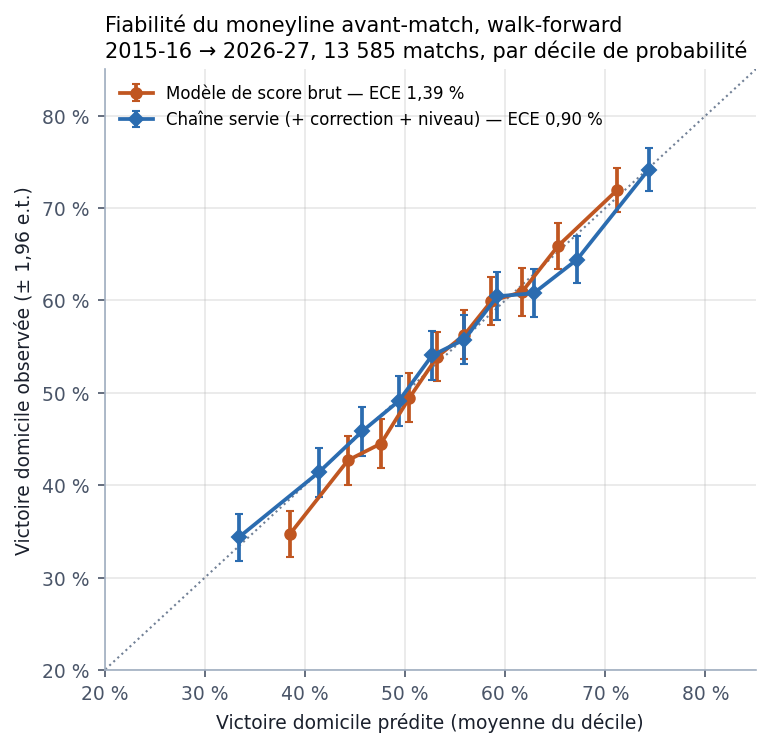

*La figure :* chaque saison est chiffrée par des modèles et des couches ajustés
sur les saisons d'avant seulement (`served_pregame.csv`), puis les matchs sont
rangés en déciles de probabilité. Sur la diagonale, « 60 % » veut dire « gagne
6 fois sur 10 ». Le modèle brut reste dans une fourchette trop étroite (il est
trop prudent) ; la chaîne servie, avec la couche de correction et le recalage,
écarte ses probabilités et colle mieux à la diagonale (ECE plus bas). Les
barres d'erreur rappellent qu'un décile, c'est environ 1 300 matchs : un écart
de 2 points y reste du bruit.

**En clair :** le modèle est bien calibré (quand il dit 60 %, c'est ~60 %) et
nettement meilleur que des règles simples, mais **il ne bat pas encore la cote
de clôture** du marché sur le moneyline. Les value bets restent donc à
considérer comme un pari sur un petit avantage non prouvé.

---

## 9. Mise à jour : rafraîchir et réentraîner

| Quand | Commande | Ce que ça change |
|---|---|---|
| Avant un backtest sur les cotes récentes | `npm run odds:export-snapshots` (dans `server/`, avec la `DATABASE_URL` de production) | Écrit `ml/data/odds_snapshots_live.csv` : la collecte live, tous livres. Le backtest la lit en plus du backfill et juge chaque livre séparément (BET99 aura sa propre ligne dans `--served` quand il aura assez de matchs). |
| Chaque semaine (tâche planifiée Windows `ml/refresh-data.cmd`) | `python refresh_data.py` | Nouvelles données de la saison en cours → `inference_state.json`, `elo_ratings.json`, le recalage de niveau de la saison → `level_layer.json`, et le moteur de match → `game_dynamics.json`. **Mêmes modèles.** Il faut ensuite committer ces 4 fichiers et pousser (le service embarque `ml/models/` dans son image). |
| Moteur de match seul | `python game_dynamics.py` (`--check` pour contrôler le fichier en place) | Réécrit `game_dynamics.json` : τ glissant + table c sur les 3 dernières saisons complètes. Aussi lancé à la fin de `train_score.py`. |
| Réentraînement (mensuel) | `python build_dataset.py && python train_score.py && python train.py && python train_player.py && python train_shots.py` | Nouveaux modèles + rapports. |
| Couche de correction | `python backtest_walkforward.py --correction --write-layer` | Réécrit `correction_layer.json` seulement si le verdict est « ADOPTER ». |
| Recalage de niveau (re-mesure) | `python live_pregame.py && python measure_level.py` | Réécrit `level_report.json` (verdict, force n0). `refresh_data.py` le lit : verdict « REJETER » → k = 1. |
| Contrôles | `python backtest.py`, `python backtest_walkforward.py [--clv|--derived|--market-gap]` | Rapports dans `ml/models/*_report.json`. |
| Règles des value bets | `python backtest_walkforward.py --served` | Rejoue la chaîne servie (modèle de score + correction + λ recalés) contre le prix du matin, avec la règle en service : ROI, CLV, placebo, verdict sur la règle et grille de bandes → `served_value_bets_report.json`. |
| Figures de ce document | `python doc_figures.py` (lancé aussi par `ml/refresh-data.cmd` après un refresh réussi) | Réécrit les 9 figures des §4 à §8 dans `ml/figures/` à partir des rapports et des CSV ci-dessus. Une figure dont la source manque est sautée, les autres sont écrites. `python doc_figures.py marges matrice` pour n'en refaire que quelques-unes. |

---

## 10. Le mode direct : prédire pendant le match

Pendant un match, chaque tuile de la page (victoire, puck line, totaux, buts
d'une équipe, props joueur…) est recalculée **toutes les 30 secondes** à partir
de l'état réel du match : score, période, horloge. Le modèle de score ne
tourne pas une seconde fois : on garde son avant-match et on **joue le reste du
match** avec un moteur dont les cadences de buts ont été **mesurées** sur
12 586 matchs. Cette section décrit ce moteur, la mesure de ses paramètres et
le rejeu qui a décidé de sa mise en service.

### 10.1 Le principe en une phrase

```
score final = score actuel + buts qui restent à marquer
buts restants : chaque équipe marque à la cadence  λ × w(t) × m(écart, moment)
```

- **λ** : buts attendus de l'équipe sur 60 minutes, **figé à l'avant-match**
  (paquet ML, λ recalés par la couche de correction et le recalage de niveau).
- **w(t)** : part des buts d'un match marqués à la seconde t. Elle suit
  `PERIOD_DIST` = 30,5 % / 36,5 % / 33 % des buts en 1re / 2e / 3e période,
  répartis uniformément dans la période (w = 0,305 / 1200 par seconde en 1re…).
- **m(écart, moment)** : le multiplicateur **mesuré** (§10.3). Il dit de
  combien une équipe marque plus ou moins que sa cadence normale selon qu'elle
  mène, est à égalité ou est menée, et à quel moment du match. Dans les deux
  dernières minutes, il dépend aussi de ce qu'un but a déjà été marqué depuis
  58:00 ou non (deux tables, §10.4).

Avec m ≡ 1, on retrouve deux lois de Poisson indépendantes sur le temps
restant (« phase 1 », la version d'avant le 2026-10-01). Les effets de score
(« phase 2 ») sont servis depuis le 2026-10-01.

### 10.2 Le chemin d'un recalcul

```
 avant-match (paquet ML, gardé 10 min) : victoire domicile, P(prolongation), λ_dom + λ_ext
        │
        ▼  à chaque recalcul en direct (30 s ; 10 s en fin de match)
 état du match (feuille NHL) : score, période, horloge, entracte, prolongation,
                               un but déjà marqué depuis 58:00 ou non
        │
        ├─ calage à la mise au jeu ─── λ_dom, λ_ext, facteur de nuls  (une fois par match)
        ├─ moteur ──────────────────── loi des buts restants (§10.4, §10.5)
        └─ grille du score final ───── toutes les tuiles (même lecture qu'avant le match, §5)
```

1. **Le match a-t-il commencé ?** Sinon, le paquet d'avant-match est renvoyé
   tel quel.
2. **Trois chiffres de l'avant-match** sont lus dans le paquet ML : victoire du
   domicile, probabilité de prolongation et λ total = λ_dom + λ_ext.
3. **Calage à la mise au jeu.** Le moteur, lancé à 0–0 avec 60 minutes à jouer,
   doit redire exactement l'avant-match. On garde λ total et on cherche par
   **bissection** le partage domicile / visiteur qui rend la victoire
   d'avant-match ; un facteur de nuls = [tie × (1 − t)] / [t × (1 − tie)] ramène
   ensuite la masse des égalités à 60 minutes (t, celle du moteur) au
   P(prolongation) du modèle (tie). Ce calage ne dépend que de l'avant-match :
   il est fait une fois par match.
4. **État du match** : score, temps réglementaire restant, prolongation en
   cours ou non, et si un but a déjà été marqué depuis 58:00 (§10.4).
5. **Le moteur** calcule la loi jointe des buts restants (§10.4, §10.5).
6. **La grille du score final** = score actuel + buts restants ; une égalité à
   60 minutes donne un but de plus au vainqueur de la prolongation (§4.1.5).
   Toutes les tuiles se lisent sur cette grille, exactement comme avant le
   match (§5) : elles restent **cohérentes entre elles** à chaque instant.
7. Chaque tuile recalculée est marquée « en direct », avec l'état utilisé
   (« 3–2, 3e, 01:00 restantes »). La probabilité exacte et l'incertitude
   d'avant-match sont effacées : elles ne décrivent plus le chiffre affiché.

Si une entrée manque (paquet incomplet, feuille de match illisible), les tuiles
gardent l'avant-match, affiché pâle. Un recalcul coûte quelques millisecondes
(§10.5) et le calage ≈ 120 ms une fois par match ; le service ML n'est pas
appelé pendant le match, et le nombre de recalculs ne dépend pas du nombre de
spectateurs (un par match et par fenêtre de rafraîchissement).

**Fraîcheur : ce que coûte un chiffre en retard.** Un rejeu dédié (3 903 matchs
2023-26, vrai moteur) note, à l'instant t, la prédiction faite avec l'état du
match à t − s, sur les 10 questions du rejeu §10.6. Hausse de la log-loss par
rapport à un chiffre frais (retard en secondes de jeu) :

| Moment | 10 s | 20 s | 30 s | 45 s | 60 s |
|---|---:|---:|---:|---:|---:|
| Reste du match (10e, 30e, 50e minute) | +0,3 % | +0,6 % | +0,8 % | +1,3 % | +1,6 % |
| 55e-58e minute | +1,6 % | +3,3 % | +5,2 % | +7,5 % | +9,1 % |
| **2 dernières minutes** | **+7,0 %** | **+13,3 %** | **+19,3 %** | **+27,1 %** | **+34,0 %** |

Tous les écarts sont significatifs. En milieu de match, le retard ne coûte
presque rien. Dans les deux dernières minutes, un chiffre en retard de 30 s
perd **19 %** de log-loss, autant que ce que les effets de score font gagner au
même moment (−17 % à −28 %, §10.6). Le retard en secondes de jeu est plus court
que le retard en secondes réelles (l'horloge s'arrête souvent en fin de match) :
ces chiffres sont un plafond.

**Décision.** Rafraîchissement toutes les 30 s pendant le match, et toutes les
**10 s en fin de match** (3e période à 5 minutes ou moins de la fin, et
prolongation), pour toute la page : tuiles du modèle, score et horloge, mode
règles. Retard attendu en fin de match : ≈ 15 s en moyenne, 30 s au plus,
contre jusqu'à environ 2 minutes auparavant — soit de l'ordre de +10 % de
log-loss au lieu de +19 % ou davantage dans les deux dernières minutes.

**Cas limites.**

| Situation | Ce qui est affiché |
|---|---|
| Entracte | Chiffres de début de la période suivante ; « entracte après la 2e » |
| Prolongation ou fusillade en cours | Vainqueur tiré à `p_ot_dom` (§4.1.5) ; totaux et handicaps à partir du score actuel + 1 but pour le vainqueur |
| Match suspendu ou reporté | L'avant-match |
| Feuille de match illisible | L'avant-match, affiché pâle |
| Chiffre d'avant-match manquant | L'état du match, avec les tuiles d'avant-match |
| But annulé après révision vidéo | Corrigé au prochain recalcul (rien n'est mémorisé d'un recalcul à l'autre) |
| Match terminé | Issues certaines (0 / 100 %) ; « score final 4–3 (OT) » |

**Retard réel en production.** Le retard attendu ci-dessus est un calcul. Pour
le mesurer sur de vrais matchs, la production comparée à l'API NHL est relevée
toutes les 2 s pendant une soirée : âge du score et de l'horloge affichés,
délai d'affichage de chaque but, en cours de match et en fin de match.

Première mesure, le 2026-10-19 au soir (heure de l'Est ; `live_lag_2026-10-20.md`) :
2 matchs relevés (surtout PIT@UTA, et la fin de SJS@TOR), 2 369 relevés, 6 buts.
Les chiffres sont en secondes réelles, côté serveur ; le retard affiché y ajoute
le rappel du client (la moitié de 30 s, ou de 10 s en fin de match, en moyenne).

| Moment | Relevés | Âge déclaré par le serveur (`asOf`), médiane / p90 | Âge de l'état servi, médiane / p90 | Délai des buts, médiane / max | Retard affiché moyen estimé |
|---|---:|---:|---:|---:|---:|
| En cours de match | 2 183 | 13,5 / 26,4 s | *non interprétable (voir ci-dessous)* | **17 / 31 s** (6 buts, tous affichés) | ≈ 30 s |
| Fin de match (3e ≤ 5 min, prolongation) | 186 | **3,5 / 9,1 s** | **14,5 / 28,6 s** | — (aucun but) | **≤ 21 s** |

- **Le serveur suit la feuille de match comme prévu.** Son propre âge déclaré
  vaut 13,5 s en médiane en cours de match, ce qu'on attend d'un recalcul
  toutes les 30 s (15 s en moyenne). En fin de match, il tombe à 3,5 s : le
  passage à 10 s fonctionne.
- **Les buts arrivent vite.** Les 6 buts vus à la source ont été servis en
  17 s en médiane, 31 s au plus, ce qu'autorise un cycle de 30 s. Aucun but
  n'est resté invisible.
- **En fin de match, le retard affiché est au plus ≈ 21 s** : 16 s de chaîne
  serveur et cache en moyenne, plus 5 s de rappel du client. Le calcul
  annonçait ≈ 15 s en moyenne et 30 s au plus ; le p90 mesuré (28,6 s, plus
  le rappel du client) reste dans cet ordre de grandeur. D'après le rejeu
  « Fraîcheur » ci-dessus, cela coûte de l'ordre de **+10 à +13 %** de log-loss
  dans les deux dernières minutes, contre +34 % pour un chiffre en retard d'une
  minute.
- **L'écart entre l'âge déclaré (3,5 s) et l'âge servi (14,5 s)** vient de ce
  qui se trouve après le serveur : le cache HTTP et le CDN, et le fait que la
  source mesurée (`score/now`) n'est pas la page que lit le serveur
  (`landing`). C'est la prochaine marge à gagner, si elle en vaut la peine.

**Limite de cette première mesure.** L'« âge de l'état servi » était mesuré
depuis le premier instant où la source avait montré cet état. Quand l'horloge
est arrêtée, et surtout pendant un entracte (≈ 18 min), cet âge grandit alors
que la production est à jour : d'où une médiane de 42,7 s et un maximum de
1 145 s en cours de match, qui ne disent rien du retard. En fin de match,
l'horloge s'arrête aussi souvent : 14,5 s est un **plafond**. Le script
mesure maintenant le retard depuis le moment où la source montre un état **plus
récent** que celui servi (0 si elle n'a pas bougé). Il écrit aussi un rapport
partiel toutes les 10 minutes, et s'arrête 20 minutes après le dernier match.
Deux matchs et 186 relevés de fin de match restent un petit échantillon.

<!-- À DÉVELOPPER
  - Refaire la mesure sur une soirée chargée avec le script corrigé (retard depuis un état plus récent) : retard en cours de match et en fin de match, avec des buts en fin de match.
-->

### 10.3 La calibration des effets de score (`calibrate_live.py`)

**Ce qu'on cherche.** Un match de hockey ne se joue pas à cadence constante.
Une équipe menée en fin de match pousse puis **retire son gardien** ; l'équipe
qui mène se replie mais marque dans le **filet désert** ; à égalité en fin de
3e, les deux équipes ferment le jeu. On mesure un multiplicateur m pour chaque
case **écart au score** (vu de l'équipe, borné à −3…+3) × **tranche de temps**,
de plus en plus fines en fin de match, là où le gardien sort :

| Tranche (temps écoulé) | 0-20' | 20-40' | 40-50' | 50-55' | 55-57' | 57-58' | 58-59' | 59-60' |
|---|---|---|---|---|---|---|---|---|

soit 8 × 7 = **56 multiplicateurs**.

**Les données.**

| Élément | Source | Volume |
|---|---|---|
| Buts horodatés (temps réglementaire) | Fichiers de tirs MoneyPuck → `fetch_live_goals.py` → `live_goals.csv` | Chaque match est contrôlé : ses buts doivent recoller au score réglementaire officiel, sinon il est **écarté** (jamais corrigé). |
| λ d'avant-match de chaque match | `live_pregame.py` → `live_pregame.csv` | **Hors échantillon** : pour la saison S, modèle de score entraîné sur les saisons < S seulement (walk-forward). Aucun match n'est chiffré par un modèle qui l'a vu. |
| Entraînement | 2012-13 → 2022-23 | **12 586 matchs, 70 280 buts** |
| Test (jamais vu par la calibration) | 2023-24 → 2025-26 | **3 903 matchs, 23 261 buts** |

**Le contrôle des données.** Un match n'est gardé que si ses buts MoneyPuck
recollent exactement au score réglementaire officiel (`nhl_games_v4.csv`), avec
les bonnes équipes et une séquence de scores sans trou :

| Saison | Matchs MoneyPuck | Gardés | Écartés : buts manquants | Absents de la référence |
|---|---:|---:|---:|---:|
| 2012-13 | 720 | 712 | 8 | 0 |
| 2013-14 | 1 230 | 1 210 | 20 | 0 |
| 2014-15 | 1 230 | 1 216 | 14 | 0 |
| 2015-16 | 1 230 | 1 213 | 17 | 0 |
| 2016-17 | 1 230 | 1 219 | 11 | 0 |
| 2017-18 | 1 271 | 1 246 | 20 | 5 |
| 2018-19 | 1 271 | 1 252 | 19 | 0 |
| 2019-20 | 1 082 | 1 067 | 15 | 0 |
| 2020-21 | 868 | 856 | 12 | 0 |
| 2021-22 | 1 311 | 1 299 | 7 | 5 |
| 2022-23 | 1 312 | 1 296 | 16 | 0 |
| 2023-24 | 1 312 | 1 295 | 17 | 0 |
| 2024-25 | 1 312 | 1 303 | 9 | 0 |
| 2025-26 | 1 312 | 1 305 | 7 | 0 |
| **Total** | **16 691** | **16 489** | **192 (1,15 %)** | **10** |

Les 192 matchs écartés ont tous la même cause : **il manque au moins un but**
dans le fichier MoneyPuck. Aucun match n'a de but en trop, d'équipes inversées
ou de séquence de score incohérente. Tous les matchs gardés ont un λ
d'avant-match (aucune perte à la jointure). L'exclusion retire de préférence
des matchs à buts ; à 1,15 % des matchs, son effet sur les multiplicateurs est
négligeable. Les saisons courtes (2012-13, 2019-20, 2020-21) sont celles du
lock-out et de la COVID.

**La méthode : maximum de vraisemblance d'exposition.** Le temps réglementaire
de chaque match est découpé aux buts et aux bornes des tranches. Sur chaque
morceau [t₀, t₁), l'état (écart, tranche) est constant ; chaque équipe y
accumule une **exposition**

```
E = λ_équipe × ∫ w(t) dt        (buts qu'elle « aurait dû » marquer à cadence normale)
```

dans la case de son état, et y marque 0 ou 1 but (O). La vraisemblance d'un
processus de comptage dont la cadence dépend de l'histoire passée vaut
Π cadence(tᵢ) × exp(−∫ cadence) ; son maximum, case par case, a une forme
fermée :

```
m(case) = buts observés / exposition = O / E
```

L'intérêt : le gardien retiré est capté **sans être modélisé**. Ses buts, pour
et contre, tombent d'eux-mêmes dans les cases « −1 / +1, dernières minutes ».

**Le rétrécissement des cases rares.** Une case comme « mène de 3 entre 59' et
60' » ne contient qu'une centaine de buts. On rétrécit vers 1 :

```
m = (O + a) / (E + a)
```

La force **a n'est pas fixée à la main** : elle est choisie par **validation
croisée saison par saison** (chaque saison d'entraînement est retirée à tour de
rôle, m est estimé sur les autres, puis noté par la log-vraisemblance de Poisson
de la saison retirée), sur la grille {0, 2, 5, 10, 20, 40, 80, 160}.

| a | 0 | **2** | 5 | 10 | 20 | 40 | 80 | 160 |
|---|---|---|---|---|---|---|---|---|
| Log-vraisemblance CV | 315 283,32 | **315 283,39** | 315 282,25 | 315 277,38 | 315 258,78 | 315 198,23 | 315 036,62 | 314 701,21 |

Choix : **a = 2**. Sans aucun effet (m ≡ 1), la log-vraisemblance vaut
311 981,63 : les effets de score rapportent **+3 301,8** points de
log-vraisemblance en validation croisée. Avec plus de 70 000 buts, les données
parlent d'elles-mêmes ; un rétrécissement fort (a ≥ 40) écrase les vrais effets
de fin de match et dégrade le score.

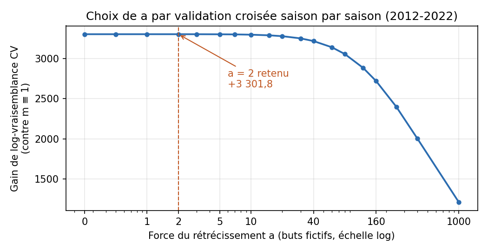

La courbe, sur une grille plus fine (`live_calibration_checks.py`), montre un
**plateau** : de a = 0 à a = 3, le gain varie de moins de 0,3 point. Le choix
précis de a dans cette zone n'a donc aucune importance pratique ; ce qui compte
est de **ne pas** rétrécir fort. Même à a = 1 000, où chaque case est tirée
vers 1 par l'équivalent de 1 000 buts fictifs, il reste +1 214 points : les
effets de fin de match sont trop massifs pour être effacés.

**Hors échantillon.** m est figé sur 2012-2022, puis noté sur les trois saisons
de test :

| Saison de test | Buts | Gain de log-vraisemblance (m mesuré contre m ≡ 1) |
|---|---:|---:|
| 2023-24 | 7 789 | **+343,0** |
| 2024-25 | 7 647 | **+458,1** |
| 2025-26 | 7 825 | **+450,7** |

Le gain se maintient sur chacune des trois saisons, sans réajustement.

**L'incertitude de chaque multiplicateur.** Intervalle de confiance à 95 % par
**bootstrap par match** (2 000 tirages de 12 586 matchs avec remise : les buts
d'un même match ne sont pas indépendants, on tire donc les matchs entiers), λ
d'avant-match tenus fixes. Une case marquée * a un intervalle qui exclut 1.

| Tranche | −3 | −2 | −1 | 0 | +1 | +2 | +3 |
|---|---|---|---|---|---|---|---|
| 0-20' | 1,03 [0,89-1,21] | 1,03 [0,97-1,11] | 1,00 [0,97-1,03] | 0,96 [0,94-0,98]* | 0,96 [0,93-0,99]* | 0,91 [0,84-0,98]* | 0,88 [0,75-1,01] |
| 20-40' | 0,99 [0,94-1,05] | 1,04 [1,00-1,08] | 1,01 [0,99-1,04] | 0,96 [0,93-0,98]* | 0,94 [0,91-0,96]* | 0,92 [0,88-0,95]* | 0,90 [0,86-0,95]* |
| 40-50' | 1,01 [0,95-1,08] | 1,01 [0,95-1,06] | 0,99 [0,95-1,04] | 0,93 [0,90-0,97]* | 0,90 [0,86-0,94]* | 0,93 [0,87-0,98]* | 0,88 [0,83-0,94]* |
| 50-55' | 0,97 [0,89-1,04] | 1,05 [0,98-1,14] | 1,01 [0,95-1,07] | 0,87 [0,82-0,92]* | 0,80 [0,74-0,85]* | 0,85 [0,78-0,92]* | 0,95 [0,88-1,03] |
| 55-57' | 0,96 [0,84-1,08] | 1,02 [0,90-1,15] | 0,95 [0,86-1,05] | 0,77 [0,69-0,85]* | 0,73 [0,65-0,81]* | 1,21 [1,08-1,35]* | 1,09 [0,98-1,21] |
| 57-58' | 1,01 [0,85-1,17] | 1,44 [1,22-1,67]* | 1,06 [0,91-1,21] | 0,73 [0,63-0,84]* | 0,93 [0,80-1,06] | 2,94 [2,65-3,24]* | 1,01 [0,86-1,16] |
| 58-59' | 1,05 [0,90-1,21] | 1,95 [1,69-2,21]* | 1,41 [1,24-1,60]* | 0,76 [0,66-0,87]* | 3,23 [2,97-3,49]* | 4,98 [4,58-5,38]* | 1,08 [0,93-1,24] |
| 59-60' | 0,83 [0,70-0,96]* | 2,03 [1,78-2,29]* | 2,61 [2,35-2,87]* | 0,64 [0,55-0,74]* | 7,35 [6,93-7,78]* | 6,43 [5,97-6,89]* | 0,77 [0,66-0,89]* |

**32 cases sur 56** s'écartent significativement de 1. Parmi les 24 autres,
15 sont du côté de l'équipe **menée avant la 57e minute** : tant que le gardien
n'est pas sorti, être mené ne change pas la cadence de façon mesurable. La
plupart des 9 restantes sont des écarts de 3 buts (matchs pliés, peu de buts
dans la case). Les grands effets de fin de match sont, eux, mesurés avec
précision : ×7,35 [6,93-7,78] dans le filet désert, ×2,61 [2,35-2,87] pour
l'équipe menée d'un but. Le rétrécissement (a = 2) ne protège donc que
quelques cases de coin, et la table servie n'est pas du bruit.

**La stabilité dans le temps.** Les mêmes cases, estimées saison par saison :

| Case | 2012-13 | 2015-16 | 2018-19 | 2021-22 | Étendue 2012-2022 | Test 2023 / 2024 / 2025 | Servi |
|---|---:|---:|---:|---:|---:|---:|---:|
| Mène de 1, 59-60' | 6,71 | 6,62 | 7,55 | 7,70 | 5,27 – 7,70 | 5,99 / 7,71 / 6,54 | 7,35 |
| Menée de 1, 59-60' | 1,68 | 2,15 | 2,52 | 2,89 | 1,68 – 2,89 | 2,22 / 2,53 / 2,30 | 2,61 |
| Égalité, 59-60' | 0,79 | 0,62 | 0,62 | 0,83 | 0,59 – 0,83 | 0,63 / 0,76 / 0,65 | 0,64 |
| Mène de 2, 58-59' | 3,33 | 4,77 | 5,31 | 5,18 | 3,33 – 5,31 | 4,60 / 4,66 / 5,57 | 4,98 |

Deux constats :

- **Les saisons varient plus que l'intervalle bootstrap.** « Menée de 1 »
  s'étend de 1,68 à 2,89 d'une saison à l'autre, quand l'intervalle de la table
  poolée n'est que [2,35-2,87]. Le bootstrap mesure le bruit d'échantillonnage,
  pas les changements de jeu d'une saison à l'autre : l'incertitude réelle d'une
  saison à venir est plus large que celle affichée.
- **Une dérive est visible** sur « mène de 2, 58-59' » : de ×3,3-3,9 en 2012-15 à
  ×4,1-5,6 depuis 2015. Les entraîneurs retirent leur gardien **de plus en plus
  tôt** quand ils sont menés de deux buts, ce qui donne plus de buts dans le
  filet désert dès la 58e minute. La table servie (×4,98) moyenne cette
  évolution ; c'est un argument pour recalibrer régulièrement sur une fenêtre
  récente plutôt que de garder 2012 dans l'entraînement.

**L'incertitude d'une saison à l'autre (bootstrap à deux niveaux).** Le
bootstrap par match tient les saisons pour acquises. Or chaque saison a son
style de jeu et ses λ, produits par un modèle d'avant-match différent
(walk-forward : un modèle par saison). On tire donc d'abord 11 saisons avec
remise, puis les matchs dans chaque saison tirée (1 000 tirages) :

- les intervalles s'élargissent d'un facteur **1,42** en médiane (de 1,11 à
  2,26 selon la case) ;
- **28 cases sur 56** restent significativement différentes de 1, au lieu de
  32. Les quatre qui basculent sont de petits effets : mène de 1 ou de 2 en
  1re période (×0,96, ×0,91), mène de 2 à 55-57' (×1,21), menée de 3 dans la
  dernière minute (×0,83) ;
- les effets qui comptent tiennent : ×7,35 [6,68-8,01] dans le filet désert,
  ×2,61 [2,26-2,98] pour l'équipe menée d'un but, ×4,98 [4,42-5,57] en menant de
  deux à 58-59'.

**Faut-il privilégier les saisons récentes ?** La dérive vue plus haut le
suggère. Pour chaque saison de test S, plusieurs tables sont ajustées sur les
saisons < S seulement, puis notées sur les buts de S
(`live_window_compare.py`). Écart de log-vraisemblance avec la table servie
(positif = meilleure), avec le z de l'écart apparié par match :

| Table, ajustée sur les saisons < S | 2023-24 | 2024-25 | 2025-26 | Total | z |
|---|---:|---:|---:|---:|---:|
| Servie, 2012-2022 figée (référence) | 0 | 0 | 0 | 0 | — |
| Croissante, 2012 → S−1 | 0,0 | +3,6 | +6,6 | +10,2 | 5,6 |
| Glissante, 3 dernières saisons | −5,3 | +9,9 | +14,6 | +19,2 | 1,9 |
| Glissante, 5 dernières saisons | −0,4 | +8,6 | +11,2 | +19,4 | 2,6 |
| Glissante, 7 dernières saisons | +1,6 | +8,2 | +13,5 | +23,3 | 4,1 |
| **Pondérée, demi-vie 3 saisons** | **+2,6** | **+10,6** | **+14,6** | **+27,8** | **4,8** |
| Pondérée, demi-vie 5 saisons | +2,3 | +8,8 | +12,9 | +24,1 | 5,6 |

La pondération récente gagne sur les trois saisons, et les fenêtres courtes
perdent en 2023-24 (trop peu de buts dans les cases rares). Mais le gain est
petit : la table servie rapporte déjà +1 252 points contre m ≡ 1 sur ces
saisons, la meilleure variante y ajoute 2,2 %. La table récente montre bien la
dérive (mène de 1 à 58-59' : ×3,75 contre ×3,23 ; mène de 2 à 57-58' : ×3,55
contre ×2,94).

Au rejeu des marchés (`server/scripts/replay-live-window.ts`, même protocole
que §10.6, table servie contre table « demi-vie 3 saisons » de chaque saison) :
log-loss cumulée **77 080,9 → 77 046,0 (−0,05 %)**, 5 cases significativement
meilleures, **aucune pire**, sur 50.

Décision : **la table servie reste en place** ; le gain ne justifie pas un
changement isolé. À la prochaine recalibration, pondérer les saisons par une
demi-vie de 3 saisons (jamais pire au rejeu) plutôt que de les compter à égalité.

Reproduire : `python live_calibration_checks.py` → `models/live/calibrate_live_checks.json`
et `figures/live_cv_shrink.png` ; `python live_window_compare.py` →
`models/live/live_window_report.json` et `live_effects_recent.json`, puis
`npx ts-node --transpile-only scripts/replay-live-window.ts 2023 2024 2025` →
`models/live/live_window_replay.md`.

### 10.4 Les multiplicateurs mesurés (`liveEffects.json`)

Lignes : tranche de temps écoulé. Colonnes : écart au score **vu de l'équipe
qui marque** (−1 = menée d'un but, +1 = mène d'un but). Dernière colonne : buts
d'entraînement tombés dans la tranche. C'est la **table unique**, la mesure de
référence de toute cette section (`m_single` dans `calibrate_live_report.json`) ;
depuis le 2026-10-19, les deux dernières minutes sont servies en deux tables
(« Correction : deux tables en fin de match », plus bas).

| Tranche | −3 | −2 | −1 | 0 | +1 | +2 | +3 | Buts |
|---|---:|---:|---:|---:|---:|---:|---:|---:|
| 0-20' (1re) | 1,03 | 1,03 | 1,00 | 0,96 | 0,96 | 0,91 | 0,88 | 20 691 |
| 20-40' (2e) | 0,99 | 1,04 | 1,01 | 0,96 | 0,94 | 0,92 | 0,90 | 24 727 |
| 40-50' | 1,01 | 1,01 | 0,99 | 0,93 | 0,90 | 0,93 | 0,88 | 10 946 |
| 50-55' | 0,97 | 1,06 | 1,01 | 0,87 | 0,80 | 0,85 | 0,95 | 5 306 |
| 55-57' | 0,96 | 1,02 | 0,95 | 0,77 | 0,73 | 1,21 | 1,09 | 2 151 |
| 57-58' | 1,01 | 1,44 | 1,06 | 0,73 | 0,93 | **2,94** | 1,01 | 1 379 |
| 58-59' | 1,05 | **1,95** | **1,41** | 0,76 | **3,23** | **4,98** | 1,08 | 2 161 |
| 59-60' | 0,83 | **2,03** | **2,61** | 0,64 | **7,35** | **6,43** | 0,77 | 2 919 |

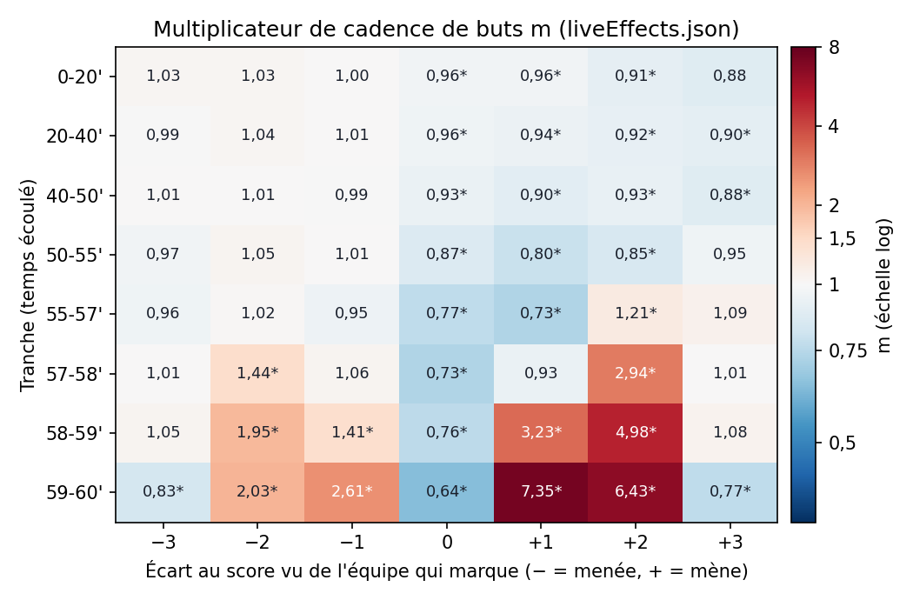

La même table en couleur (échelle logarithmique : bleu = l'équipe marque moins
que sa cadence normale, rouge = plus ; * = intervalle à 95 % qui exclut 1,
§10.3). Les 50 premières minutes forment un bloc presque blanc ; toute
l'information est dans le coin inférieur droit (filet désert) et dans la colonne
centrale (égalité, fin de match).

**Ce que la table raconte :**

- **Pendant 50 minutes, le score compte peu** : tous les m sont entre 0,88 et
  1,06. L'équipe qui mène ralentit légèrement (×0,90 à ×0,96), l'équipe menée
  ne s'emballe pas.
- **À égalité en fin de match, on ferme le jeu** : ×0,87 à 50-55', ×0,64 dans
  la dernière minute. Aucune équipe ne veut perdre le point de la prolongation.
- **Gardien retiré** : menée d'un but, une équipe marque ×1,41 à 58-59' et
  **×2,61** dans la dernière minute ; menée de deux, le retrait commence plus
  tôt (×1,44 dès 57-58').
- **Filet désert** : l'équipe qui mène d'un but marque **×7,35** dans la
  dernière minute, celle qui mène de deux ×2,94 → ×4,98 → ×6,43 de 57' à 60'.
- **Match plié** (écart de 3) : retour vers 1, voire en dessous (×0,77-0,83
  dans la dernière minute) — on ne retire plus le gardien.

**Contrôle de cohérence.** Le moteur de match d'avant-match (§4.1.4 bis)
mesure la même chose avec une autre fenêtre (3 dernières saisons, λ du modèle
servi). Les deux mesures, indépendantes, concordent dans la dernière minute :
×2,60 contre ×2,61 menée d'un but, ×7,69 contre ×7,35 en menant d'un but.

**Comparaison avec les études publiées.**

- *Hockey Graphs* (« The State of Goalie Pulling in the NHL », 2020) mesure
  qu'une équipe à 6 contre 5, gardien retiré, marque **≈ 6,5 buts par
  60 minutes**. Rapporté à la cadence moyenne d'une équipe dans nos données
  (2,78 buts par 60 min, `leagueLambda`), cela fait **×2,3**. Notre case
  « menée d'un but, 59-60' » vaut ×2,61, et elle mélange les secondes avec et
  sans gardien : l'ordre de grandeur concorde. La même étude trouve qu'une
  équipe menée d'un but qui retire son gardien égalise dans **≈ 15 %** des
  matchs. Notre exemple ci-dessous donne 12,1 % pour la seule dernière minute,
  et le retrait commence souvent plus tôt (×1,41 dès 58-59').
- *Asness & Brown* (« Pulling the Goalie: Hockey and Investment
  Implications », résumé par la Chicago Booth Review) concluent que retirer le
  gardien **multiplie environ par quatre** les chances de l'adversaire de
  marquer et **ne fait guère que doubler** celles de l'équipe qui le retire.
  Notre table montre la même asymétrie : ×7,35 pour l'équipe qui mène contre
  ×2,61 pour l'équipe menée dans la dernière minute.
- *Hockey Graphs* note aussi que les entraîneurs retirent leur gardien
  **≈ 30 secondes plus tôt** qu'il y a sept saisons quand ils sont menés d'un
  but. C'est cohérent avec la dérive mesurée au §10.3, qui apparaît chez nous
  surtout à deux buts d'écart.

Nos multiplicateurs sont donc en accord avec ce qui est publié, sans avoir été
ajustés sur ces études.

**Exemple.** Deux équipes à λ = 3,0, l'une mène 3–2 à une minute de la fin.
À cadence normale, chacune attend 3,0 × 0,33 / 20 = 0,0495 but dans la
dernière minute, soit 4,8 % de marquer. Avec les effets mesurés : l'équipe
menée attend 0,0495 × 2,61 = 0,129 but (**12,1 %** d'égaliser), l'équipe qui
mène 0,0495 × 7,35 = 0,364 but (**30,5 %** de marquer dans le filet désert).
Le « plus de 5,5 » (au moins un but de plus, d'un côté ou de l'autre) passe
ainsi de 9,4 % à cadence fixe à **38,9 %** — et c'est exactement sur ce type de
marché que le direct gagne le plus (§10.6).

**Biais connu : mesuré, et petit.** Une équipe plus forte que son λ
d'avant-match mène plus souvent ; mesurée avec ce λ, elle gonfle un peu m(mène)
et dégonfle m(menée). Le corriger avec un λ « mis à jour » par les buts déjà
marqués ne marche pas : ces buts mélangent la force réelle et les effets de
score qu'on cherche justement à mesurer. On le chiffre donc par **simulation**,
là où la vérité est connue (`live_effects_bias.py`) :

1. les 12 586 matchs d'entraînement sont rejoués 4 fois chacun, avec leurs
   vrais λ d'avant-match, la table servie comme **vraie** table m et le même
   pas de 10 s que le moteur ;
2. chaque équipe reçoit une **force cachée** u (loi gamma de moyenne 1,
   d'écart type σ) : sa vraie cadence est λ × u, mais l'estimateur ne voit que
   λ ;
3. m est ré-estimé exactement comme dans `calibrate_live.py`, et comparé à
   l'estimation sans force cachée (σ = 0). Trois graines par valeur de σ.

**L'estimateur est juste.** Sans force cachée, il retrouve la table d'entrée à
0,4 % près en médiane et 1,4 % au pire, sur les cases de plus de 1 000 buts.

**Le biais, selon la force cachée :**

| Case | σ = 0,15 | σ = 0,30 |
|---|---:|---:|
| Mène de 1, 59-60' | ×1,002 | ×0,995 |
| Menée de 1, 59-60' | ×0,966 | ×0,953 |
| Égalité, 59-60' | ×1,013 | ×0,936 |
| Mène de 2, 58-59' | ×1,018 | ×1,064 |
| Menée de 1, 58-59' | ×0,948 | ×0,953 |
| Mène de 1, 1re | ×1,006 | ×1,047 |
| Menée de 1, 1re | ×0,992 | ×0,965 |
| **Moyenne pondérée, équipe qui mène (+1, +2)** | **×1,010** | **×1,044** |
| **Moyenne pondérée, équipe menée (−1, −2)** | **×0,987** | **×0,945** |

Le sens est bien celui attendu (mène gonflé, menée dégonflé). Avec une force
cachée d'écart type 15 %, le biais reste autour de **±1 %**. Il faut supposer
30 % pour atteindre ±5 %.

**Quelle force cachée est plausible ?** La dispersion des buts réglementaires
autour de λ, (E[(G − μ)²] − E[μ]) / E[μ²], vaut **−0,018** sur les vrais
matchs, contre −0,004 en simulation sans force cachée, +0,016 avec σ = 0,15 et
+0,078 avec σ = 0,30. Les vrais matchs sont donc **moins** dispersés que même
la simulation sans force cachée : aucune force cachée n'est détectable. Le
hockey est connu pour avoir des buts légèrement sous-dispersés, ce qui peut
masquer une petite hétérogénéité, mais σ = 0,30 est clairement exclu. Le biais
réel de la table servie est donc de l'ordre de **1 % ou moins**, bien
en dessous de l'incertitude statistique des cases (§10.3) et de leur variation
d'une saison à l'autre. Aucune correction n'est nécessaire.

**D'où vient la sous-dispersion ?** (`live_dispersion.py`). Rapport
Var(G − μ) / E[μ] des buts d'une équipe autour de son λ (1 = Poisson), observé
et simulé sans force cachée avec la table servie :

| Période | Observé | Simulé (table m) |
|---|---:|---:|
| 1re période | 0,958 | 0,982 |
| 2e période | 0,952 | 0,977 |
| 3e, 40-57' | 0,970 | 0,993 |
| 3e, 57-60' | 0,939 | 1,036 |
| 60 min, par équipe | 0,950 | 0,989 |
| 60 min, total des deux équipes | 0,919 | 0,986 |

| Situation du but | Part des buts | Rapport | Corrélation domicile / visiteur |
|---|---:|---:|---:|
| Égalité numérique (EV) | 69,8 % | 0,965 | +0,02 |
| Avantage numérique (PP) | 22,7 % | **0,916** | +0,08 |
| Infériorité numérique (SH) | 2,5 % | 1,005 | +0,01 |
| Filet désert (EN) | 5,0 % | 0,986 | **−0,14** |

1. **Ce n'est pas une erreur de λ.** Toute erreur sur λ, de niveau ou de
   partage entre les équipes, AJOUTE de la variance et pousse le rapport
   au-dessus de 1. Le déficit vient du déroulement du match lui-même.
2. **Il est présent toute la partie**, ≈ 2,5 points sous la simulation dans
   chaque période : ce n'est pas un effet de score. C'est l'**avantage
   numérique**, la catégorie la plus sous-dispersée (0,916) : une pénalité
   mineure s'arrête au premier but, et les pénalités s'alternent (62,8 % de
   pénalités de compensation, §10.7). Les buts en avantage sont donc plus
   réguliers qu'une Poisson. La corrélation positive entre les deux équipes
   (+0,08) est la trace de cette alternance.
3. **En fin de match, la table exagère les buts répétés.** Simulée, la table
   prédit une sur-dispersion dans les trois dernières minutes (1,036) : l'équipe
   qui mène peut y marquer plusieurs fois dans le filet désert à ×7. En réalité
   (0,939), un but dans le filet désert met le plus souvent fin à la poussée,
   et une seule équipe marque dans cette situation (corrélation −0,14).
4. Les buts à égalité numérique restent un peu sous-dispersés (0,965) : le
   reste n'est pas expliqué (effets de score plus fins que la table).

Conséquences. La table m n'est pas biaisée par cette sous-dispersion : son
estimateur (buts / exposition) ne suppose pas de variance Poisson, et le
bootstrap par match (§10.3) non plus. Le moteur, lui, tire des buts Poisson : il
surestime la variance des buts restants (mesure ci-dessous). Enfin, le test de
force cachée ci-dessus est prudent : même les buts à égalité numérique seuls
(0,965) ne montrent aucune sur-dispersion.

**L'effet sur les extrêmes, mesuré au rejeu** (`server/scripts/replay-live-tails.ts`,
3 903 matchs 2023-26). À six moments, la loi des buts réglementaires RESTANTS
donnée par le moteur (calé comme en production) est comparée à ce qui s'est
passé. Le rapport de variance vaut Σ(N − E[N])² / Σ Var[N] : 1 si le moteur a
la bonne dispersion, < 1 s'il la surestime.

| Moment | Buts restants, prédit / observé | Rapport de variance | P(0 but) prédit / observé | P(≥ 2 buts) prédit / observé | P(≥ 3 buts) prédit / observé |
|---|---:|---:|---:|---:|---:|
| Fin de la 2e | 2,19 / 2,14 | 0,89 | 11,0 / 10,5 % | 64,5 / 64,9 % | 37,5 / 36,4 % |
| 10 min restantes | 1,22 / 1,23 | 0,87 | 29,2 / 25,8 % ⚠ | 34,5 / 34,6 % | 12,4 / 11,2 % ⚠ |
| 5 min restantes | 0,76 / 0,79 | 0,85 | 46,6 / 41,1 % ⚠ | 17,4 / 16,8 % | 4,0 / 3,1 % ⚠ |
| 3 min restantes | 0,56 / 0,58 | 0,80 | 57,3 / 52,4 % ⚠ | 11,0 / 9,3 % ⚠ | 2,0 / 1,0 % ⚠ |
| 2 min restantes | 0,43 / 0,44 | 0,79 | 65,5 / 61,9 % ⚠ | 7,6 / 5,5 % ⚠ | 1,1 / 0,4 % ⚠ |
| 1 min restante | 0,24 / 0,24 | 0,81 | 79,0 / 77,4 % ⚠ | 3,0 / 1,3 % ⚠ | 0,3 / 0,0 % ⚠ |

⚠ = écart significatif (|z| > 2, variance Σ p(1 − p)).

- **La moyenne est juste, la forme ne l'est pas.** Le moteur prédit le bon
  nombre de buts restants, mais trop de « aucun but » ET trop de « deux buts
  ou plus » : la réalité concentre la masse sur **exactement un but**. Sa
  variance est surestimée de 11 % en fin de 2e, et de **20 %** dans les trois
  dernières minutes.
- **Les longs coups de fin de match sont surpayés.** À 2 minutes de la fin,
  « au moins deux buts de plus » vaut 7,6 % pour le moteur et 5,5 % en réalité
  (×1,4) ; à 1 minute, 3,0 % contre 1,3 % (×2,3). Ce sont exactement les paris
  qui en ont besoin : une équipe menée d'un but qui gagne en temps
  réglementaire, un « plus de » qui manque de deux buts, un −1,5 à égalité.
- **Les tuiles moyennes, elles, restent calées** (prédit moyen contre observé
  sur toutes les situations, plus de 5,5, plus de 6,5, −1,5, buts d'une équipe,
  prolongation : écarts de 0 à 1,4 point). Les erreurs ne sont visibles que
  conditionnellement, dans les situations qui demandent deux buts ; on en voit
  la trace sur « plus de 6,5 » à une minute de la fin (45,4 % prédit, 44,8 %
  observé, z −2,4). L'autre écart persistant (« visiteur −1,5 » sous-estimé d'environ 1 point, z ≈ 2,5)
  existe dès la fin de la 2e période : il vient de l'avant-match, pas de la
  dispersion.

**Correction : deux tables en fin de match** (`calibrate_live.py`, servie
depuis le 2026-10-19). D'où vient l'excès de « deux buts ou plus » ? En coupant
les buts de fin de match selon qu'un but a déjà été marqué depuis le début de la
fin de match ou non, la cadence n'est pas la même : **après un premier but, le
jeu ralentit** dans presque toutes les cases. Un but dans le filet désert met
fin à la poussée de l'équipe menée ; une égalisation renvoie à la prudence de
l'égalité. Une seule table mélange ces deux régimes : elle sous-estime le
premier but et surestime le second.

La table est donc mesurée deux fois à partir du début de la fin de match :
`m` (aucun but marqué depuis ce début) et `mAfterGoal` (au moins un).
`mAfterGoal` est rétréci vers `m`, pas vers 1. Le début (55:00, 57:00 ou 58:00)
et la force du rétrécissement b sont choisis ensemble par validation croisée
saison par saison. Résultat : **58:00, b = 5** (+141,9 points de
log-vraisemblance en CV contre une seule table ; 55:00 donnait +120,8). Le zéro
est exclu de la grille de b : sans rétrécissement, une case « après un but »
sans but observé vaudrait 0, une cadence nulle servie telle quelle. Sur les
saisons de test, les deux tables gagnent sur les buts chaque saison (+8,1,
+21,8 et +14,8 points).

| Tranche | Table | −3 | −2 | −1 | 0 | +1 | +2 | +3 |
|---|---|---:|---:|---:|---:|---:|---:|---:|
| 58-59' | `m` (pas encore de but depuis 58:00) | 1,13 | 2,13 | 1,46 | 0,75 | 3,28 | 5,41 | 1,17 |
| 58-59' | `mAfterGoal` (un but depuis 58:00) | 0,57 | 1,06 | 0,77 | 0,83 | 2,66 | 2,88 | 0,47 |
| 59-60' | `m` | 0,96 | 2,60 | 2,77 | 0,67 | 7,57 | 8,36 | 0,86 |
| 59-60' | `mAfterGoal` | 0,56 | 1,48 | 1,88 | 0,49 | 6,42 | 4,48 | 0,56 |

Après un premier but depuis 58:00, l'équipe menée d'un but marque presque deux
fois moins vite à 58-59' (×0,77 contre ×1,46), celle qui mène de deux aussi
(×2,88 contre ×5,41) : la partie est souvent jouée.

Le moteur suit les deux régimes exactement : sa grille est tenue en deux
couches (aucun but depuis 58:00 / au moins un), et l'état de départ vient du
résumé des buts de la feuille de match. Le coût reste
négligeable (les deux couches ne coexistent que dans les deux dernières
minutes).

Effet sur la forme des buts restants (même rejeu que ci-dessus,
`live_tails_report_endgame.json`) :

| Moment | Rapport de variance, avant → après | P(0 but), avant → après (observé) | P(≥ 2 buts), avant → après (observé) |
|---|---:|---:|---:|
| Fin de la 2e | 0,89 → 0,91 | 11,0 → 10,6 % (10,5 %) | 64,5 → 64,9 % (64,9 %) |
| 10 min restantes | 0,87 → 0,90 | 29,2 → 28,2 % (25,8 %) | 34,5 → 34,7 % (34,6 %) |
| 5 min restantes | 0,85 → 0,91 | 46,6 → 45,0 % (41,1 %) | 17,4 → 16,9 % (16,8 %) |
| 3 min restantes | 0,80 → 0,87 | 57,3 → 55,4 % (52,4 %) | 11,0 → 10,1 % (9,3 %) |
| 2 min restantes | 0,79 → **0,89** | 65,5 → 63,4 % (61,9 %) | 7,6 → **6,3 %** (5,5 %) |
| 1 min restante | 0,81 → 0,83 | 79,0 → 76,8 % (77,4 %) | 3,0 → 2,7 % (1,3 %) |

La surestimation de la variance passe de 20 % à 11 % à deux minutes de la fin, et
« deux buts ou plus » se rapproche du réel. La correction n'est que partielle :
dans la toute dernière minute, le second but reste surpayé (2,7 % contre 1,3 %),
et « aucun but » reste un peu trop probable avant 58:00, que les deux tables ne
touchent pas.

Au rejeu des marchés : sur les cinq moments de §10.6, log-loss 77 080,9 →
77 048,6 (−0,04 %), 9 cases meilleures, 2 pires (« plus de 6,5 » à la mise au
jeu, +0,0002 ; « domicile en 60 min » à 5 minutes, +0,0004). Sur cinq moments de
fin de match (5, 3, 2 et 1 min, 30 s), log-loss **−0,22 %**, **16 cases
meilleures**, 1 pire, sur 50 : surtout les totaux et les buts d'une équipe, ce
que la forme des buts restants décide (`live_endgame_replay.md`,
`live_endgame_replay_late.md`). Décision : **servi**.

**Niveau contre forme.** m est relatif : sur l'entraînement, buts observés /
exposition = 70 280 / 70 033 (1,0035). Le niveau absolu des buts reste
l'affaire de λ et du recalage de niveau (§4.3 bis) ; m ne fait que répartir les
buts selon l'état du match.

<!-- À DÉVELOPPER
  - Finir la correction de la dernière minute (second but encore surpayé, 2,7 % contre 1,3 %) : cadence qui dépend du temps écoulé DEPUIS le dernier but, ou retour du gardien après un but dans le filet désert.
  - Corriger « aucun but » encore trop probable entre 50 et 58 minutes (avantage numérique qui s'arrête au premier but, lien avec §10.7).
-->

### 10.5 Le moteur exact (`evolveLiveScore`)

Plutôt que de simuler des milliers de fins de match, le moteur calcule la loi
**exacte** des buts restants par programmation dynamique sur le score :

- **Pas de 10 secondes**, de l'instant présent jusqu'à 60:00 ; les bornes des
  tranches et des périodes en sont des multiples.
- À chaque pas, chaque équipe marque 0, 1 ou 2 buts (Poisson de moyenne
  λ × w × m sur le pas, renormalisée) ; seuls 3 buts d'une même équipe en
  10 secondes sont tronqués (~10⁻⁶).
- L'écart est figé pendant le pas ; m ne dépend que de l'écart borné à ±3,
  donc seulement 7 couples de lois sont calculés par pas.
- Sortie : `rem[i][j]` = P(le domicile marque encore i buts, le visiteur j).

Le moteur sert aussi aux **props joueur en direct** (`boxscoreLiveInfo` →
`teamGoalsFactor`) : la part restante de la production offensive d'une équipe
n'est plus le temps restant mais ses **buts restants attendus / λ**, calculés
par le même moteur avec λ moyen de la ligue (`leagueLambda` = 2,7822 buts par
équipe). Une équipe menée en fin de match a plus de chances que son joueur
marque qu'une équipe à égalité. Ce facteur s'applique aux buts, passes et
points ; les tirs, mises en échec, tirs bloqués et arrêts gardent la part de
temps restante. Les seuils « 1+, 2+… » se lisent ensuite avec la binomiale
négative sur la part restante (`nbAtLeastLive` : moyenne λ·f, dispersion k·f,
qui redonne exactement la loi d'avant-match à f = 1).

**Pourquoi un calcul exact plutôt qu'une simulation ?** Comparaison du moteur
et d'une simulation Monte-Carlo des mêmes fins de match (mêmes cadences, même
pas de 10 s), match à λ 3,2 / 2,9, sur quatre probabilités : domicile mène à
60 min, nul à 60 min, plus de 5,5 buts, domicile −1,5. L'erreur est l'écart
maximal au calcul exact, en moyenne sur 5 graines.

| Moment | Moteur exact | Monte-Carlo 1 000 matchs | 10 000 matchs | 100 000 matchs |
|---|---:|---:|---:|---:|
| Mise au jeu | **3,5 ms**, erreur 0 | 31 ms, ±2,05 pt | 292 ms, ±0,55 pt | 3 486 ms, ±0,17 pt |
| 5 min restantes | **0,26 ms**, erreur 0 | 2,6 ms, ±1,52 pt | 30 ms, ±0,78 pt | 285 ms, ±0,25 pt |

Pour descendre sous le quart de point, la simulation coûte **1 000 fois** le
temps du moteur à la mise au jeu, et ses chiffres changeraient à chaque
recalcul (un bruit visible sur des tuiles rafraîchies toutes les 30 s). Le
moteur donne le chiffre exact, identique d'un appel à l'autre, et cohérent
entre toutes les tuiles.

**L'effet du pas.** Le moteur fige l'écart au score pendant chaque pas. Une
version du moteur avec un pas réglable (identique au code servi à 10 s, écart
maximal 0, sur la table unique — la couche « après un but » de la fin de match,
§10.4, n'y change pas la question du pas) est comparée à une référence au pas de
1 s, sur les cinq moments du rejeu et les quatre probabilités ci-dessus :

| Pas | Écart maximal à la référence 1 s | Où | Temps total des 5 moments |
|---|---:|---|---:|
| 5 s | 0,13 pt | Nul à 60 min, 1 min restante | 15,1 ms |
| **10 s (servi)** | **0,30 pt** | Nul à 60 min, 1 min restante | **6,8 ms** |
| 30 s | 0,92 pt | Nul à 60 min, 1 min restante | 3,2 ms |
| 60 s | 1,75 pt | Nul à 60 min, 1 min restante | 1,1 ms |
| 1 s (référence) | — | — | 67,6 ms |

L'erreur se concentre là où les multiplicateurs sont les plus forts (dernière
minute, où un but change immédiatement la cadence des deux équipes). À 10 s,
elle reste sous le tiers de point, en dessous de l'arrondi affiché sur les
tuiles, pour un temps 10 fois plus court que la référence. Passer à 5 s
diviserait l'erreur par deux pour un coût doublé, sans effet visible.

Reproduire : `scripts/bench-live-engine.ts` (dans `server/`).

### 10.6 La validation : rejeu de 3 903 matchs (`live_report.md`)

La décision de mise en service ne repose pas sur la vraisemblance des buts mais
sur ce que voit l'utilisateur : **les probabilités des marchés**. Le script
`server/scripts/replay-live.ts` rejoue chaque match des trois saisons de test
avec le **code de production** (`liveCtxFromDetail` + `computeLiveModelGroups`),
à partir des λ d'avant-match hors échantillon, à cinq instants : mise au jeu,
fin de la 1re, fin de la 2e, 5 minutes et 2 minutes restantes. Chaque instant
pose 10 questions (moneyline, victoire en 60 min de chaque équipe,
prolongation, totaux 5,5 et 6,5, puck line −1,5 de chaque équipe, buts de chaque
équipe > 2,5), soit **50 cases**. Phase 1 (cadence fixe) et phase 2 (effets
mesurés) sont comparées par match, avec une erreur type **appariée** (±1,96 e.t.).

**Synthèse :** log-loss cumulée **78 806,0 → 77 080,9 (−2,19 %)** ;
**23 cases significativement meilleures, 2 pires**, sur 50.

Là où le gain se concentre (toutes saisons de test, log-loss) :

| Instant | Question | Phase 1 | Phase 2 | Variation |
|---|---|---:|---:|---:|
| 2 min restantes | Visiteur −1,5 | 0,2133 | 0,1528 | **−28,4 %** |
| 2 min restantes | Domicile −1,5 | 0,2266 | 0,1646 | **−27,4 %** |
| 2 min restantes | Total > 5,5 | 0,1816 | 0,1439 | **−20,8 %** |
| 2 min restantes | Total > 6,5 | 0,1577 | 0,1300 | −17,6 % |
| 2 min restantes | Buts domicile > 2,5 | 0,1816 | 0,1576 | −13,2 % |
| 5 min restantes | Visiteur −1,5 | 0,2431 | 0,2076 | −14,6 % |
| 5 min restantes | Domicile −1,5 | 0,2562 | 0,2226 | −13,1 % |
| 5 min restantes | Total > 6,5 | 0,2344 | 0,2085 | −11,0 % |
| Fin de la 2e | Visiteur −1,5 | 0,3709 | 0,3576 | −3,6 % |
| Fin de la 2e | Domicile −1,5 | 0,3839 | 0,3751 | −2,3 % |

**Lecture :**

- Les gains suivent exactement la table m : ils explosent dans les cinq
  dernières minutes, sur les marchés qui dépendent d'**un but de plus** (puck
  line, totaux, buts d'une équipe), c'est-à-dire ceux que le filet désert
  décide.
- La **puck line −1,5** gagne dès la fin de la 1re (−0,0056 et −0,0081 de
  log-loss, significatifs) : l'équipe qui mène de 1 en fin de match a plus de
  chances de finir à +2 que ne le dit une cadence fixe.
- Le **moneyline** ne bouge presque pas (0,2358 → 0,2353 à 2 minutes, non
  significatif). C'est attendu : le gardien retiré augmente à la fois
  l'égalisation et le but dans le filet désert, deux effets qui se compensent
  en grande partie sur le vainqueur.
- À la mise au jeu, moneyline, victoire en 60 min et prolongation sont
  **identiques** dans les deux phases : c'est le calage (§10.2, étape 3).
- **Les deux cases pires** sont les totaux 5,5 et 6,5 à la mise au jeu
  (+0,0009 et +0,0016 de log-loss) : un coût minime, à comparer à −0,021 et
  −0,026 cinq minutes avant la fin.
- **Stabilité** : le même profil se retrouve sur chacune des trois saisons
  (2023-24, 2024-25, 2025-26), détaillées dans le rapport.

Décision : **effets de score activés le 2026-10-01** (`LIVE_EFFECTS` dans
`nhlPredictions.ts` ; `null` revient à la phase 1 sans redéployer de modèle).

**Minute par minute, et la fiabilité des chiffres affichés**
(`server/scripts/replay-live-reliability.ts`, 2026-10-20, table servie avec les
deux tables de fin de match du §10.4). Le rejeu ci-dessus ne regarde que cinq
instants et une seule note, la log-loss. Il laisse deux questions : **à partir
de quand** les effets de score comptent-ils, et les probabilités affichées
sont-elles **fiables** (quand une tuile dit 30 %, l'issue arrive-t-elle 30 % du
temps) ? Même protocole et mêmes 10 questions, mais à **23 instants** : mise au
jeu, fins de 1re et de 2e, chaque minute de la 3e et 30 s avant la fin, soit
≈ 900 000 prédictions par moteur.

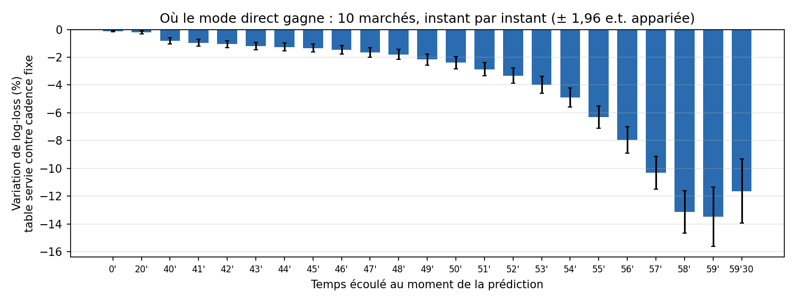

| Temps écoulé | 0' | 20' | 40' | 45' | 50' | 55' | 57' | 58' | 59' | 59'30 |
|---|---:|---:|---:|---:|---:|---:|---:|---:|---:|---:|
| Log-loss, table servie contre cadence fixe | −0,1 % | −0,2 % | −0,8 % | −1,3 % | −2,4 % | −6,3 % | −10,3 % | −13,1 % | **−13,5 %** | −11,6 % |

- **Le gain est significatif à chacun des 23 instants**, mise au jeu comprise
  (−0,0075 ± 0,0035 par match sur les 10 questions).
- **Il ne commence pas quand le gardien sort.** Il grandit sans saut dès le
  début de la 3e (−1,0 % à 41', −2,4 % à 50') : c'est la prudence à égalité et
  le repli de l'équipe qui mène (×0,87 à ×0,93 entre 40 et 55 minutes, §10.4).
  Le gardien retiré accélère ensuite la courbe à partir de 55'.
- **Le maximum est à 1 ou 2 minutes de la fin** (−13 %). À 30 s, il retombe un
  peu (−11,6 %) : beaucoup de matchs sont joués, et les deux moteurs y disent la
  même chose.

**La fiabilité.** Pour chaque prédiction, on range la probabilité affichée par
tranche de 10 points et on compare, dans chaque tranche, la moyenne prédite à
la fréquence observée. L'erreur type de chaque tranche est groupée **par
match** : un match fournit jusqu'à 230 prédictions corrélées (10 questions ×
23 instants). L'ECE résume la courbe : c'est l'écart moyen entre prédit et
observé, pondéré par le nombre de prédictions de chaque tranche (0 = parfait).

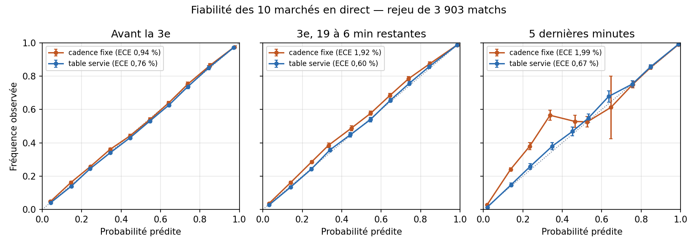

| ECE (cadence fixe → table servie) | Avant la 3e | 3e, 19 à 6 min restantes | 5 dernières minutes |
|---|---:|---:|---:|
| **Toutes questions** | 0,94 → **0,76 %** | 1,92 → **0,60 %** | 1,99 → **0,67 %** |
| Vainqueur (moneyline, 60 min, prolongation) | 0,33 → 0,38 % | 0,87 → 0,62 % | 0,44 → 0,60 % |
| Totaux 5,5 et 6,5 | 1,24 → 2,67 % ⚠ | 3,11 → 0,75 % | 3,46 → 0,68 % |
| Puck line −1,5 | 4,68 → 0,88 % | 4,90 → 1,21 % | 4,16 → 1,24 % |
| Buts d'une équipe > 2,5 | 0,88 → 1,46 % ⚠ | 1,70 → 0,43 % | 2,30 → 0,50 % |

- **La cadence fixe sous-estime systématiquement « un but de plus ».** Dans les
  cinq dernières minutes, ce qu'elle annonce à 34 % arrive **57 %** du temps
  (13,5 % → 27,2 % sur les totaux, 14,0 % → 42,1 % sur la puck line). Avec la
  table servie, la même tranche donne 35 % annoncé pour 38 % observé.
- **La puck line −1,5 était mal calée dès la mise au jeu** : la cadence fixe
  annonçait 33,9 % pour 40,8 % observé avant même la 3e période ; la table
  servie donne 34,3 % pour 34,7 %. Même calée sur le vainqueur et la
  prolongation d'avant-match (§10.2, étape 3), la cadence fixe ignore le filet
  désert, qui transforme une victoire d'un but en victoire de deux.
- **Le vainqueur est fiable avec les deux moteurs** (ECE ≤ 0,9 %), ce qui
  rejoint le moneyline inchangé du rejeu ci-dessus : égalisation et filet
  désert se compensent.

**Deux défauts restants de la table servie**, visibles sur la courbe :

1. **Avant la 3e, les totaux et les buts d'une équipe sont annoncés trop
   haut** d'environ 3 points au milieu de l'échelle (« plus de » annoncé à
   45,3 % pour 41,8 % observé, 54,4 % pour 51,1 %), alors que la cadence fixe y
   était presque juste (ECE 1,24 % → 2,67 %). Ce sont les deux cases pires du
   rejeu à la mise au jeu. La cause reste à établir (voir le commentaire
   ci-dessous) ; l'effet sur la log-loss est faible, car le gain des autres
   marchés le couvre dès la mise au jeu.
2. **Dans les cinq dernières minutes, les longs coups sont surpayés** : la
   tranche 0-10 % annonce 2,0 % pour 1,4 % observé (z −7,7), et 1,4 % pour
   0,8 % sur la puck line. C'est le second but de fin de match encore trop
   probable, déjà mesuré au §10.4 (2,7 % annoncé contre 1,3 % observé à une
   minute de la fin) : deux mesures indépendantes qui pointent le même défaut.

À lire avec prudence : en fin de match, la tranche 90-100 % est remplie
d'issues déjà acquises (un total déjà dépassé, 100 % prédit et 100 % observé).
Elles pèsent dans l'ECE sans rien dire du moteur, et rendent l'ECE de fin de
match flatteur ; c'est la courbe tranche par tranche qui compte.

Décision : **rien ne change en production**. Le rejeu confirme la mise en
service des effets de score à chaque instant, et les deux défauts restants
rejoignent la liste des pistes.

<!-- À DÉVELOPPER
  - Expliquer puis corriger les totaux et buts d'une équipe annoncés ~3 points trop haut avant la 3e avec la table servie (ECE 2,67 % contre 1,24 % à cadence fixe) : comparer l'espérance de buts du moteur à la mise au jeu avec et sans effets, et la variance (lien avec la sous-dispersion, §10.4).
  - Comparer aux cotes EN DIRECT des livres (in-play) : le vrai test de valeur du mode direct, absent du rejeu.
  - Journaliser les prédictions live servies en production et les noter sur les matchs réels (suivi continu, pas seulement le rejeu historique).
-->

### 10.7 Piste mesurée et écartée : l'avantage numérique en cours

Le même cadre a servi à tester une troisième couche : un facteur g selon la
**situation numérique en cours** (`calibrate_live_pp.py`, buts 2018-2022 avec
le nombre de patineurs, `situationCode` de la feuille de match en direct).

| Situation (vue de l'équipe) | 5 c. 5 | 4 c. 4 / 3 c. 3 | 5 c. 4 | 5 c. 3 | 4 c. 5 | 3 c. 5 |
|---|---:|---:|---:|---:|---:|---:|
| Facteur g (moyenne pondérée par le temps = 1) | 0,937 | 0,884 | **2,185** | 5,105 | **0,353** | 0,100 |
| Part du temps de jeu | 80,7 % | 1,5 % | 8,7 % | 0,2 % | 8,7 % | 0,2 % |

Les facteurs sont stables d'une saison à l'autre (5 c. 4 entre ×2,09 et ×2,25
sur 2018-2022) et améliorent nettement la vraisemblance des **buts** sur le test
(+682, +686, +707 points en 2023-24, 2024-25, 2025-26). Pourtant, le rejeu des
**marchés** (`replay-live-pp.ts`, 3 890 matchs, `live_pp_report.md`) ne montre
aucun gain : log-loss **+0,07 %** (Δ +23,2 ± 47,8), et significativement **pire
au début du premier avantage** (+35,5 ± 32,0). La cause identifiée : les
**pénalités de compensation** — 62,8 % des pénalités suivantes sont pour
l'équipe en avantage. Le facteur g voit l'avantage en cours mais ignore la
pénalité qui risque de le rééquilibrer, et surestime donc l'équipe en avantage.

Décision : **non activé** (2026-10-13). La clé `pp` est absente de
`liveEffects.json` et le code correspondant reste inerte. La piste à suivre
n'est pas d'activer g « seulement en fin de match », mais de modéliser les
pénalités **futures**.

<!-- À DÉVELOPPER
  - Modéliser les pénalités FUTURES (fréquence, compensation) avant de retenter le facteur g.
  - Tester g seulement sur les avantages de 5 minutes (majeures), où il n'y a pas de fin au premier but.
-->

### 10.8 Limites assumées

- **Le modèle reste d'avant-match** : rien de ce qui se passe sur la glace en
  dehors du score et de l'horloge (tirs, xG, changement de gardien, blessure en
  cours de match) ne modifie λ.
- **Une seule table m pour toutes les équipes** : une équipe qui défend
  particulièrement bien une avance n'a pas sa propre table.
- **Saison régulière** uniquement : les séries éliminatoires (prolongation sans
  fusillade, jeu plus fermé) ne sont pas calibrées.
- En prolongation, le vainqueur est tiré directement à `p_ot_dom` ; le moteur
  ne tourne qu'en temps réglementaire.

<!-- À DÉVELOPPER
  - Mettre à jour λ en cours de match avec l'information live (tirs, xG, changement de gardien) : quel gain par rapport au λ figé ?
  - Tables m par équipe ou par style (modèle hiérarchique rétréci vers la table de ligue).
  - Calibrer les séries éliminatoires séparément (prolongation sans fusillade, jeu plus fermé).
-->

### 10.9 Reproduire la mesure

| Étape | Commande | Sortie |
|---|---|---|
| Buts horodatés | `python fetch_live_goals.py` (dans `ml/python/`) | `data/live_goals.csv`, `data/live_games.csv` |
| Avant-match hors échantillon | `python live_pregame.py` | `data/live_pregame.csv` |
| Calibration | `python calibrate_live.py` (`--last-train 2022` par défaut) | `server/src/services/prediction/liveEffects.json` (servi) + `models/live/calibrate_live_report.json` (CV, test, comptes O et E par case) |
| Rejeu | `npx ts-node --transpile-only scripts/replay-live.ts 2023 2024 2025` (dans `server/`) | `models/live/live_report.md` / `.json` |
| Contrôles de la calibration | `python live_calibration_checks.py` | `models/live/calibrate_live_checks.json`, `figures/live_cv_shrink.png`, `figures/live_m_heatmap.png` |
| Biais de la calibration | `python live_effects_bias.py` (~10 min, reprend où il s'est arrêté) | `models/live/live_effects_bias.json` |
| Coût et exactitude du moteur | `npx ts-node --transpile-only scripts/bench-live-engine.ts` (dans `server/`) | Sortie console |
| Coût du retard d'affichage | `npx ts-node --transpile-only scripts/replay-live-staleness.ts 2023 2024 2025` (dans `server/`, ~20 min) | `models/live/live_staleness_report.json` |
| Forme des buts restants (extrêmes) | `npx ts-node --transpile-only scripts/replay-live-tails.ts 2023 2024 2025` (dans `server/`, ~1 h ; `OUT=` pour un autre nom) | `models/live/live_tails_report.json` (une table), `live_tails_report_endgame.json` (deux tables) |
| Une table contre deux tables de fin de match | `LIVE_A=ancien.json LIVE_B=nouveau.json OUT=live_endgame_replay npx ts-node --transpile-only scripts/replay-live-window.ts 2023 2024 2025` (`MOMENTS=late` pour la fin de match) | `models/live/live_endgame_replay.md`, `live_endgame_replay_late.md` |
| Retard réel en production | `server/scripts/measure-live-lag.cmd` (Windows, pendant des matchs) | `models/live/live_lag_<date>.md` / `.json` |
| Gain minute par minute et fiabilité | `npx ts-node --transpile-only scripts/replay-live-reliability.ts 2023 2024 2025` (dans `server/`, ~25 min ; sur une machine lente, par tranches : `PART_OFFSET=0 PART_LIMIT=300 PART_OUT=parts/p0.json`, puis `MERGE=parts`), puis `python live_reliability_figures.py` | `models/live/live_reliability.md` / `.json`, `figures/live_reliability.png`, `figures/live_gain_by_minute.png` |
| Table récente contre table servie | `python live_window_compare.py`, puis `scripts/replay-live-window.ts 2023 2024 2025` | `models/live/live_window_report.json`, `live_window_replay.md` |
| Sous-dispersion des buts | `python live_dispersion.py` | `models/live/live_dispersion_report.json` |
| Avantage numérique (mesure) | `python fetch_live_pbp.py && python calibrate_live_pp.py`, puis `scripts/replay-live-pp.ts` | `models/live/calibrate_live_pp_report.json`, `live_pp_report.md` |

`liveEffects.json` ne s'édite jamais à la main : toute nouvelle calibration doit
repasser par le rejeu avant d'être committée.

---

<!-- À DÉVELOPPER
  - Lien avec l'application : capture d'écran d'une page match en direct avec les tuiles qui évoluent.
  - Fréquence de recalibration recommandée (chaque été ? après un changement de règles ?) et procédure de comparaison avec la table en service.
-->

## 11. Exemple complet chiffré

Match fictif : le domicile a λ_dom = **3,30** buts attendus en 60 min, le
visiteur λ_ext = **2,70** (chiffres calculés avec les vrais τ et p_ot du rapport —
la matrice Poisson × τ servie jusqu'au 2026-10-15. Avec le moteur de match :
nul après 60 min 21,9 %, puck line −1,5 38,5 %, plus de 5,5 buts 55,8 % ; 3e
période plus de 1,5 buts 63,8 % au lieu de 58,9 % avec la part fixe).

1. **Prolongation** : p_ot = σ(0,2948 × 0,60 − 0,0639) = **52,8 %**.
2. **Matrice** sans τ : nul après 60 min 16,2 %. **Avec τ : 21,9 %**.
3. **Victoire en 60 min** = Σ M[i>j] = 49,3 %.
4. **Victoire (moneyline)** = 49,3 % + 21,9 % × 52,8 % = **60,9 %**.
5. **Couche de correction** : avec toutes les autres variables à leur moyenne, z = 0,0819 + 0,4702 × logit(0,609) → **57,2 %** ; si en plus le domicile a +60 d'ELO, +0,04 de xGF% court terme, +0,3 xG d'alignement et +0,5 de star power → **63,7 %**. Le service recale alors les λ (somme 6,00 conservée) pour que la matrice donne exactement 63,7 %, et **les étapes 3, 4, 6-9 se refont sur cette matrice recalée** — les chiffres ci-dessous sont ceux de la matrice brute, pour suivre le calcul pas à pas.
6. **Puck line −1,5** = Σ M[écart ≥ 2] = **37,5 %**.
7. **Plus de 5,5 buts** : total final espéré 6,23 → **56,0 %**. Avec le recalage de niveau de fin 2025-26 (k = 0,9729, `level_report.json`, §4.3 bis), la somme des λ passe de 6,00 à 5,84 (3,22 / 2,62), la victoire reste **60,9 %**, le « plus de 5,5 » descend à **53,4 %** et la puck line −1,5 à 37,2 %.
8. **Les deux équipes marquent** : **89,8 %**.
9. **Domicile plus de 2,5 buts** (prolongation comprise) : **68,4 %**.
10. **Confiance** : |3,30 − 2,70| = 0,60 se situe au rang 0,75 des déciles → base 0,80 → moneyline 80/100.
11. **Value bet ?** Si un livre propose le domicile à 1,75 et le visiteur à 2,15 : marché dévigé = (1/1,75)/(1/1,75 + 1/2,15) = 55,1 %. Edge = 63,7 − 55,1 = 8,6 % → **au-dessus du plafond de 6 % → rejeté** (trop beau pour être vrai : plus probablement une info que le modèle n'a pas). Avec 1,85 / 2,02 : marché 52,2 %, edge 11,5 %… rejeté aussi. À 1,65 / 2,30 : marché 58,2 %, edge 5,5 %, EV = 0,637 × 1,65 − 1 = +5,0 % → **value bet**, cote minimale 1/0,637 = 1,57.

---

## 12. Carte des fichiers

### Python (`ml/python/`)

| Fichier | Rôle |
|---|---|
| `fetch_data_v4.py` | Téléchargement complet des données (API NHL, MoneyPuck, cotes). |
| `refresh_data.py` | Mise à jour hebdomadaire de la saison en cours, puis `build_dataset.py`. |
| `build_dataset.py` | Features pré-match, cibles, ELO, état d'inférence. |
| `train_score.py` | **Modèle de score** + τ + p_ot + déciles de confiance. |
| `score_model.py` | Mathématiques de la matrice des scores (partagé entraînement / service). |
| `game_dynamics.py` | **Moteur de match** (§4.1.4 bis) : ajustement de τ glissant et de la table c → `game_dynamics.json` ; matrice du match et marchés de période (partagé ajustement / service). |
| `train.py` | Classifieur moneyline (informatif). |
| `train_player.py` | Modèle joueur (8 statistiques). |
| `train_shots.py` | Modèle de tirs d'équipe → arrêts du gardien ; recalage hebdomadaire des tirs (`refresh_shots_level`). |
| `arena_effects.py` | Facteur de comptage de chaque aréna (mesure ; non servi). |
| `ml_service.py` | Service FastAPI (toutes les routes de prédiction). |
| `backtest.py` | Backtest sur le test + `--reliability` (calibration par tranches). |
| `backtest_walkforward.py` | Backtests saison par saison : ROI, CLV, marchés dérivés, incertitude, sélection de features, correction, écart au marché… |
| `calibrate_live.py`, `fetch_live_goals.py`, `live_pregame.py` | Effets de score pour le direct (§10) → `liveEffects.json`. |
| `live_calibration_checks.py` | Contrôles de la calibration du direct (§10.3-10.4) : courbe de validation croisée, intervalles de confiance bootstrap (par match et à deux niveaux), stabilité par saison, carte de chaleur. |
| `live_effects_bias.py` | Taille du biais « l'équipe forte mène plus souvent » par simulation (§10.4) → `models/live/live_effects_bias.json`. |
| `live_window_compare.py` | Table des effets de score pondérée vers les saisons récentes contre table servie (§10.3). |
| `live_dispersion.py` | Sous-dispersion des buts par période et par situation numérique (§10.4). |
| `calibrate_live_pp.py`, `fetch_live_pbp.py` | Facteurs d'avantage numérique en cours (§10.7, mesurés, non servis). |
| `measure_level.py` | Mesure du recalage de niveau des buts (§4.3 bis) → `level_report.json`. |
| `doc_figures.py` | Figures des §4 à §8 de ce document → `ml/figures/` (importance, découpage, écarts, moteur, correction, niveau, joueur, matrice, fiabilité). |
| `measure_*.py`, `compare_*.py`, `probe_odds_books.py` | Études ponctuelles (face-à-face, retour de blessure, Corsi/Fenwick, sources de cotes). |
| `content_insights*.py` | Statistiques « contenu » pour les réseaux sociaux — sans lien avec les prédictions. |
| `fetch_data.py` | Ancienne collecte v3 (standings) — encore copiée dans l'image Docker. |

### Modèles et rapports (`ml/models/`)

| Fichier | Contenu |
|---|---|
| `score_model.json` / `score_report.json` | Modèle de score / ses réglages (features, τ, p_ot, déciles, métriques). |
| `game_dynamics.json` | Moteur de match : table c (avance × tranche), τ glissant, fenêtre de saisons, diagnostics. |
| `game_model.json` / `training_report.json` / `feature_importance_game.json` | Classifieur / Platt, mélange, métriques. |
| `correction_layer.json` / `correction_report.json` | Couche de correction / sa mesure. |
| `level_layer.json` / `level_report.json` | Recalage de niveau de la saison en cours (k, comptes) / sa mesure et sa règle. |
| `player/*.json` / `player_report.json` / `player_state.json` | Modèle joueur / rapport / état des joueurs (+ face-à-face par adversaire). |
| `shots_model.json` / `shots_report.json` / `shots_level_layer.json` | Modèle de tirs / rapport (mesures, k, coefficient du partant) / recalage des tirs de la saison. |
| `player_retrain_report.json` / `player_arena_report.json` / `player_lineup_report.json` | Mesures 2026-10-15 : réentraînement récent (adopté pour 6 stats), facteur d'aréna (rejeté), alignement et déploiement récent. |
| `player/pen_count.json` / `player_penalties_report.json` | Pénalités en nombre (2026-10-16) : modèle du nombre de pénalités / sa mesure. |
| `player_vs_report.json` | Mesure du face-à-face joueur vs adversaire, stat par stat (verdict `keep`). |
| `inference_state.json` | État actuel des équipes, gardiens, alignements, étoiles. |
| `elo_ratings.json` | Notes ELO actuelles. |
| `*_report.json` | Rapports de mesure. |
| `live/` | Mode direct (§10) : calibration des effets de score (`calibrate_live_report.json`), rejeux (`live_report.md`, `live_pp_report.md`), avantage numérique. |

### Serveur (`server/src/services/`)

| Fichier | Rôle |
|---|---|
| `featureEngineering.ts` | Construit la requête envoyée au service ML. |
| `mlApiClient.ts` | Client HTTP (jeton, cache 5 min, disjoncteur après 5 échecs). |
| `gameMlBundle.ts` | Paquet de toutes les tuiles d'un match + direct. |
| `nhl/liveRefresh.ts` | Rythme du direct : 30 s, 10 s en fin de match (§10.2). |
| `prediction/playerRates.ts` | Cadences joueur (règle ou modèle joueur). |
| `valueBets.service.ts` / `valueBetScan.service.ts` | Value bets et alertes push. |
| `bestBets.service.ts` | Liste « best bets ». |
| `nhlPredictions.ts`, `prediction/*.ts` | Moteur de RÈGLES (sans ML), utilisé en mode règles et comme grille du direct. |
| `nhl/restTravel.ts` | Repos, dos-à-dos, voyage. |
| `oddsClient.ts` / `oddsLogger.service.ts` | Cotes : livre d'**affichage** (`ODDS_BOOKMAKERS`, value bets), livre de **collecte** (`ODDS_COLLECT_BOOKMAKERS`, DraftKings, série du CLV et `odds_log`) et livres **parallèles** (`ODDS_SHADOW_BOOKMAKERS`, défaut `bet99_ca_on`, archivés dans `odds_snapshots` seulement ; `none` désactive). Six passes par jour, même coût avec ou sans livres parallèles (≤ 10 livres = une région). |
